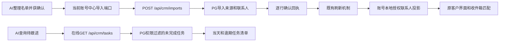

# AI导入与跟进提醒接入中心（2026-10-15）

状态：0.43.0-alpha.1工作区实现；原前端保持；未提交、推送或发布。用户确认账号增长来自Navigator迁移，不做清理。

## 改了什么

1. `import_contacts`中心分支接现有POST `/api/crm/imports`。AI整理名单，经既有人工作业审批后导入；只写中心，不调用旧本地importContacts。公司与邮箱必须有效，缺公司不猜造；同批同公司/国家联系人共用客户编号。同批邮箱归一去重，每次最多200人。用户来源personal、管理员来源operations由中心按身份决定，客户端不传kind。
2. 服务端回执逐行计算created/duplicate/invalid/restricted_conflict，归属冲突不伪装成重复或新增。备注留在来源记录，不自动成为跟进或联系人备注。工具输出notesArchived/noteStorage明确范围。
3. `reminders_due`接现有GET `/api/crm/tasks?status=open`，按本机自然日区分今天和逾期，只读当前权限可见的中心任务。每页100条，最多10页，超范围/页数变化/重复或缺页标partial；不拿离线缓存宣称最新结果。
4. 客户级任务返回taskId/customerId，不是contactId；未携带旧批量发信动作。需要发信时必须重新确定授权联系人，走已接通的中心发送路径。中心尚无联系人删除API，delete_contacts继续拒绝且明确未删除，不错误引导客户页可删除。
5. 复用AgentContactPort注入HTTP端口；新增agent-crm-tools.service纯编排，无Electron/DB/文件IO。请求按账号权限范围+对话+原参数固定幂等键及body；并发合并，成功短期去重，未知结果重试原键。账号/权限切换中止旧结果与旧账号审计。

## 数据链路

## 数据库与契约

无新增表、字段、迁移、IPC、HTTP路由、依赖或配置；不创建另一套联系人/提醒库。现有IPC及前端布局不变。

| 现有表/字段 | 本节点用途 |
| --- | --- |
| crm_import_batches：batch_id/actor_id/source/source_detail/mapping | 记录导入人及来源；source=agent |
| crm_import_rows：row_id/batch_id/row_index/customer_key/raw_row/customer_id/status | 逐行来源证据和结果；备注在raw_row.input.rawRow.note中 |
| companies、crm_customers、contacts、crm_customer_contacts | 中心统一客户与联系人、关联及来源；同批同公司合并客户关系 |
| crm_customers.origin/owner_user_id/created_by | 中心按角色计算来源与归属，不在AI里创建第二套权限 |
| crm_followup_tasks：task_id/customer_id/title/due_at/status/version等 | 复用已有客户级任务，未改成联系人级任务 |
| 既有账号本地联系人投影 | 中心导入完成后原同步刷新，收件箱匹配继续读取相同授权引用 |

## 验证

- 定向5文件40项通过，覆盖实际工具分支不访问旧SQLite、字段保留、同批公司合并、并发去重、未知结果原键重试、部分回执、账号切换、离线和任务分页。
- 真实完整Electron主进程+原renderer/preload+原生SQLite+真实HTTP/PG回滚：9链路通过，无页面异常。用户导入变为personal且归本人，管理员导入变为operations；真实中心任务出现在AI逾期清单；导入联系人可通过原本地匹配入口找到；重复请求不增加联系人；删除、离线明确失败。
- 回滚前后：账号77、联系人1072、客户147、会话179、事件154均一致；未新开账号，临时本地profile已移除。无模型网络调用、无SMTP外发、旧同号联系人和全局邮件正文目录不变。
- 类型检查、桌面/服务端构建通过；架构检查224个源码、0例外，检查器5项通过。
- 首次全量：1396通过、2失败、163条件跳过。2失败为并行中心连接保护增加user核对后，管理审计测试的虚拟连接池漏填user；仅补测试夹具user，不放宽生产保护。定向40项已包含这两项复核。
- 最终普通全量复跑：162文件通过、26文件条件跳过；1398项通过、163项条件跳过，无失败（183.53秒）。本节点没有重跑全部PG条件套件，复用了真实HTTP/PG桌面回滚验证；不将条件跳过算作已验证。
- 当前55844服务live/ready均200，未重启或修改其数据库。知识库巡检ok=true、errors=[]；全项目源指纹未整体重置，保留并行未复核差异。

运行证据：`.work/agent-remaining/report.json`、`runtime.log`、`final-targeted-tests.log`、`final-full-tests.log`、`final-build.log`。真实桌面验证脚本`.work/agent-remaining/runtime.cjs`仅用于本机回滚验证，不是产品接口。

## 验收与边界

托盘重启应用后，在AI对话提供含公司/邮箱的小名单并确认导入；原客户页应出现对应联系人。管理员归管理员来源，用户归我的线索。查询“今天有哪些跟进任务”返回当前权限下真实任务；无网络明确报失败，非空结果不冒充全部。

中心联系人删除仍未实现，需另定历史、归属、邮件和撤权处理；本节点不自行新增删除API。旧本地显式提醒/沉默天数推断不自动转换为中心任务；中心任务仍按既有客户归属权限，不宣称已经提供联系人级任务或完整联系人跟进覆盖。备注只留来源，未自动成为跟进事实。幂等保留仅同进程，跨重启恢复、持久重试、高级撤权/冲突与关机后台工作仍后续。

checkpoint：`D:/Agent Basement/checkpoints/prospector-agent-remaining-20261015`。不重置工作区、不改Navigator迁移账号。
