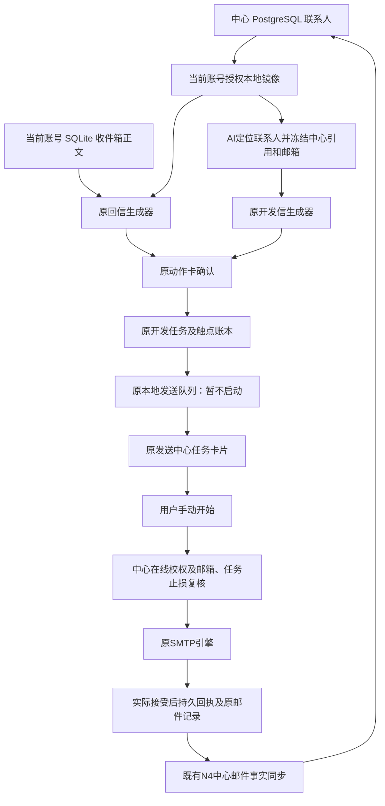

# AI草稿、入队与发信任务接入交付

版本：0.42.0-alpha.1，2026-10-15，工作区未提交/推送/发布。

## 本次完成

| 原入口 | 现在的行为 | 保留内容 |
|---|---|---|
| generate_draft 开发信 | 用当前账号中心联系人公司、姓名及默认语言生成草稿 | 原模型接口、解析、素材保存与动作卡 |
| generate_draft 回信 | 原账号本地收件箱取正文，按发件邮箱精确定位授权中心联系人 | 原回复正文、Re:主题、询价提取与实时Navigator报价链路 |
| 草稿入队 / send_queue_add | 冻结明确中心引用、邮箱与身份，复用原组信和队列，关联原开发任务卡片 | 原模板、系统句库、变量、账号亲和轮换、限额、手动开始 |
| campaign_create | 原预览/确认卡，确认后中心引用写入原任务草稿 | 原多轮计划、时段/配额、停止后续触点规则；由发送中心启动 |

没有改前端布局、样式或导航。AI临时队列会显示为发送中心的一轮手动任务；多轮计划则显示为草稿。入队和建任务均不直接外发。

## 链路

多轮计划的确认先停在任务draft，直到发送中心启动才排队。上图最后的邮件事实同步沿用N4，不把邮件正文自动上传到中心。

## 数据库与字段

本次没有增加、删除或重命名数据库表、列及迁移。完整逐表逐字段结构沿用[最近数据库字典](database-dictionary-20261015-n4.md)。

| 位置 | 已有表/字段 | 本次用途 |
|---|---|---|
| 中心PG | contacts、crm_customer_contacts、crm_customers | 授权数据的唯一来源；不再拿中心整数编号查旧本地contacts |
| 账号本地镜像 | crm-offline.db授权联系人投影 | AI查找及读取联系人；写入仍走中心确认链路 |
| 账号业务SQLite | inbox_messages、对应账号正文文件 | 回复原文仍按账号读取，旧matched_contact_id不作为中心引用 |
| 账号业务SQLite | agent_working_memory.payload_json | 草稿JSON附加centerScope、centerContactRefs；已有列不变 |
| 账号业务SQLite | send_campaigns | 临时队列生成一轮手动任务auto_send=0；多轮计划status=draft |
| 账号业务SQLite | send_campaign_targets.center_reference_json | 保存既有明确中心引用与scope；实际入队queued，未入队skipped |
| 账号业务SQLite | send_queue.campaign_id、recipients、contact_vars | 队列归属原任务；引用随收件人传递、scope随原字段持久化 |
| 主进程内存 | 动作注册表active回调、去重回执 | 不落新表、不传前端；绑定账号权限现场，重启失效 |

## 修复与一致性核对

- 修复默认语言未传时错误解引用；中心档案可提供默认语言。
- 回复只按授权中心邮箱精确匹配，不用旧邮件外键查询本地同号联系人；无唯一联系人仍可出稿，但不提供错误收件人入队动作。
- 确认时重新核对身份、负责人权限、客户编号与邮箱。生成中、执行中账号变化，不写入新账号工作记忆或动作审计。真正发送前仍走原在线重校权。
- 同账号/会话/引用/内容的并发及短期重复请求复用同一批次；草稿按钮和直接入队共用去重，不做两次。明确失败可修复后重试；抛异常的未知结果本进程内不自动重放。
- AI不覆盖已有pending队列。新队列挂原任务卡片，避免“库里有、界面没有”。队列保存失败恢复原内存并返回失败，不启动发送。
- 无新IPC通道、HTTP路由、依赖或配置，没有另建收件人库、发送引擎或CRM。

## 验证证据

- 全量串行回归：1365通过、154按条件跳过（158测试文件通过、25跳过）；跳过项不视为已验收。
- 新增中心AI工具/身份去重/动作账号保护与原发送队列、Campaign专项：93通过；最后默认语言类型整理另做定向核对。
- 实际生产Electron主进程、原renderer/preload、原生SQLite和真实HTTP/PostgreSQL外层回滚：12条链路通过，页面异常0。实际任务卡截图和报告位于`.work/agent-center-send/actual-ai-queue.png`、`report.json`。
- 模型输出与SMTP为确定性测试替身，不访问真实模型，不发真实邮件；模拟SMTP仅在手动启动后执行一次。真实第三方模型可用性和邮件投递不在此验收结论内。
- 回滚前后账号6、联系人1014、客户82、会话77、事件84一致；旧本地同号联系人及全局正文文件保持原样。固定agent账号，无新测试账号；临时资料已回收。
- 类型检查、桌面构建、架构223源码0例外、检查器5测试通过。现有ESLint缺配置，不声称通过lint；构建既有chunk提示不代表运行失败。

## 如何验收

1. 当前桌面主进程尚未强制重启；用托盘“重启应用”加载新构建。
2. AI中指定一位已有中心联系人，生成开发信，核对公司、收件人及语言；也可选原收件箱邮件生成回复，核对Re:主题及对应联系人。
3. 点击草稿入队或批准AI入队，到原发送中心看到同名任务卡；展开查看名单和待发送组。未点击开始前不会发信。已有pending批次时，新请求应明确提醒先处理。
4. 创建多轮开发计划，确认后应为草稿；到发送中心核对计划后才启动。
5. 切换账号会沿用原身份重建流程，旧动作不能继续执行。断网时可查已有授权数据，无法确认的在线入队不报成功。

不要求用户代替Agent做常规测试；上面是用户体验验收入口，工程验证已执行。真实外发仍须用户明确操作。

## 边界及下一环

- AI导入/删除/旧提醒继续明确拦截，尚未完成中心适配。
- 当前去重只在运行期；未实现跨重启未知结果持久重试、跨设备任务接管、Campaign整体上云或电脑关机后Worker执行。
- 显式引用不等于所有旧SQLite联系人已经迁走；其他未适配入口不应传入裸中心整数编号。
- 下一步应核对AI剩余入口及中心状态/联系人来源字段的读写清单，再进入跨重启版本、冲突、删除、撤权和重试；仍遵从既定逐节点批准。

Checkpoint：`D:/Agent Basement/checkpoints/prospector-agent-send-20261015`。代码/契约/版本前态及知识写回前态留存；无中心结构变更，无真实客户数据迁移。
