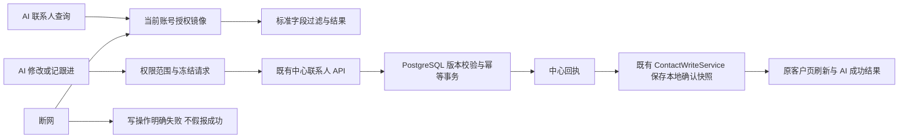

# 本轮代码复核与 AI 联系人接入（2026-10-15）

状态：0.41.0-alpha.1 工作区，未提交、推送或发布。前端页面、布局和样式不变。本报告覆盖上一节点统一字段及中断中的 AI 联系人接线，不是全仓安全认证或全部 SQLite 迁移完成证明。

## 审查结论与修复

| 严重程度 | 原问题 | 已处理 |
|---|---|---|
| 高 | 中心联系人未命中后继续查旧 SQLite；相同数字编号可能指向不同人 | 中心查询/修改/跟进走独立端口；显式未命中即失败；旧共享定位器在中心模式不返回本地记录 |
| 高 | 中心搜索复用旧批量成信动作卡，闭包用中心编号查询 SQLite 并入队 | 中心搜索不创建旧动作卡；尚未适配的 AI 草稿、入队、创建营销任务、旧提醒、导入、删除明确不可用；原发送中心 N4 功能保留 |
| 中 | 同步失败返回空数组，误报“没有联系人”；旧搜索缓存无账号范围 | 返回原错误，中心工具不走旧 SQLite 读缓存、旧写幂等缓存或旧工作记忆名单 |
| 中 | 重试生成新请求编号，回执丢失可能重复跟进 | 同一运行期/账号权限范围/会话/参数复用冻结请求编号、字段和版本，合并并发；成功五分钟去重，未知结果保留；上限100不盲目淘汰未知请求 |
| 中 | `extra` 整体替换可覆盖来源等非偏好字段 | 契约仅增 `fields.preferences`，禁止任意 `fields.extra`；中心 jsonb_set 只改已有 extra.preferences，校验最多10条、每条200字符、非空不重复 |
| 中 | 修改关系阶段覆盖真实 tags，与0.40字段分离冲突 | 跟进阶段仍来自活动时间线，跟进写不再修改 tags；标签独立修改 |
| 中 | 账号切换后迟到回执/成功缓存可能用于新账号 | 按账号/服务/权限隔离，前后检查active；成员移除后不复用成功缓存；错引用回执拒绝，不跨账号追加工具审计 |
| 中 | 行业筛选猜测 extra.industry/businessType，实际不是公司行业源 | 明确报告未支持，不制造假筛选结果；其余既有关键词/国家/阶段/状态/电话/邮箱/沉默筛选使用授权快照 |

## 结构与调用链

- `src/main/core/agent-contact.ts`：纯定位、过滤、状态别名和命名常量；不访问数据库、HTTP、Electron。
- `src/main/services/agent-contact.service.ts`：端口、写编排及当前运行期的冻结请求；时间/请求编号/存储/HTTP/日志均由适配器提供。
- `src/main/services/agent/toolkit/center-contacts.ts`：既有 AI 工具的预算、审计、结果包络；隔离旧数据库动作卡，不增加产品调试入口。
- `contact-mail-runtime.adapter.ts`：在账号业务库就绪后绑定端口；读取同一 crm_contact_mirror，写调用既有 adapter.contactUpdate/contactFollowup；关闭时拆除。
- `contacts.ts`：保留旧独立测试/历史调用路径；正式中心模式先分流，不混合编号。未适配功能显式拦截，不做本地兜底。

## 数据库、契约与漂移核对

无新表、列、迁移、数据库文件、依赖或配置键。中心仍为 PostgreSQL，账号 crm-offline.db 为授权镜像，prospector.db 仍保存邮件/发送/AI历史及尚未迁移的旧联系人。完整表字段沿用 [N4字典](database-dictionary-20261015-n4.md)。

唯一 API 输入增量：原 `CenterContactUpdate.fields` 增加 `preferences?: string[]`，经原 `online:contact-update`、原 `POST /api/crm/contacts/:id/update` 进入同一仓储与回执链；实际只修改现有 `contacts.extra.preferences`。中断版本中刚加的任意 `extra` 写入口已撤除，未作为发布接口保留。跟进接口参数不变，修正其覆盖 tags 的旧兼容副作用。

无新增/删除 IPC 或 HTTP 路由，无第二套邮件或联系人同步。版本/引用/权限校验、保存、变更通知复用现有链。可见用户界面未改造；AI 工具无法使用未适配操作时会明确反馈。

## 验证

- 针对性测试包含中心搜索错误、禁止旧库访问、失配编号、重复邮箱、只读联系人、偏好白名单、回执错引用、账号切换、迟到回执、重复与并发写、未知结果重试、缓存撤权。
- 真实 PostgreSQL 外层回滚测试：联系人分配/字段/偏好保留、跟进标签不被覆盖、邮件触达/关系阶段独立、HTTP查询口径。
- 真实 Electron 主进程+原preload/renderer+原生SQLite+HTTP+真实PostgreSQL回滚：9条链路通过，pageErrors=[]；中心账号/联系人/客户/会话/outbox计数回滚前后相同，旧同号联系人未改。只SMTP适配器替换为测试桩，未调用真实AI模型、无邮件外发。
- 运行证据 `.work/agent-contact-review/report.json`、`runtime.log`、`unchanged-customers.png`；单测/全量结果见收尾记录。

## 验收

托盘“重启应用”加载最新主进程。在当前账号 AI 对话中查询一位已有客户；要求修改其职位或记录一条备注，随后打开原客户详情核对。收到成功提示才算中心确认；管理员可查看授权内同一记录。断网时已同步名单可查，修改不应假报成功。无需新建测试账号或上传真实邮件。

## 副作用与未解决边界

1. 原发送中心仍可用；AI草稿、自动入队/建任务等尚未正确携带中心引用，因此暂时拦截，不能宣称AI完整迁移。
2. 冻结请求仅在当前桌面运行期保存，重启后的未知结果不能自动安全重试；需先核对中心时间线。本节点未增加持久 outbox 或宣称跨重启恰好一次。
3. 原邮件正文和附件仍本地；未做关机持续Worker、全部历史联系人迁移、容量压测或全部旧字段物理删除。
4. 查询基于已同步授权快照，不是中心实时查询；未观测到的中心撤权仍受既有同步/离线授权有效期限制。
5. 旧兼容服务仍有Drizzle访问、少数兼容DTO借用标签表达阶段等历史债务；本次新增核心与写编排遵守端口分层，不将架构检查通过等同全仓已无技术债。

## 检查点

- 接入前：`D:/Agent Basement/checkpoints/prospector-agent-contact-port-20261015`。
- 本次重新审查前：`D:/Agent Basement/checkpoints/prospector-agent-contact-review-20261015`，保留中断版本供对照。未回退或覆盖其他任务改动。

下一优先事项是 AI 草稿/发送入口明确传递中心引用，恢复本次拦截的功能；随后再做持久重试、冲突/撤权/删除与历史迁移。

## 收尾验证记录

- 全量串行：156文件通过，25文件条件跳过；1343测试通过、154条件跳过。补充两项缓存撤权/错回执测试后，最终针对性35项通过（其中AI联系人14项）；未将跳过项当成执行通过。
- 类型检查、服务端编译、最终桌面构建、222源码架构检查及检查器自身5测试通过；git diff --check未发现补丁空白错误。仓库没有可用ESLint配置，本轮未声称ESLint全仓通过。
- 最终源码再次完成9条实际Electron/PG链路，pageErrors=[]。回滚前后：账号6、联系人1014、客户82、会话76、outbox84；临时资料已按限定路径回收，正文目录哈希未变。
- 中心55844已受控重载，/health/live与生命周期status健康；用户原Electron窗口保留，托盘重启应用加载最新主进程。未推送发布。
- 上次并行测试超时后单跑通过，仅支持“并发条件可能相关”；不据此直接断言已排除功能回归。本次串行全量通过是新增验证证据。

知识库：已同步项目状态、聚合审阅与人用总览；只读巡检通过，范围外源码指纹待复核保留。
