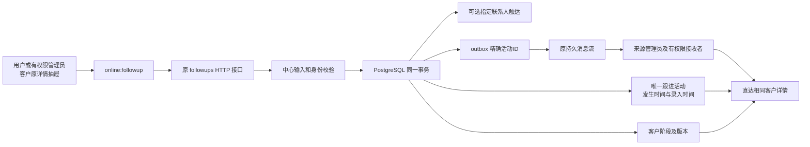

# B2 客户阶段与跟进交付

日期：2026-10-12；工作区版本 0.23.0-alpha.1，未发布。本节点根据用户批准实施，沿用现有客户抽屉，没有新增导航。

## 改动及业务口径

- 公司关系阶段独立存储，单个联系人的触达结果独立存储；不再用旧发送步骤推断公司阶段，也不因一次跟进更新全部联系人。
- 跟进可记录邮件、电话、拜访、其他联系或备注。联系人可选，没有联系人也可记录公司级活动；备注不修改触达。
- 发生时间与录入时间分开。补录昨天的电话保留昨天的发生时间；最近实际联系排除备注及无法确认方式的历史记录。
- 新增 012 增量迁移，旧 001–011 文件保持原样。已有联系人发送 stage/status、interaction 和活动原时间保留；阶段歧义保存快照并标记待核对，用户明确选阶段后清除提示。
- 原请求同键重试；客户版本、活动、指定触达、关系阶段及 outbox 同事务。授权先于缓存读取，联系人必须属于当前客户。
- 未知结果冻结完整草稿并保留同键；明确写前拒绝允许修正。修复旧列表/详情轮询跨保存覆盖新版本的竞态。

## 数据链路

中心 PG 继续为共享 CRM 唯一真源；本节点没有 SQLite CRM 失败回写或第二份跟进同步协议。在线 IPC 仍 22 个，HTTP 路由数量不变；契约在中心 core 定义，客户端直接重导出。旧调用缺省 method 为 other、缺省时间为中心当前时间，缺省阶段保持不变。旧 createdAt 字段保留。

## 已执行验证

- 普通回归 992 通过、119 跳过；跳过项包括需要独立 PG 开关及真实外部服务的用例，不能计为通过。
- 中心专用串行 HTTP/PG 套件 132 通过，已纳入原桌面会话及新跟进测试。B2 服务单元 17、真实 PG 7、前端 11；原客户前端 16 通过。
- 独立限定复核发现并修复 1 处轮询竞态，3 项延迟响应回归通过；限定范围无剩余可确认 P0–P2，不是完整生产安全认证。
- 另修复一个旧会话测试夹具的两次时钟读数偶发超期；实际生产签发已共用一次时钟，无生产代码修改。
- 实际隔离 Electron 双账号经 HTTP/PG 跑通：丢失已提交响应后相同完整请求重试；只产生一条活动/一次版本增加/一个 outbox；多联系人触达隔离及旧发送字段保留；昨天时间不变；管理员通知直达同客户/同活动；零联系人备注不算实际联系。页面异常 0。
- 实际 1040×660 和 1366×768 检查表单无水平溢出、保存入口可见；截图保存在 `.work/b2-followup/runtime/`。
- 迁移前 736 个合成测试客户逐一对照，原联系人 stage/status 未变化；10 个原 schema 文件与 checkpoint 字节一致。重复 migrate 不重置人工修正。
- 类型检查、桌面/管理端/中心构建通过；架构检查 193 文件、0 例外，检查器 5 项通过。测试中心恢复且健康。

## 简要验收

1. 用户打开已分配客户，选择电话、其中一个联系人、已触达和报价中，保存。只有选中的联系人变为已触达，公司阶段为报价中。
2. 将发生时间改为昨天再记录，动态显示昨天及补录时间；添加备注不推迟最近实际联系。
3. 来源管理员打开消息中心，点击该条通知，进入同一客户并看到对应跟进。
4. 无联系人客户可直接记录公司级跟进；阶段待核对的历史客户明确选择阶段后提示消失。

## 检查点与限制

Checkpoint：`D:/Agent Basement/checkpoints/prospector-b2-followup-20261012`，含改前源码、schema-only、原阶段快照、改后文件及 SHA-256 清单、验证日志/截图。没有复制中心密码、私钥或用户会话文件。该工作区含既有未提交改动，本节点没有 Git 提交或推送。

旧历史方式/联系人未知时不猜补，因此部分客户最近实际联系会为空；真实 Excel 没有导入。本节点仍为本机测试中心，不代表局域网/公网多机验收。旧本地收信/自动发送尚未产生中心跟进活动，未来邮件联动和服务器持续任务需单独推进。

下一节点 B3：下一步跟进任务、到期提醒和完成反馈。其价值是让每次跟进都有下一步；尚未实施，仍按原因、提升、副作用形成方案后审批。
