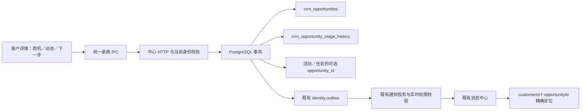

# B4 商机与结果闭环

状态：本机实现与验证；工作区版本 0.31.0-alpha.1，未发布 release。

## 行为

同一客户可以有多条商机，例如 Manzanillo 整柜和 Lazaro Cardenas 整柜分别报价、成交或丢单。客户关系阶段不随商机阶段自动改变；成交客户可由已成交商机查询得到，不复制客户主档。

客户详情增加紧凑的商机列表与折叠历史。创建只要求标题，航线、箱型、金额、来源和说明可选。阶段向前推进，可跳过中间步骤；终态暂不重开。成交必须有金额、币种和订舱号／合同／订单等证据引用；丢单必须有原因。金额是业务录入值，本节点不认定营收、利润，也不做跨币种求和。

选中商机的“跟进”后，现有跟进记录和下一步任务带上商机关联；取消关联恢复公司级记录。保存跟进会清除本次关联选择。

## 数据与接口

- 新增 `018-opportunities` 增量迁移；不修改已经执行的 001–017 迁移。历史客户不回填商机。
- `crm_opportunities` 保存标题、航线、箱型、来源、阶段、金额／币种、终态原因／证据、版本、创建者与时间。
- 负责人由当前客户的 `owner_user_id` 或 `created_by` 推导，不复制第二份归属字段；客户转派时开放商机版本加一，旧负责人失去读写权限。关闭者 `closed_by` 单独保留历史事实。
- `crm_opportunity_stage_history` 追加保存阶段前后值、操作人、发生时间及金额／证据快照；UPDATE／DELETE 被触发器拒绝。数据库 owner 的管理权限不属于绝对防篡改保证。
- `crm_shared_activities`、`crm_followup_tasks` 新增可空 `opportunity_id`；复合外键强制关联同一客户。省略时保持原公司级行为。
- 金额请求与响应使用十进制字符串，PG 用 numeric，最多 12 位整数／2 位小数；币种为 3 位大写字母。金额与币种须成对填写；未指定币种不推断 USD。
- HTTP：GET／POST `/api/crm/opportunities`，GET `/api/crm/opportunities/:id`，POST `/api/crm/opportunities/:id/stage`。
- IPC：`online:opportunity-list`、`online:opportunity-create`、`online:opportunity-detail`、`online:opportunity-stage`。在线通道由 26 增至 30，共享声明、主进程注册和 preload 白名单一致。
- 新事件：`crm.opportunity.created`、`crm.opportunity.stage_changed`；复用既有 outbox、投影、游标、消息已读接口。普通公海浏览者收不到商机详情摘要；读取和已读时重新校验当前权限。

## 漂移检查与审查修复

没有新增第二个 CRM 库、通知消费协议或 renderer 直连数据库。商机写入使用独立幂等操作键、版本与事务；未知结果保留完整请求，重试同一键。当前账户、产品准入、角色能力和客户权限在服务端重新计算，授权不能由 UI 传入。

独立复核发现并修复：未知写入时关闭／切换客户／编辑资料丢失重试键；客户转派后旧通知摘要残留；分页外深链商机不刷新；保存时旧 props 回调恢复已取消关联。父级同步锁防路由监听器旧闭包绕过；安全退出账号仍允许。

本节点也校正了既有仪表盘 `timeLabel` 类型缺口和客户页变更后过时的测试选择器，未扩大管理权限。

## 验收

1. 用固定 Agent 用户登录，进入客户详情，新增两条不同航线商机。
2. 第一条设为已报价；第二条应保持询价，客户关系阶段保持原值。
3. 点第一条“跟进”，保存动态或安排下一步；记录应显示该商机标题。取消关联后新增记录应只属于客户。
4. 成交不填证据不能保存；填写金额、币种和证据后，阶段历史保留每次变更。丢单要求原因。
5. 来源管理员登录，消息中心点击商机进度消息，应到对应客户及具体商机。转派后旧用户再次读取被拒绝，在线通知刷新清除失效摘要。

测试证据汇总在 `.work/opportunity-final-all-tests.log`、`.work/opportunity-pg-tests.log` 和 `.work/opportunity-runtime/report.json`。实际隐藏 Electron 通过生产 renderer／preload／IPC、HTTP、PG 测了两条商机、活动／任务关联、成功响应丢失重试、成交证据与管理员消息深链接，页面异常为 0，外层事务回滚前后账号和业务计数一致。

实际运行截图：`.work/opportunity-runtime/customer-two-opportunities.png`、`operations-messages.png`、`operations-deep-link.png`。

## Checkpoint 与后续边界

Checkpoint：`D:/Agent Basement/checkpoints/prospector-opportunity-mvp-20261013`，包含原文件与迁移前 schema-only 数据库快照。新表为空起步，不推断 Excel 历史成交事实，不导入真实业务文件，不外发邮件，不创建长期测试账号。

尚未实施：商机资料修改／删除／重开，运价关联的权威快照，独立财务成交事实表，在线邮件联动与持续 Worker，自动识别邮件意图，销售效率指标。下一节点按方案审批接邮件与商机反馈，不能据本次模型就宣称转化率已可信。

## 最终验证补记

2026-10-13：普通回归128文件／1071项通过，20文件／149项条件跳过；单独开启中心PG的7文件49项通过。最新构建的隐藏Electron再验5条真实链路通过，页面异常0，回滚前后6账号／64会话／50客户／983联系人／963公司／8outbox完全一致。类型检查、三端构建及196源码文件的架构检查通过。页面截图已经实际查看；中心55844健康。

客户视图调整时发现useLayoutEffect依赖引用尚未初始化的bootstrap，已前移状态初始化；相关61项界面回归及随后完整回归通过。完整回归存在测试环境的既有伪元素与Form警告，实际Electron没有对应页面异常，不把条件跳过算作通过。

## 用户验收演示数据（2026-10-13）

用户取消导航调整并授权补充可交互样本。已在本机中心测试库持久保留来源“演示 CRM · 20261013”的12家虚构客户、11联系人、12商机、31阶段历史、25活动、11任务（8开放／3完成），另有真实outbox投影通知。所有名称带【演示】，邮箱使用example.invalid；没有外发邮件、没有发送队列或新账号、没有修改原50客户。

管理员固定账号导入9家，其中3家分配给admin@yqn.com、3家分配给固定Agent用户，2家待分配、1家公海待领取。固定Agent用户另有3家自有线索，含无联系人公司。商机覆盖询价／已报价／谈判／订舱／成交／丢单；蓝港物流含两个独立商机。关系阶段由跟进接口修改，商机阶段由商机接口修改，任务和消息走既有中心链路。

数据生成先用完整事务回滚验证，再原子写入；再次运行不会重复追加。种子工具／ID清单仅在本机.work/crm-demo，后续清理以清单和来源精确限定；验收样本按用户要求暂时保留，与任务结束应删除的临时账号不同。Checkpoint：D:/Agent Basement/checkpoints/prospector-crm-demo-20261013/before-demo.dump（加样本前的本地完整备份，不用于覆盖后续业务修改）。

真实隐藏Electron用固定Agent账号验证自有3家／分配3家、管理员来源9家、客户详情商机／活动／关联任务，以及通知跳转具体商机。4链路通过，页面异常0；此次检查产生的临时会话与读回执均在外层事务回滚，原用户数6保持不变。证据：.work/crm-demo/runtime/report.json和截图；未改变任何生产IPC/API/表结构，未发布Release。
