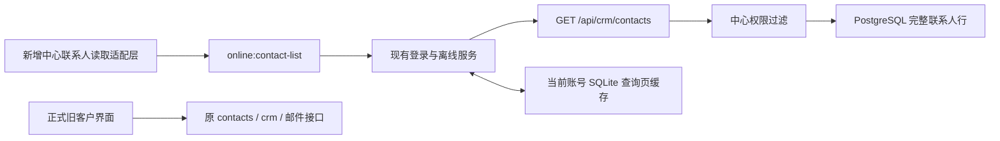

# 中心联系人读取接入 · 第一项

后续状态（2026-10-14，0.34.0-alpha.4）：已新增可进入的中心列表隔离预览，并受控重载本机中心加载该端点。原客户页仍走旧SQLite，未做正式数据源切换。当前入口、开放交互及验证见[三视图与隔离预览交付](customer-tabs-preview-delivery-20261014.md)；下文保留本项alpha.2的原时点边界。

2026-10-14，工作区0.34.0-alpha.2，未发布。用户批准开始接入；本节点新增中心完整联系人列表读取，不切换正式客户页面，也不迁移历史业务数据。

## 改动与原因

旧contacts:list返回联系人行，原online:list返回客户主档摘要。不能用主联系人摘要替代一家公司所有联系人，也不能把中心数字ID直接交给旧SQLite详情、删除或发信。新增独立查询端口及显示适配层，保留两个旧端口各自用途。

新增server/core/center-contacts.ts统一查询参数、DTO、常量与路径编码；服务验证、HTTP路由、PG仓储、桌面服务和IPC在原层级增加实现。src/renderer/hooks/useCenterContacts.ts提供独立读取hook和显示适配，尚未挂入ContactList。

## 契约及语义

- GET `/api/crm/contacts`；IPC `online:contact-list`。输入统一search/limit/offset，可选stage/status/tags/clientType/country。默认50行、上限100行；重复HTTP参数、未知参数及非法整数分页拒绝。
- 输出统一Result，data={items,total}；一行对应一个联系人，未挂联系人客户不会伪装出一行。
- 复用当前会话鉴权；客户端不能传userId、owner扩大范围。普通用户读取自己负责客户的联系人；管理员读取自己创建或负责客户；具有共享读取授权的超级管理员读取全部。计数与分页前用同一权限/筛选条件；未领取公海不会暴露完整联系人。
- 保留全部旧联系人业务字段：发送stage、邮件status、tags、extra、来源、联系方式和原始时间；触达、归属独立返回，不用客户关系阶段覆写发送stage。
- 显式contactId/customerId/customerVersion，行键由客户ID和联系人ID组成，不提供旧SQLite id。显示负责人从中心owner派生；原assignee仍保留在DTO，不当权限依据。
- 中心tags/extra为结构化数据，仅显示适配时转为旧页面使用的JSON字符串。无邮箱联系人显示空值。搜索中的%/_/!按字面转义；SQL参数化。
- renderer query key按中心地址和不可变用户ID隔离，翻页占位不能沿用别人的数据；复查使用原轮询间隔，无新增配置。

## 离线边界

复用已有账号隔离的crm_offline_state.cache[path]保存成功查询页，无新SQLite表或双写协议。重启可读同参数缓存；未缓存页/筛选离线返回不可用，不伪造空列表。权限变化清缓存，失效身份不能读取；仍受原签名离线期限约束，离线无法实时获知服务端撤权。

查询页缓存不是整库镜像，也未把旧页面挂入中心写入队列。离线待提交编辑的即时投影及写后失效机制随后续写接口一起接入，不宣称离线联系人全量编辑完成。

## 验证与验收

- 先增加失败测试，确认缺少方法/端点，再实现。最终相关服务、IPC、权限、离线和客户跟进渲染49项通过。
- 真PG+HTTP集成1项通过：四类临时身份、同客户多个联系人、无邮箱、权限先于分页、完整字段、搜索转义、阶段/国家口径、停用账号，实际HTTP→桌面服务→显示适配贯通。外层事务回滚，用户、会话、公司、联系人、客户、outbox计数前后一致。
- 隔离真实Electron、生产preload及原生SQLite通过5条链路：带身份HTTP读取、非法分页请求前拒绝、中心断网读缓存、未缓存页拒绝、离线退出清本地身份。页面异常0；桌面使用合成中心，不冒充PG桌面全链验证。报告.work/center-contact-read-smoke/report.json。
- 最终桌面类型、桌面/中心构建、203源码架构检查0例外和5项架构测试通过；IPC测试核对共享常量、main别名、handler逐一对应，preload实际调用已验证。
- 旧ContactList、CrmPipeline、ContactDetail、useContacts及router与本节点checkpoint的SHA256一致。无新schema迁移、表、依赖、配置键；未发布或推送。

现在打开正式客户页不会看到数据源切换。为避免中心读、本地写混用，详情和操作接齐后再切入口。本节点未强制重启用户现有中心/桌面进程，隔离验证不等于已有55844进程加载了新端点。

## 下一项

完整联系人详情读取：用显式中心客户ID+联系人ID定位，保留旧详情标签/字段，并核对往来记录、最近联系和历史发送账号。邮件仍在本地，不能碰巧按数字ID跨库关联；须建立账号内明确映射并检查权限。已有组件/接口更改前仍按用户要求简述并逐项确认。

检查点：D:/Agent Basement/checkpoints/prospector-center-contact-list-20261014-105822。
