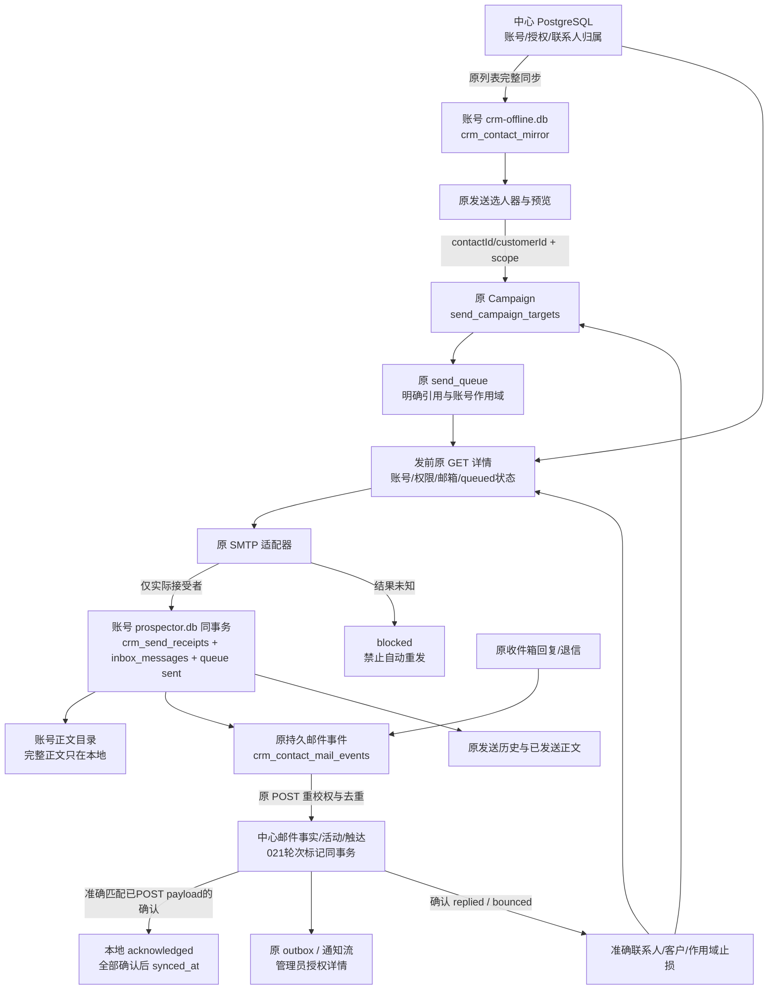

# N4 原发送中心接入交付

2026-10-15，工作区版本 **0.39.0-alpha.1**，未发布。用户纠正重复请批后，本轮按既定计划自主完成N4与验证。原前端固定；实际SMTP边界使用模拟，没有真实外发。

## 1. 改了什么、为什么、影响

| 改动 | 原因 | 实际提升 | 影响与边界 |
|---|---|---|---|
| 原ContactPicker与Campaign向导读中心授权联系人 | 原联系人已在线，原发送选人仍查旧contacts | 自有和已接受分配共用授权投影；明确引用贯穿选择、预览、任务和队列 | 样式/布局不重做；旧Campaign不按同数字自动转换 |
| 原发送引擎接明确中心端口 | 中心整数ID不能当旧本地FK | 模板、轮换、限额、暂停沿用；发前在线核对归属/权限/邮箱/任务未止损 | 中心线索离线实际发送暂停；手动明确发送与Campaign止损规则区分 |
| 原队列增加持久SMTP接受回执 | 已发邮件不能因中心故障而被重发 | 回执、收件箱行与队列sent同一本地事务；中心恢复只补传事实 | 本地回执不是可丢弃缓存；SMTP接受不代表最终送达 |
| 实际accepted/rejected与未知结果处理 | SMTP成功可能只接受部分BCC；超时可能已被服务器接受 | 只为接受者记事实/配额/开发轮次，未知结果阻止自动重发 | 被拒收者不记已发；部分接受保留1/2等警告，不盲目重发整组 |
| 中心确认后推进开发轮次 | Sent扫描和真实SMTP回执可能先后到达 | 021事务标记保证同一事实最多推进一次，已有回复/关系阶段不被清除 | cold/f1/f2/f3/f4是开发轮次，不能推定报价、成交或送达 |
| 回复/退信止损与原历史显示 | 只停止未来轮次仍可能发出已排队触点 | 中心确认后准确停止目标；发前闸门拒绝已止损队列；原历史显示中心回执 | 原文/附件仍本地，管理员中心只获得授权摘要；历史清空只隐藏回执 |
| 邮件正文、删除集及归档路径跟随选定账号 | 模块在登录前加载，旧常量抓住匿名DB目录 | 同号邮件不会跨账号读正文、误用删除缓存或写公共归档 | 修复现有路径，不自动搬迁/归属匿名历史文件；归档可靠性全面改造仍不在本轮 |

## 2. 实际数据流

中心故障时：SMTP已接受的任务仍为sent，持久回执保留，恢复后上传元数据；绝不因synced_at为空重新发邮件。SMTP结果未知时保持blocked，没有虚构已发事实，人工确认结果后再决定下一次操作。这里没有实现SMTP“恰好一次”投递。

同一Message-ID先被Sent扫描发现、后收到SMTP确认时，保留首个事实元数据，只升级确认标记。旧POST在途时若本地payload升级，旧回执不能ack新payload；下一次将确认标记传中心。中心已确认后扫描同Sent副本不重复推进。

## 3. 数据库与字段

完整逐表逐列、默认值/可空/主外键/约束/索引/JSON业务键见 **[当前数据库字典](database-dictionary-20261015-n4.md)**。该字典直接采集实际测试PG系统目录及当前源码隔离原生SQLite迁移结果，没有导出真实客户/邮件/凭据。

| 存储 | 实际结构 | 用途 |
|---|---|---|
| 一套中心PostgreSQL（public＋identity） | 36表、278列 | 统一身份、权限、正式CRM、分配、活动、任务、商机、邮件摘要、通知审计 |
| 每账号data/prospector.db | 31表、276列（含FTS/系统表） | 邮箱/收件箱、发送队列/任务、持久已发回执、历史兼容数据、Agent与运价镜像 |
| 同账号crm-offline.db | 6表、24列 | 当前授权联系人投影、按需详情、邮件关联、持久待同步事件及兼容离线状态 |

不是36个数据库。本轮无新数据库文件；账号目录由中心URL和不变userId定位，不绑主设备。

### 中心新增字段

迁移`021-contact-mail-send-stage`，表`crm_contact_mail_events`：

| 字段 | 类型/默认 | 用途 |
|---|---|---|
| send_stage_advanced | BOOLEAN NOT NULL DEFAULT false | 该真实已发事实是否已原子推进一次开发轮次；不是邮件送达标记 |

既有表、事件摘要digest和接口保持；确认标记、事件、联系人触达/轮次、活动及outbox同事务。普通Sent事件不推进轮次；实际确认必须是sent/outbound且匹配当前授权联系人邮箱。

### 本地新增字段与表

`send_campaign_targets.center_reference_json TEXT NULL`：JSON `{reference:{contactId,customerId},scope}`，scope为`JSON.stringify([baseUrl,userId])`。NULL仅兼容历史本地目标；禁止按contact_id同号猜测中心身份。

| crm_send_receipts字段 | 类型/约束 | 用途 |
|---|---|---|
| send_key | TEXT PRIMARY KEY NOT NULL | 发送项目幂等编号 |
| center_scope | TEXT NOT NULL | 中心URL与账号作用域 |
| payload | TEXT NOT NULL，JSON | `{receipt,accountEmail}`，保留真实SMTP接受者与本地正文 |
| mail_ids | TEXT NOT NULL，JSON数组 | 原收件箱本地邮件行号，绝非中心contactId |
| recorded_at | TEXT NOT NULL | 本地持久记录时间 |
| synced_at | TEXT NULL | 全部中心事实确认时间；NULL为未全部确认 |
| history_hidden | INTEGER NOT NULL DEFAULT 0 | 仅隐藏历史展示，不删除事实或待同步记录 |

索引`idx_crm_send_receipts_pending(center_scope,synced_at)`。两项本地命名迁移：`v0.39-center-send-target-reference`、`v0.39-center-send-receipts`；完整原生命名迁移23项，执行两遍验证。

`payload.receipt`包含id、accountId、subject、body、messageId、occurredAt、advanceSendStage、companyName、centerScope，及可选cc/campaignId。recipients[]为实际接受者的`{contactId,email,name,centerReference:{contactId,customerId}}`。body只在本地保存；原HTTP上传仅subject/preview/from/to/cc/来源键等最小事实。

原`send_queue.recipients` JSON增加可选centerReference，`contact_vars.__centerScope`保存作用域；没有另造队列表。本地邮件`matched_contact_id`保持NULL，通过原中心关联表定位，旧contacts/interactions同号记录不修改。

结构核对：17项中心迁移checksum全部匹配；35业务表275列名称/类型/可空与24源码显式索引存在性核对0差异。全目录保留真实约束/默认表达式；这不等于证明所有表达式与新建PG重放完全同构，也不是对每台旧安装库的普查。

## 4. 接口核对与保留边界

| 原入口 | 本轮适配 | 兼容/限制 |
|---|---|---|
| ONLINE.CONTACT_LIST | 原选人器读取统一授权联系人 | 先完成一致分页，再选择；不读取旧联系人作为中心名单 |
| send:start / dynamic / preview | 可选centerContactRefs | 明确引用失败拒绝，旧未迁移工具仍保留本地调用边界 |
| send:campaignPreview | 兼容原number[]，另支持{contactIds,centerContactRefs?} | 不把同号旧草稿自动改为中心草稿 |
| send:campaignCreate / updateDraft | 保存中心引用及作用域 | 仍是本地任务，未成为关机持续在线Worker |
| send:test | 可选centerReference快速发送 | 已有IPC后端支持；本轮未新增客户详情快捷按钮 |
| 原发送历史/日期/清理 | 展示本地确认中心回执；清理只隐藏 | 不代表另一台电脑已下载完整本地邮件原文或Campaign配置 |
| 原GET contact detail | 发前在线校权和邮箱比对 | 中心不可用不以离线缓存授权实际发信 |
| 原POST contact-mail-events | 可选advanceSendStage，确认已发事实 | 不新增平行发送回写/消息协议 |
| 原邮件同步ack/原Campaign回调 | 确认实际payload，明确ref/scope，检查已排队目标 | 中心bounced映射旧Campaign bounce；失败保留事实等待重试 |

无新增/删除公共IPC通道、HTTP路由、依赖或配置；ONLINE仍43项，原preload白名单沿用。内部端口只是隔离数据源/IO，不是第二套公开API。旧success/data在兼容边界使用，中心仍ok/data/error。

N5仍需逐个核对AI搜索、草稿、跟进及发送工具；不能因队列接入就宣称AI全部使用中心。N6完整离线命令、冲突/删除/转派撤权及重试策略，N7关闭客户端持续执行，N8历史迁移/容量验证仍后续。无全功能100%迁移或生产级全仓安全认证承诺。

## 5. 验证与恢复点

- 最终完整回归：**1331通过、154条件跳过**，`.work/center-send/full-tests-final3.log`。另启用真实PG回滚验收2项，`.work/center-send/pg-tests.log`；条件跳过不算通过。
- 桌面/服务端/管理端类型及构建通过，架构检查扫描219源码、0例外。最终工作区版本0.39.0-alpha.1。
- 真实生产main＋原preload/renderer＋原生SQLite＋实际HTTP/PG：**11链路通过，pageErrors=[]**。仅SMTP适配器确定性模拟，原引擎、队列、数据库和权限链真实执行；没有真实发信。
- 11链路包括未选同公司联系人排除、旧同号隔离、开发任务入队/事实/轮次、重复Sent、接受后断网恢复、BCC部分接受、未知结果禁重试、原历史/正文展示、实际退信止损及已排队触点被拒绝。
- 原生测试事务回滚前后：账号6、联系人1014、客户82、会话75、events79一致。固定Agent身份，不增加永久测试账号/线索；所有测试进程及临时资料清理。
- 独立限定审查无剩余可确认P1/P2，见`.work/center-send/review-final.md`。修复期间RED/失败日志保留；它不是全仓安全扫描。
- 正文路径陷阱在并行验证中生成4份匿名目录合成正文，已按创建时间/确切合成内容核对，备份后只删除这4份；真实历史文件不改。最终原生验收证明账号正文目录正确、仓库公共正文目录SHA256前后不变。删除索引缓存和归档也改为按所选账号解析，并有3项隔离回归。

源码/文档checkpoint：`D:/Agent Basement/checkpoints/prospector-center-send-20261015`，包含本轮前完整源码及差异、知识写回前快照。中心新增字段前custom dump：`center-before-021.dump`，231976字节。

中心测试服务已受控重载，地址仍127.0.0.1:55844，021已应用；没有强制重启用户桌面。用户托盘选择“重启应用”加载新主进程即可。未提交/推送/发布；没有创建夜间定时器。

## 6. 如何验收

1. 托盘重启应用，打开原发送中心创建任务。选人表应能找到本人自有及已接受分配联系人；不应混入其他用户联系人或同公司未分配联系人。
2. 选联系人完成原预览/创建草稿，名单和原联系人页保持一致。默认先验草稿；这一步不要求真实发送。
3. 已有真实发送后可在原发送历史、已发送正文及联系人往来摘要查看；中心故障只影响回执同步，不应把已发任务重新变成待发送。
4. 自动化已验证未知结果与部分接受等故障路径，测试证据在`.work/center-send/report.json`及三张原界面截图；无需用户亲自制造SMTP故障。

知识库：已同步Prospector当前状态、聚合审阅、项目入口与人用总览；结构巡检ok=true、errors=[]。保留Prospector与运价台账已有源码基线待复核警告，未将本轮限定审查夸大为所有历史差异评审，也未覆盖其他项目基线。下一重点是N5 AI工具统一联系人入口，保持原确认与审计规则。
