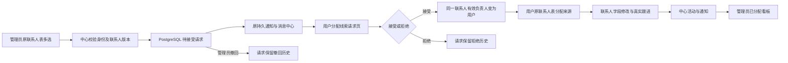

# 联系人级分配接受与正式客户页接入

版本：0.35.0-alpha.1，工作区未发布。2026-10-14 用户明确批准，取消产品隔离预览；工程测试仍用回滚事务和临时资料，避免污染真实线索。

## 入口和行为

客户正式页保留原联系人表、跟进看板、公司组件。联系人表多选后管理员发起分配，管理员第四标签“分配管理”显示待分配/已分配；用户第四标签“分配线索”接受或拒绝。联系人表来源筛选全部/自有/分配；来源由身份及中心有效归属计算，导入不用选身份来源。

已分配页面复用原跟进看板，额外显示未首次跟进联系人。接受不制造已触达状态；原看板仍排除未触达。详情复用旧布局，基本字段读写、公司背调只读、联系活动保存均访问中心。中心邮件时间线尚未接入，收件箱搜索仅按邮箱，不把中心数字ID交给本地联系人协议。

原任务/商机业务保留在非菜单的中心客户级详情入口 /customers-online，通知仍能定位；只获得某联系人不自动获得整客户级任务/商机权限。产品预览组件删除，旧预览URL转回正式客户页。

## 数据线路

联系人有效负责人优先取 active accepted 请求的 target_user_id，否则兼容原 crm_customers.owner_user_id。接受不改 crm_customers.owner_user_id/state，不复制 contacts，不批量转交同公司的未选联系人。公司基础资料共享，活动只读取同 contact_id 且无商机关联；实际最近联系按 occurred_at 派生，备注和商机活动不伪装最新联系。

019-contact-assignment-acceptance 新增 contacts.crm_contact_version 及 crm_contact_assignment_requests。请求状态 pending/accepted/rejected/cancelled；部分唯一索引保证每联系人至多一个 pending/accepted，请求与客户联系人关联使用复合外键。版本、归属、幂等回执及 outbox 同事务，任一失败整体回滚。接受后的转派/释放属于后续节点。

## 协议与缓存

新8个ONLINE通道与中心core类型统一：contact-detail/update/followup、assignment-list/create/accept/reject/cancel；原 contact-list 增加scope/assignment/followupOnly/crmStage。移除不再使用的 online:assign/online:claim 桌面通道及孤儿组件，原HTTP整客户分配/领取保留显式拒绝用于兼容调用，不允许绕过新流程。ONLINE共43个，常量/处理器/preload白名单一致，不增加独立会话或消息服务。

通知 requestId 精确定位当前请求，历史pending消息仍可打开已接受记录，不扫描全部请求；额外通知人只得最小摘要，通知已读不会接受。事件只进入原 outbox/feed/read。

中心联系人页在线GET核对最新权限，写后失效同账号联系人/请求缓存；失联可读实际加载过的快照。新联系人写入、分配决定及正式单表导入必须在线确认，导入等待实际中心回执，不先报本地成功。原客户级离线队列保留兼容，不与中心contactId混用；旧SQLite历史不自动迁移或删除。

## 验证和边界

单元回归118文件：994通过、1跳过；最后改动后桌面契约及旧客户/分配渲染5文件32项通过，另正式客户/来源/通知/侧栏27项通过。真实PostgreSQL事务回滚与校验4项通过，覆盖单联系人接受、同公司其他联系人隔离、重复与竞争请求、整批失败回滚、权限及来源字段。类型检查、两端构建、206源码文件架构检查通过。独立审查发现的通知状态、导入字段丢失/假成功、候选身份、冲突重试和旧任务消息定位均已修复；限定复核无剩余可确认P1/P2。

实际生产main/preload及原渲染器、真实PG、两份临时桌面资料跑通7条链路：发请求/接受、详情与跟进、历史通知定位当前请求、未触达不入板、管理员待首次跟进及两种窗口尺寸。renderer异常0。报告.work/contact-assignment/report.json；外层事务回滚前后用户6、联系人1014、客户82、会话72、事件76一致，临时桌面资料已清理。不是正式安装包、实际邮件或大规模并发压测。

本机中心55844已受控重启并加载019迁移；新端点未授权访问为401，实际用户6、联系人1014、客户82、分配请求0，没有留下测试请求。用户当前桌面主进程未强制结束：使用托盘“重启应用”一次加载新IPC，避免打断未保存内容。

工程checkpoint：D:/Agent Basement/checkpoints/prospector-contact-assignment-implementation-20261014，含源码副本、差异与中心变更前dump。数据库回退需先停中心、检查后续新业务写入，不直接覆盖现有库。没有新依赖、外发邮件、持久新增mock账号、提交、推送或release。

限制：历史SQLite联系人/邮件未迁移，中心发送/Agent/邮件时间线、公司修改/删除、中心新增/删除联系人、任务级提醒映射及接受后转派尚未接入；相关旧数字ID写操作不开放。看板/公司仍由授权联系人分页汇总，不是无限规模压测结论，后续规模增大须接中心聚合/增量事件，不能宣称容量已达标。
