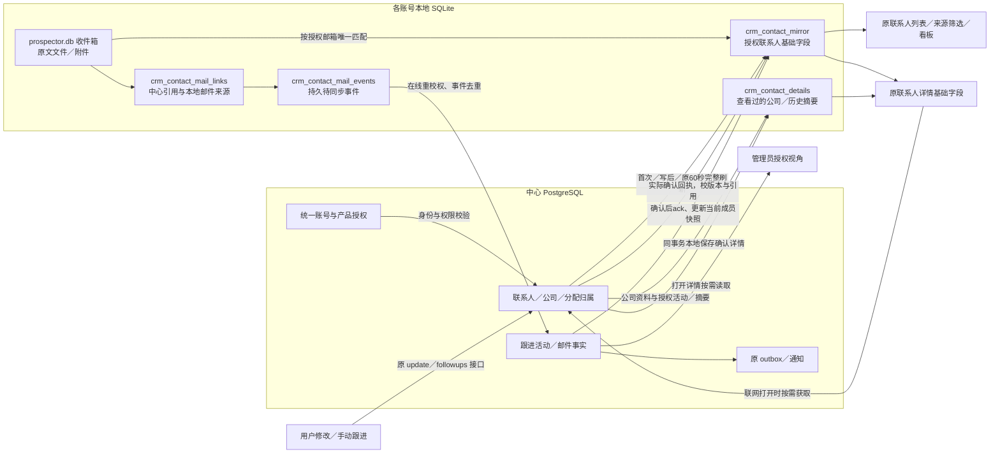

# 联系人详情、确认写与收件关联交付

2026-10-15；工作区版本 **0.38.0-alpha.1**。用户选择的连续范围N1—N3已实现并完成本机验证，未提交、推送或发布。保持旧联系人、公司、看板、详情及收件箱布局/样式；只在原详情公司与往来区域增加“尚未下载”状态的简短反馈。

## 1. 改动与实际效果

| 节点 | 原因 | 已实现 | 提升 | 影响/边界 |
|---|---|---|---|---|
| N1详情 | 列表已读结构化本地数据，详情仍依赖中心/路径JSON缓存 | 原详情接口读取同一联系人基础投影，打开时按需下载公司、跟进和邮件摘要；持久保存已下载详情 | 离线可开已同步联系人，已看历史可离线恢复；最新基础字段/权限优先 | 首次未下载的公司/历史需联网，不伪报空记录；不全库N+1下载 |
| N2修改/跟进 | 成功回执和列表/详情需一致，防旧响应回退字段 | 在线确认端口，保留中心权限/版本/幂等；回执校引用并本地保存后返回最新确认快照 | 写成功后列表、详情、匹配一致；备注/改阶段不捏造触达；重复请求不重复活动 | 离线字段写仍拒绝；中心已提交但本地失败时重试原幂等请求，不能声称中心未写 |
| N3收件关联 | 多候选广播、退信引用误归属、在途权限变化可能污染互动 | 每邮箱只关联去重后唯一中心引用；明确退信证据不降级归因引用人；前后检查身份/权限/active | 保留原收件行为及正文，中心获得正确最小互动摘要 | 歧义邮件暂不自动归属；历史已误存事实不自动撤销；无结构退信兜底仍弱证据 |

独立审查确认并修复四种竞态：明确拒绝后旧完整扫描重新加入联系人；字段成功回执重新加入已移除联系人；邮件成功回执重新加入已移除联系人；同账号重登复用已失活旧详情请求。新增回归先失败后实现。已确认邮件事实可以ack，不以ack恢复授权成员。

## 2. 当前数据流

图中“同事务本地保存”是本地SQLite内部事务，不是跨PostgreSQL/SQLite的分布式事务。中心先确认，本地再保存；中途故障使用原幂等请求重试。管理员端也拥有自己的账号隔离数据，不直接读取用户电脑文件。

离线：已有有效离线身份才能使用本地；列表、基础详情、已下载公司/历史、原收件箱本地正文可读取。新字段写需要中心。邮件关联事实持久保留，恢复后由原同步机制上传并等待回执。没有实现全量离线编辑、远程实时撤权或新的退避/冲突处理系统。

## 3. 数据库存储与字段

完整逐表逐列结构见 **[数据库字典](database-dictionary-20261015.md)**；原始目录快照在`.work/contact-continuation/schema-inventory.json`。

| 存储 | 实际采集数量 | 当前用途 | 采集范围 |
|---|---|---|---|
| 中心 PostgreSQL | 36表／277列 | 统一账号、权限、正式CRM、分配、活动、任务、商机、通知/审计 | 当前本机隔离中心库实际系统目录 |
| 账号本地 prospector.db | 30表／268列 | 收件箱、邮件配置、旧发送/Agent、运价镜像、历史contacts/interactions | 当前源码在隔离Electron原生SQLite完整迁移后的结构，含FTS影子/系统表 |
| 账号本地 crm-offline.db | 6表／24列 | 授权投影、已下载详情、邮件关联/待同步事实、旧客户兼容JSON状态 | 当前真实Store在隔离原生SQLite创建后的结构 |

不是36个数据库。逻辑上使用一套中心PostgreSQL；每个账号/中心组合隔离本地文件。本次未普查每个真实账号历史SQLite安装文件。

本轮仅新增以下本地表，无中心迁移、无新数据库文件：

| crm_contact_details字段 | 类型 | 约束 | 用途 |
|---|---|---|---|
| contact_id | INTEGER | NOT NULL；复合主键 | 中心联系人编号，绝非旧本地contacts.id |
| customer_id | TEXT | NOT NULL；复合主键 | 该联系人对应客户容器UUID，与contact_id一起定位 |
| permission_key | TEXT | NOT NULL | 当前账号角色/能力范围指纹，匹配才可读 |
| snapshot | TEXT | NOT NULL，JSON | 下载的CenterContactDetail：公司资料、活动、邮件摘要及回执字段 |

`snapshot.contact`用于版本检查和原中心回执，不作为独立基础数据入口；显示时覆盖为最新`crm_contact_mirror`基础字段及权限。`supplementAvailable=false`仅用于离线基础响应，不将占位保存成完整详情。

字典逐表列出字段类型、可空、默认值/自增、主外键、唯一/check、索引及JSON业务键。16项中心迁移checksum匹配；另外核对35业务表274列的类型/可空和24源码显式索引存在性，0差异。该核对未证明所有默认值/约束表达式与重新建库逐字等价；实际目录定义完整保留。SQLite完整命名迁移21项执行两遍，基底列无缺失或定义漂移。

## 4. 字段和编号映射

| 业务标识/字段 | 中心 | 本地正式读取 | 注意事项 |
|---|---|---|---|
| 联系人引用 | contacts.id + crm_customer_contacts.customer_id | mirror.contact_id/customer_id；detail复合主键；mail links两字段 | 不用同数字旧contacts.id替代 |
| 账号 | identity.users.user_id | 账号目录由中心URL+userId定位 | 换电脑用同账号下载；不是绑主设备 |
| 来源 | crm_customers.origin | CenterContact.origin | personal＋本人owner＝我的线索；operations＋本人owner＝分配线索 |
| 已分配 | 当前accepted请求 | assignmentStatus | owner非空不等于已接受 |
| 并发版本 | crm_contact_version及客户version | contactVersion/customerVersion | 较旧GET/回执不覆盖新确认基础 |
| 触达/阶段 | crm_touch_status；relationship_stage；发送stage/status | 显式不同字段/派生展示 | 仅改阶段或记备注不算真实触达 |
| 邮件源 | crm_contact_mail_events的mailbox/message/event keys | links.local_mail_id/mail_account_id及message_key；events.payload | Message-ID可跨邮箱相同，来源需邮箱隔离 |
| 原文 | 本轮不上传中心 | 原本地正文文件、附件、检索 | 换设备下载联系人不等于恢复所有原文 |

## 5. 接口一致性与兼容项

| 接口 | 当前链路 | 对照结果 |
|---|---|---|
| online:contact-list | 原renderer→原transport/service→本地统一列表端口 | 原输入/分页/total保留，完整范围先筛选 |
| online:contact-detail | 原renderer→原service→本地详情端口→按需原GET路由 | 一套引用契约，补可选supplementAvailable；无第二路由 |
| online:contact-update/followup | 原renderer→确认写端口→原POST路由→本地事务回执 | expectedVersion/idempotencyKey保持；离线不伪成功 |
| contacts:listForMatch、原inbox操作 | 原兼容Result→授权投影与显式centerReference | 中心ID不进入旧邮件FK写入/删除；原文链沿用 |
| POST /api/crm/contact-mail-events | 原持久事件→原HTTP→中心事实/activity/outbox→ack | 无第二互动上传接口，不含正文/附件 |
| 原消息feed/read | 原outbox通知/消息中心 | 没有新通知协议；已读不等于接受 |

**ONLINE通道仍43项**，shared声明、主进程注册及preload链沿用。没有新HTTP路由、依赖或配置键。新增detail/read/write/contains/invalidate等是主进程内部端口，不是新增对外IPC/API。

收尾对照节点前checkpoint：70个已保存renderer文件中，仅CenterContactDetail.tsx的两处数据可用性提示变化；src/main/contract.ts哈希一致。原客户列表、看板、公司及侧栏等受保存范围覆盖的源码保持原样。

保留项明确分层：crm_offline_state中的客户级JSON兼容读写/任务等仍存在；正式联系人详情不再通过路径JSON缓存读取。独立旧port测试fallback保留，不是正式运行的第二入口。旧SQLite联系人、旧营销发送及Agent ID工具尚未全部接中心，仍需N4/N5；不能把本节点称作所有CRM旧功能100%迁移。未删除历史数据或掩盖未接入口。

## 6. 验证与证据

- 测试先行：详情/存储/IPC委托、回执持久化、离线拒绝、旧版本、三种移除竞态、同账号重登，以及收件歧义/退信/权限场景先运行失败再实现。
- 最终串行全量：**151文件通过、24条件跳过；1282测试通过、153条件跳过**，175文件/1435测试。日志`.work/contact-continuation/full-tests-final.log`。
- 另启用真实PG测试：联系人列表（含三身份21组查询对照）、分配接受、邮件事实外层回滚，3项通过，`.work/contact-continuation/pg-tests.log`。
- 主进程/renderer类型检查、server类型检查、三段构建通过；架构检查215源码0登记例外及其5项测试通过。
- 独立范围审查最终无剩余可确认P1/P2；五文件92项、扩展八文件104项回归通过。报告`.work/contact-continuation/review.md`。这是本节点审查，不是全仓库安全审计。
- 最终生产main/preload/renderer＋原生SQLite＋实际PG/HTTP **17链路通过**，`.work/contact-continuation/report.json`的ok=true，pageErrors=[]。包括原收件箱正文与精确跳转、邮件事件去重/ack、成功字段回执、备注/阶段幂等且不重置触达时间、旧版本冲突、管理员跨账号看到确认信息、离线首次未看详情基础/已看详情历史、离线拒绝写、重启恢复、新设备同账号下载及已观察权限失效。
- 测试前后数量相同：users6、contacts1014、customers82、sessions75、outbox/events79；外层事务回滚，最终临时桌面目录回收。无持久测试账号或真实邮件外发。
- 保留首次失败证据：首轮全量在RED测试加入而实现未完成时撞上invalidate缺失，且原opportunities超大请求偶发ECONNRESET；该HTTP单文件4项通过，最终稳定源码串行全量通过。没有声称无关并发/HTTP偶发问题已修复。首次桌面17断言通过但report阈值误设18导致ok=false，修正验收脚本并以最终构建完整重跑，最终ok=true。

截图位于`.work/contact-continuation/`，只含合成测试记录；实际查看确认原详情/客户布局保持，未添加产品教学区域。

## 7. Checkpoint与用户验收

checkpoint：`D:/Agent Basement/checkpoints/prospector-contact-continuation-20261015`保存本轮前源码/服务端/测试/文档及差异；N2-before与N3-before分别保存对应节点前文件。知识文档原件另保留，未重置既有大量未提交工作。

用户窗口保留，没有强制结束；使用托盘“重启应用”加载0.38主进程。中心HTTP接口未变，55844健康状态已读回；本轮未发布安装包或推送release。

快速验收：联网打开某联系人详情、保存一个字段并加跟进，列表和详情应一致；断网后已同步联系人仍能打开，已看过的历史能显示，首次未看历史提示联网；管理员查看对应已分配联系人能读已确认修改/记录。工程已主动完成这些隔离验收，不将测试转交用户。

## 8. 尚未覆盖与下一节点

发送中心与回复、Agent联系人工具、历史SQLite迁移、离线字段命令及完整版本冲突/删除/转派撤权/重试、关机持续Worker、邮件全文附件上传仍独立后续。没有容量压测或索引化本地查询；原60秒完整刷新在大规模需另评估。弱证据退信与历史错误事实未全面治理。

建议下一节点N4：原发送中心/回复的中心联系人适配，重点发前权限与来源编号、实际发送结果回写；此项不在今晚获批范围，另给具体方案。真实外发仍需明确授权。

知识库已同步当前状态、聚合审阅与人用总览；只读巡检ok=true、errors=[]。保留Prospector既有源码指纹差异及运价项目needs_review提示，没有以本节点验收覆盖所有历史差异或清除其他项目基线。
