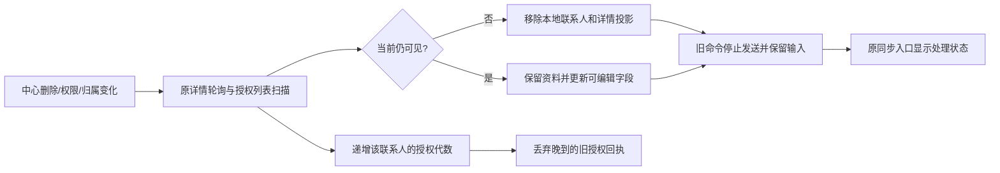

# 联系人多端生命周期同步

状态：0.49.1-alpha.1工作区已实现并验证，未提交、推送或发布。用户已批准删除、归属变化、共享撤销和权限降低的同步闭环；前端布局固定。

## 改动范围

联系人完整扫描及详情读取、成功回执统一核对当前可见性、负责人、客户关联和编辑权限。失权终止旧待提交命令，保留原请求内容；重新授权不自动重新发送。明确拒绝移除可见资料，临时断网保留已授权详情及未保存输入。

原详情、联系人多选、公司详情和同步处理入口使用现有组件；无新导航。查询缓存按账号和权限范围隔离，迟到写回执不能重新开放被取消的权限。

## 数据线路

## 数据库与协议

本节点未新增数据库、表、列、IPC、HTTP、依赖或配置键。沿用PostgreSQL既有软删/归属/共享权限，账号SQLite既有联系人投影、详情和三列crm_contact_commands。命令input、attempted、原始幂等键保留；status/error/discardable按已知证据更新，不把未知提交当成未发生。

每联系人授权代数仅为当前主进程内的并发保护，不是新业务编号或中心版本字段；重启后仍依赖持久命令状态、当前授权及中心版本/幂等校验。

## 原组件和内部链路对齐

| 对象 | 修改原因与结果 |
|---|---|
| contact-commands纯契约/命令服务 | 复用字段和跟进允许判断；捕获当前归属/权限指纹与每联系人授权代数，旧成功/冲突刷新不得越权写投影 |
| contact-mirror-store | replaceContacts、saveDetail、upsertContacts在实际接受变更后事务内退休旧命令，保留input；旧版本被拒和普通内容更新不误停 |
| contact-mail-runtime | 唯一受控缓存写入口；命令响应不经observer提前落地，公司等其他回执必须与当前权限/归属一致 |
| center-send-runtime | 删除发送前GET顺便saveDetail的多余副作用；发送仍校验实时邮箱与权限，并登记原发送授权 |
| contact-detail/local-read/mail-sync | 同账号重新登录也丢弃旧会话结果；晚到详情/邮件回执不得恢复已收回权限，邮件事实确认仍独立完成 |
| 原联系人详情与FieldEdit | 明确失权关闭详情、降低权限停用编辑器；网络错误保留未保存输入和简短错误 |
| 原联系人表/公司页/同步入口 | 刷新后核对仍授权的选择、公司详情和相关缓存；不改变页面排版 |
| useCenterContacts与详情查询 | 权限签名加入现有缓存key，placeholder不能跨权限继承；保留IdentityProvider原本变权清缓存机制 |

没有增加并行IPC/HTTP写入口，旧联系人修改/跟进仍由同一命令服务落地。未把未接通的转派入口伪装为可用。

### 数据表字段说明（本节点无DDL变更）

| 现有位置/字段 | 本节点的处理 |
|---|---|
| PostgreSQL contacts.crm_deleted_at / crm_deleted_by | 中心软删事实，不由本地草稿覆盖 |
| crm_contact_assignment_requests.target_user_id / status | 原分配归属事实，读取其有效归属；本节点不新增转派写接口 |
| crm_contact_shares.editable_fields / can_followup / can_change_stage / status | 由中心控制，详情和扫描都能触发本地收权 |
| SQLite crm_contact_mirror.snapshot | 只保存已确认且当前授权的联系人；失权移除 |
| SQLite crm_contact_details.snapshot / permission_key | 当前权限下的详情补充；移除或权限变化清理旧授权内容 |
| SQLite crm_contact_commands.permission_key / command_id / payload | 原三列结构不变，未增一份联系人表 |
| payload.input / attempted / idempotencyKey | 原请求及尝试记录保留，未知结果不能当作没发生 |
| payload.status / error / errorCode / discardable | 已失权命令变failed，禁止后台继续发送；可安全放弃与未知提交区分 |

字段完整定义沿用[0.49交付字典](./offline-contact-delivery-20261016.md)及[数据库结构](./database-schema.md)。本次以源码schema/迁移无变更、隔离集群业务回归为依据，不宣称重新逐列审计所有持久实库。

## 审查与验证

- 最终普通全量：217文件，1559通过、167条件跳过、0失败。证据full-tests-final.json。首次1552通过后，评审新增回归与修复再次全量跑通；没有以首轮结果代替最终版本。
- 隔离真实PostgreSQL：40文件206通过，临时实例已停止删除；共享权限收窄后拒绝旧字段/阶段写入，撤销后不可见，删除保留历史；回滚fixture模拟归属变化，验证原用户读写拒绝、新用户正确归属及互动历史无私人邮件正文/附件字段。证据center-full.log、center-report.json。
- 实际双桌面：生产主进程/原renderer/preload/原生SQLite，合成本机HTTP中心、签名临时身份、独立用户目录。最终7项通过、页面错误0、临时资料清理，39.9秒；已明确等候原详情关闭、列表移除及紧凑同步按钮变为“同步失败”。删除由另一个实际客户端IPC发起，归属/共享变更由合成中心控制；自动详情及状态轮询实际运行，晚回执场景显式刷新授权列表；没有专门等候60秒周期计时。真实中心PG验证与合成中心桌面验证为两层证据，不冒充一条真实账号中心端到端。
- 类型、桌面构建、服务端构建、架构232源码0例外、检查器5项通过。
- 独立审查两组P1均关闭：详情先降权再授权/归属变化不退休命令；发送前GET旁路缓存恢复旧编辑权。独立复现分别2/2、1/1复验通过。官方镜像测试覆盖详情及基础upsert，发送授权测试约束不再写缓存。
- 测试仅使用合成内容、回滚事务和临时资料；无真实发信、模型调用或新持久测试账号。正式55846及Navigator未改，55844无需迁移。

## 边界

- 现有联系人分配不含接手后再次转派业务接口。本节点验证中心归属变化的同步和隔离；数据库测试仅在回滚fixture中模拟归属变化，未开放新的转派操作。
- 原详情5秒轮询、授权镜像60秒刷新；收到明确失权后立即执行本地保护，不承诺实时推送。断网无法即时知道远端撤权，沿用原离线有效期限。
- 原账号私人邮箱正文、附件不随联系人归属复制；已上传的获授权业务互动摘要仍属中心历史。
- 未开放离线删除、离线公司编辑、离线分配或云端营销执行。命令保留期清理与容量验证仍未做。

Checkpoint：D:/Agent Basement/checkpoints/prospector-contact-lifecycle-20261016，改动前708文件。

## 验收

托盘右键“重启应用”加载本机新主进程。管理员删除或收回共享后，另一端已打开的联系人详情应关闭，列表移除；只降低字段编辑权限时联系人仍可看，原编辑框停止保存。断网修改后若中心已撤权，联网后显示同步失败并保留本地处理记录，不自动重试原修改。重新授权也不会自动发送这些旧修改。

由于接手后转派入口尚未实现，不能用现有分配按钮验收完整转派业务；本节点相关证据限于模拟中心归属变更后的同步。

下一项值得单独规划的是同步日志保留清理与容量验证，而非直接扩大离线可写操作。

证据位置：.work/contact-lifecycle-20261016/，最终普通full-tests-final.json、center-full.log/center-report.json、native-report.json及六张最终截图、typecheck-final.log、build-final.log、architecture-final.log、knowledge-check.json。独立复现为.work/lifecycle-review.repro.ts和lifecycle-send-review.repro.ts，不混入默认测试。

知识库已同步项目状态/审阅/入口和人用总览，巡检ok；保留旧有与并行源码指纹提醒，不重置未审查基线。
