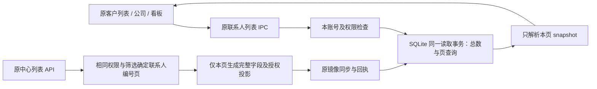

# 联系人列表与深分页交付（0.50.1-alpha.1）

2026-10-16；用户批准沿上一节点建议继续。工作区实现，未发布；原始源码与SHA256存于 `D:/Agent Basement/checkpoints/prospector-contact-pagination-20261016`（713文件）。所有测量仅使用隔离合成数据，不读取或改写正式账号、Navigator、真实联系人或邮件，不外发。

## 改动与数据流

原本本地翻页先读取全部snapshot、逐条JSON解析，再在内存筛选排序；中心OFFSET前生成完整详情，跳过的联系人也发生昂贵的资料计算。本次只优化读取，不重做前端或替换业务规则。



- `contact-local-read.service.ts` 增加可选**内部**page端口；`contact-mail-runtime.adapter.ts` 接线原生SQLite实现。兼容内存驱动保留原数组算法，不增加第二条公开读取入口。
- `contact-mirror-store.adapter.ts` 使用参数化筛选、原顺序及LIMIT/OFFSET；COUNT和页读取置于同一延迟事务，保证多窗口WAL并发提交时同页总数一致。只有当前页JSON进入应用层。
- 中心 `contact-assignment-repository.ts` 用MATERIALIZED编号页后补字段，以(contact_id,customer_id)重新关联。授权、有效邮件贡献、总数及排序不变，跟进时间仍先计算再分页。中心原有COUNT/列表两个READ COMMITTED语句未改成同一快照，不新增相关一致性承诺。
- 不调整原联系人来源、角色、认领、共享和编辑权限。当前中心只支持运营来源共享，未借本轮扩展个人线索共享。

## 数据库与字段

PostgreSQL：无新表、列、索引、迁移。原中心SQL变化，不复制CRM数据。

账号 `crm-offline.db` 原表保持：

```text
crm_contact_mirror
├─ contact_id       INTEGER PRIMARY KEY
├─ customer_id      TEXT NOT NULL
├─ email_normalized TEXT nullable
└─ snapshot         TEXT NOT NULL（原中心确认联系人JSON）
   ├─ updatedAt / lastFollowupAt：原时间字段
   ├─ touchStatus：原跟进看板准入
   ├─ origin / ownerUserId：原来源与本人归属
   └─ email / firstName / lastName / title / companyName：原搜索字段
```

新增4个表达式索引，DDL唯一来源仍为存储adapter；不新增业务字段或CRM副本：

| 索引 | 用途 |
|---|---|
| crm_contact_mirror_page | updatedAt时间倒序、contact_id倒序 |
| crm_contact_mirror_followup_page | contacted/replied部分索引，lastFollowupAt、updatedAt、contact_id倒序 |
| crm_contact_mirror_source_page | origin、ownerUserId及原默认排序 |
| crm_contact_mirror_search_page | 5个独立字段的小写值及原排序，避免全量重复调用JS转小写 |

每个运行时连接先注册确定性 `crm_contact_lower` / `crm_contact_time`，再创建索引，保持JS Unicode小写和Date.parse合法日期排序。空日期按原最低时间处理；有效中心数据为ISO时间，不承诺损坏非空日期的NaN排序行为。搜索使用独立字段instr，不把百分号/下划线当通配符，也不拼接字段造成跨字段误匹配。

## 实测与验证

同机i5-14400/16GB，Electron 37.10.3原生better-sqlite3磁盘库，WAL/FULL；10万合成联系人，每项3次，真实服务读取结果逐项对照旧算法。以下为实际样本范围，不是生产P95或多人吞吐承诺；运行时存在其他检查负载。

| 本地查询（每页50条） | 改前 | 改后 |
|---|---:|---:|
| 首页 | 487–517ms | 1.9–25.3ms |
| 末页 | 491–569ms | 4.7–5.3ms |
| 特殊字符搜索 | 345–389ms | 58–89ms |
| Unicode搜索 | 357–384ms | 56–73ms |
| 已分配筛选 | 471–545ms | 480–502ms |
| 多条件组合 | 376–523ms | 353–371ms |
| 跟进看板 | 654–822ms | 3.7–9.2ms |

每页JSON解析从100000条变为50条，超出末页为0条且仍返回准确总数。已分配及复杂组合仍可能遍历候选，不能用首页数字代表全部筛选。

真实隔离PostgreSQL、10万合成联系人、每项5次：中心首页594–628ms→225–239ms；末页2680–3819ms→247–256ms；搜索294–319ms→239–249ms。末页完整备注投影Actual Loops从100000降至50。测量为真实repository/service及事务回滚，未冒充HTTP或生产压测。

- 普通回归1577通过、168条件跳过，218文件，0失败；真实隔离中心40文件206通过，1容量条件跳过，实例已停止删除。
- 类型检查、桌面与服务端构建通过；架构232源码0例外、检查器5项通过。
- 实际生产Electron主进程/preload/renderer、两个临时账号库、合成HTTP中心9项通过：原列表IPC分页/Unicode/字面量搜索、删除、归属变化、撤权、降权、离线失败意图、晚到回执、压缩后重放；页面异常0，临时profile回收。中心权限另由真实PG测试证明，两层证据不冒充真实账号一体E2E。
- 独立审查复现并关闭本地COUNT/页跨快照问题；最终专项14/14，无剩余P1/P2。
- 原renderer/preload/shared/transport/公共契约136文件与checkpoint逐项哈希核对一致。无IPC/API增删，无新增依赖/配置。

原始证据位于 `.work/contact-pagination-20261016`：baseline/after读写JSON、center-before/after及执行计划、upgrade-100000、完整回归、隔离回收与native-report。生成脚本和报告保留，大型临时数据库在交付前删除。

## 副作用、回滚与验收

四索引增加本地磁盘与镜像写入成本：10万样本库112328704→132440064字节，约增加19.2MiB；旧缓存首次打开创建索引约1.6秒（隔离副本）。无并行负载独立复测：首次写入1517→5949ms，重复完整替换3205→7493ms，约多4.3秒；新增索引每次10万行写入涉及50万次小写与43.3万次日期回调。原并行基准27秒不能与首次旧版1.7秒直接比较，不用其宣称固定倍数。

全量镜像刷新仍整批替换，主进程同步SQLite可能在大缓存刷新时暂时阻塞。本轮没有改首次全量下载及60秒刷新策略；下一优先节点应保持完整授权扫描为真，跳过未变化快照的重写，只删除消失条目并替换变化条目，另行验证删除、降权及旧版本完整覆盖语义，不直接套用增量upsert的防旧版本规则。这是尚未实现的建议，不把查询优化说成完整大数据同步已达标。

表达式索引依赖上述函数。DBeaver普通只读SELECT可用；不注册函数的外部连接写镜像或执行integrity_check会失败。业务修改仍经程序接口。回滚不能仅还原旧源码：须停用所有客户端写入，先备份账号库并在新运行时连接移除四索引，再恢复checkpoint源码及依赖锁；联系人、待同步命令及邮件不删除：

```sql
DROP INDEX IF EXISTS crm_contact_mirror_page;
DROP INDEX IF EXISTS crm_contact_mirror_followup_page;
DROP INDEX IF EXISTS crm_contact_mirror_source_page;
DROP INDEX IF EXISTS crm_contact_mirror_search_page;
```

本轮未在用户资料上执行回滚。新版本重开会按需恢复索引。

使用托盘“重启应用”加载桌面新代码，原联系人、公司及跟进看板外观不变；可检查翻页、搜索、来源筛选及总数。中心查询优化需重启**运行对应源码的中心进程**才生效，没有替用户停止正式服务。网络初次全量下发、复杂权限统计及完整跟进时间排序仍有成本。

N7关机后中心持续营销、真实历史迁移及正式部署尚未完成。本节点不发布、不推送、不改正式业务数据。
