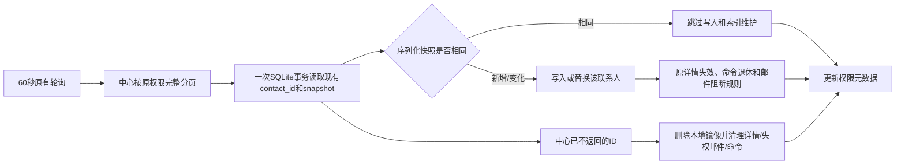

# 联系人缓存差量落盘交付（0.50.2-alpha.1）

2026-10-16，承接0.50.1的查询优化。用户批准继续处理“完整授权扫描后未变化联系人不重复写入”。本节点只改本地缓存落盘，不新增同步游标、事件协议、表结构、IPC/API、依赖或配置；原前端不变。

## 原因与链路

客户端每60秒仍从中心按原权限完整分页核对联系人集合。旧实现收到完整集合后先删除本地镜像再全部写回，10万条重复刷新约3.2–7.5秒，索引也重复维护。

完整扫描仍是权威范围核对：中心撤权、删除、归属变更会从返回集合消失或快照变化，继续触发对应清理。变化和新增采用完整扫描的权威值，即使版本号相同或降低也会覆盖；只有同一次异常返回中的重复ID仍沿原版本优先级，避免重复页污染。

## 实现范围

- `SqliteContactMirrorStore.replaceContacts` 在同一SQLite事务内读取已存联系人ID和原始snapshot。
- snapshot字符串完全相同的记录不解析、不执行INSERT/UPDATE、不触发表达式索引回调。
- 变化/新增记录使用预编译写入语句；中心不再返回的ID逐项删除。
- 继续执行详情权限清理、待处理邮件阻断（已授权的历史外发归档例外保留）、命令退休和权限元数据更新。
- 事务失败整体回滚；WAL另一连接并发写入导致的陈旧读取不会提交旧刷新结果。
- 只变更 `src/main/adapters/contact-mirror-store.adapter.ts`，新增 `tests/unit/contact-mirror-refresh.test.ts`；版本更新为0.50.2-alpha.1。原界面、共享契约和公开IPC/API保持不变。

## 性能证据

同机Electron 37.10.3/better-sqlite3、WAL/FULL、合成联系人、无网络。时间包括完整扫描后的本地落盘阶段，不包括中心网络下载；每个样本为同一隔离库中的实际存储调用。

| 10万联系人场景 | 改前 | 改后 |
|---|---:|---:|
| 首次写入 | 约2.7秒 | 约2.7秒 |
| 不变重复刷新 | 约3.6–7.6秒 | 约0.40–0.50秒 |
| 修改100条 | 约7.3秒 | 约0.37秒 |
| 删除100条 | 约7.5秒 | 约0.37秒 |
| 权限/归属变化100条 | 约7.2秒 | 约0.42秒 |

改后不变刷新没有调用小写/日期索引函数，也不改联系人镜像行；100条变更只触发对应索引维护。首次完整下载仍受网络和中心分页影响，本节点没有把它变成增量网络同步。

实际双Electron测试等待原有未加速的60秒定时器：其中一个保持不变的客户端产生0次联系人镜像写入；另一个客户端此前包含删除、转移、撤权等生命周期变化，未被纳入“不变”断言，避免把真实变化误判为无写入。两端的授权集合最终一致，临时资料已回收。

## 验收与验证

- 普通回归：1585通过、168条件跳过、0失败、219测试文件。
- 中心隔离回归：40文件、206通过、1容量条件跳过；一次性PG实例已停止删除。
- 专项审查：129项通过（刷新8、镜像38、分页9、邮件同步20、详情14、命令31、命令存储8、运行时1），无本节点P1/P2。
- 原生桌面：10项通过，含双独立客户端、分页搜索、删除、转移、共享撤权、权限降级、离线命令、晚到回执、命令维护及实际60秒轮询；页面异常0、临时profile回收。
- 类型检查、桌面构建、服务端构建、架构扫描232源码0例外、架构测试5项通过。
- 本节点没有真实账号、真实联系人、真实邮件外发或正式中心写入。

## 副作用与边界

中心仍需每60秒完整分页并传回可见联系人，所以网络流量和中心查询成本尚未消除；本地只避免重复落盘。换电脑、首次登录、权限范围整体变化时仍可能发生完整缓存刷新。真正的增量同步需要中心游标、变更/撤权事件和异常修复协议，另立节点。

## 回滚

源代码checkpoint：`D:/Agent Basement/checkpoints/prospector-refresh-diff-20261016`，715文件。回滚只涉及replaceContacts实现和对应测试；不需要数据库迁移或删除数据。恢复旧实现后，四个表达式索引仍可由当前连接正常使用，不存在0.50.1的函数索引回滚限制。回滚会恢复“完整集合删除后全部写回”的性能，不会恢复旧数据权限语义。

知识库已同步项目入口、当前状态、审阅记录和人用总览；check_vault只读检查0 errors。未提交、未推送、未发布。
