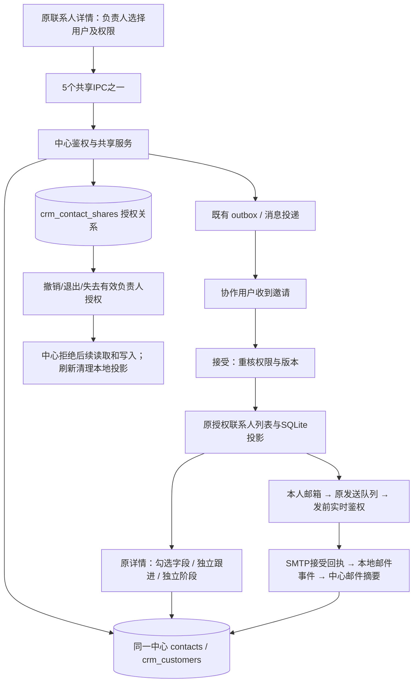

# 联系人字段权限与协作共享交付

> 2026-10-16权限更正：管理员来源线索由所有具备相应能力的管理员共同管理，不按上传账号隔离；`created_by`只用于留痕。下文0.46交付时写的“上传管理员”应按“任一管理员”理解。用户自有线索仍对普通管理员不可见；公司包含用户自有线索时，管理员不能借运营联系人修改该公司主档。

> 后续更新（2026-10-16）：本次交付时“邮件反复分类／改为其他尚无更正协议”的限制已由0.47补齐，见[更正链路、字段和验证](mail-classification-correction-delivery-20261016.md)。迟到SMTP撤权归档仍未实施；下文保留0.46交付时记录。

日期：2026-10-16；工作区版本：0.46.0-alpha.1，未发布。按用户批准的字段边界和自定义共享权限实施，保留原客户界面布局，不另建一套联系人。

## 使用方式

1. 用户打开自己已接受分配的联系人，点击详情顶部“共享线索”。选择协作用户，勾选可编辑字段；记录跟进与修改关系阶段分别选择。
2. 接收用户收到消息，在原“分配线索”页的“共享”中接受或拒绝。接受前只有邀请摘要，没有完整联系人访问权。
3. 接受后联系人进入原联系人列表，带“协作”标识；仍属于管理员来源，不变更主要负责人。可按勾选权限编辑，使用自己的邮箱发信。
4. 共享者可在联系人详情的共享弹窗调整权限，并在“发出的共享”撤销；接收者可在“收到的共享”退出。不会删除既有邮件或跟进历史。

首期仅共享已接受的管理员来源线索；自有线索共享、协作人再次共享未开放。新创建且仍须首次改密的用户完成改密后才进入可选目录。

## 角色与字段

下表的“完整”指业务字段管理；不包括篡改编号、来源、历史、系统时间与邮件事实。

| 对象/操作 | 自有线索本人、获授权超级管理员 | 任一管理员（含分配后） | 获分配用户 | 接受共享的协作用户 |
|---|---|---|---|---|
| 姓名、职位、电话、LinkedIn、国家、语言、客户类型 | 可改 | 可改 | 可改 | 仅勾选项 |
| 邮箱、普通分类标签 | 可改 | 可改 | 不可直接改 | 不可直接改 |
| 个人开发偏好 | 可改 | 可改 | 可改 | 本轮不委派 |
| 跟进记录 | 可新增 | 可新增 | 可新增 | 单独授权 |
| 关系阶段 | 可修改并留痕 | 可修改并留痕 | 可修改并留痕 | 单独授权，改变该联系人共同阶段 |
| 使用本人邮箱发信 | 可用，仍受禁止开发等限制 | 同左 | 同左 | 接受后可用，不依赖编辑/跟进授权 |
| 共享 | 本轮不开放自有线索共享 | 可管理管理员来源的已有共享 | 可邀请用户 | 不可再次共享 |
| 公司主档 | 继续独立校验，不由联系人权限推导 | 继续原公司权限 | 不可覆盖共享主档 | 不可覆盖共享主档 |
| 删除/负责人/来源 | 仍走原受保护专用流程 | 同左 | 不通过普通字段接口开放 | 不开放 |
| 开发轮次、邮件分类/真实收发事实 | 系统维护 | 系统维护 | 系统维护 | 系统维护 |

管理员仍不可见用户自有线索。超级管理员具有权限不代表本轮新增了展示所有用户自有线索的入口。

公司背调可由获授权的分配/协作用户运行，结果临时显示，不因允许生成报告而允许覆盖共享公司资料；切换账号/联系人或授权失效丢弃旧异步结果。

## 数据流转

- 共享不是第二份联系人或转派；主要负责人、来源、中心双编号保持不变。
- 接收前不开放联系人详情；邀请通知仅提供处理邀请所需摘要，通知已读不等于接受。
- 共享者、目标用户、当前身份/角色、原负责人及开发权限每次由服务端核对。失效共享在查询中按撤销呈现；不可依靠过期缓存获得写权限。
- 修改共享或接受/拒绝/撤销递增相应版本；字段写复用联系人版本，邀请操作复用既有幂等与审计。旧整客户更新入口不能绕过获分配用户字段上限。
- 原本地授权投影复用现有存储，未新增第二套SQLite联系人表。接受后立即打开详情会先补齐授权投影，避免异步全量同步尚未结束造成误报不存在；切换身份及确认失权仍拒绝。
- 发信独立使用 canSendMail：AI、原发送中心、运价更新开发、邮件匹配/事件同步使用同一能力。协作人没有跟进权也可发信，记录真实操作人，不能记作负责人的发信。
- 邮箱正文及附件不因共享而自动全部上传或开放；沿用现有摘要与本地邮件存储范围。无跟进权限的协作人不会因此得到任意手工跟进写权限。
- 原收件箱的自动回复、退信仍通过邮件分类→匹配→邮件事件派生；删除旧 CONTACT_UPDATE.status 写入，避免绕过事实规则。发生时间沿用原邮件时间，不用分类时间冒充邮件时间。

## 数据库变化：023-contact-sharing

新增 PostgreSQL `public.crm_contact_shares`，13列；未重建 contacts、未迁移客户副本。

| 列 | 类型/约束 | 用途 |
|---|---|---|
| share_id | uuid PK，自动生成 | 一次共享关系编号 |
| contact_id | integer NOT NULL，FK contacts | 原中心联系人 |
| customer_id | uuid NOT NULL，FK crm_customers | 原客户包装关系 |
| grantor_user_id | uuid NOT NULL，FK identity.users | 原共享者 |
| target_user_id | uuid NOT NULL，FK identity.users | 协作用户 |
| editable_fields | jsonb NOT NULL，默认 [] | 可编辑字段白名单，数据库也限制为8种候选字段 |
| can_followup | boolean NOT NULL，默认 false | 新增跟进权限 |
| can_change_stage | boolean NOT NULL，默认 false | 修改关系阶段权限 |
| status | text NOT NULL，默认 pending | pending/accepted/rejected/revoked |
| version | integer NOT NULL，默认1，必须>0 | 授权操作乐观锁 |
| created_at | timestamptz NOT NULL，默认 now() | 邀请创建时间 |
| updated_at | timestamptz NOT NULL，默认 now() | 授权最后变更时间 |
| decided_at | timestamptz，可空 | 接受/拒绝/撤销操作时间 |

另有 `(customer_id,contact_id)` 外键，禁止共享给自己；同联系人/目标用户的 pending/accepted 关系唯一；按接收者/共享者/状态/创建时间建索引。无 can_send_mail 持久列：接受后的发信能力按实时身份与禁止开发规则派生，不存第二份容易漂移的结论。

原 CenterContact/Detail 增加 `permissions`（editableFields/canFollowup/canChangeStage/canSendMail/canShare）及 `isShared` 等投影。权限不作为可由客户端修改的业务字段。

## 接口一致性

纯契约在 server/core/contact-sharing.ts，shared/online-crm.ts 重导出，preload按统一通道集合放行，不加另一套身份或凭据通道。

| 新IPC | 中心HTTP | 输出 data |
|---|---|---|
| online:contact-shares | GET /api/crm/contact-shares | ContactSharePage |
| online:contact-share-create | POST /api/crm/contact-shares | ContactShare |
| online:contact-share-decide | POST /api/crm/contact-shares/:shareId/accept、reject、revoke | ContactShare |
| online:contact-share-update | POST /api/crm/contact-shares/:shareId/update | ContactShare |
| online:contact-share-members | GET /api/crm/contact-shares/members | ContactShareMember[] |

共5个IPC、7个HTTP方法/路由组合，统一 `{ok,data?,error?}`；decide 的 action 由桌面转路由，不混入中心严格校验的业务体。列表含 incoming/outgoing、可选状态/联系人/客户及分页。操作使用共享版本与幂等键，创建另检查联系人版本。

复用现有详情/字段修改/跟进/邮件事件/消息/本地投影通道，没有为共享复制这些接口。共享事件为 crm.contact.share.requested/accepted/rejected/revoked/updated；消息携目标用户编号，区分收到的共享与发出的共享，不从消息读状态推导授权。

## 验证与运行状态

验收证据在 `.work/sharing-20261016/`。常规全量176文件1454项通过、28文件165项条件跳过；最后收件箱/匹配/详情修订另定向56项通过，背调渲染3项及主进程2项通过。完整隔离中心38文件204项通过，临时集群停止并回收；类型、桌面与服务端构建、228源码0例外及架构检查器5项通过。

本机测试中心55844已受控重载并应用023，live/ready200，共享列表/目录/创建匿名401，13列实际核对；迁前pg_dump备份305847字节且目录验证通过。用户77、联系人1073、客户148保持，新增共享表为空（合成验收已回滚）。正式55846与Navigator未迁移。旧桌面通过托盘“重启应用”加载本轮前端和主进程；未替用户强制关闭当前窗口。使用固定Agent账号、合成联系人与回滚事务；不新增持久测试账号，不真实外发、搜索或调用模型。

原生完整生产 Electron 主进程、原 renderer/preload、原生 SQLite 与 HTTP/PG 联调9项通过，`pageErrors=[]`：邀请消息、原详情共享弹窗、接受、字段白名单、其他同公司联系人隔离、无跟进权限协作发信（替身SMTP）、撤销后读写/发信拦截均已覆盖。外层回滚前后用户77、联系人1073、客户148、会话180、事件154一致；原全局邮件正文目录未变。这是本机合成验收，不是对真实邮件外发的承诺。

Checkpoint：`D:/Agent Basement/checkpoints/prospector-sharing-implementation-20261016`，保留改前源码及迁移前数据库备份；不覆盖其他任务差异。新依赖/配置键均为0。

## 明确未闭合的边界

1. SMTP已经接受，但上传中心邮件事件前共享被撤销：本地发送事实和正文保留，上传事件标记 blocked，不重发、不伪装同步成功，也不阻塞其他联系人事件；**当前没有中心侧预授权发送凭证，不能保证这类迟到事实撤权后仍可中心归档**。设计中的完整迟到归档仍待后续独立闭环。
2. 邮件从一个分类改为另一个分类会生成不同幂等事件键，发生时间保留。反复切回已经存在的旧分类、或改为“其他”后的中心状态撤销尚无独立修订协议；不宣称完整反复重分类已经解决。
3. 其他客户端靠现有同步/重新读取更新权限，离线已有缓存不保证即时远程消除；实际在线写入和发前鉴权实时拒绝。未新增跨设备即时推送或新离线冲突/删除恢复协议，后续N6仍未开始。
4. 原界面布局保持；真实外部背调、真实SMTP、正式服务部署和发布不在本次验收范围。

知识库：已同步当前状态、聚合审阅、项目入口与人用总览；只读巡检通过，保留并行源码指纹待复核提示，不重置全仓基线。5份本轮临时Electron用户目录已确认进程退出后回收。

## 后续节点覆盖（2026-10-16，0.48）

发送前已有中心授权的迟到SMTP接受回执现已支持撤权/转派/软删后仅历史归档，原权限继续阻断新发送。无事前授权的旧blocked记录不自动解锁。详见[迟到回执交付](late-send-receipt-delivery-20261016.md)。本页原节点时点的限制与验证记录保留，不扩大为所有历史邮件已恢复。

## 管理员跨账号桌面补验（2026-10-16）

后续权限更正的隔离PG回滚用例已验证两个管理员对同一运营线索的服务端读取和修改，以及普通管理员不能读取销售自有线索。本次使用 `scripts/test-operations-contact-desktop.cjs` 和独立临时用户目录，在真实Electron窗口、生产renderer/preload、原生SQLite镜像、在线IPC与合成HTTP中心中，以管理员B打开管理员A创建的运营联系人并保存“职位”；详情请求1次、更新请求1次，页面异常0。模拟中心不等同于真实中心的桌面端到端验收，服务端跨账号授权仍以独立PG回滚用例为依据。桌面构建和类型检查通过，定向权限及邮件同步28项通过；普通Vitest模式下PG用例按条件跳过。没有真实账号、客户写入或邮件外发。
