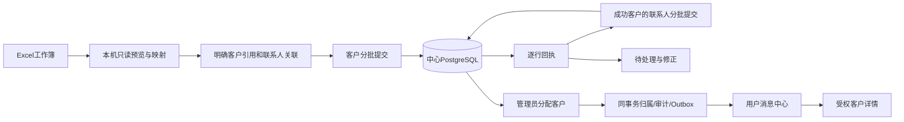

# B1：客户主档与分表导入交付

2026-10-12，工作区0.21.0-alpha.1；用户批准落地后实施，未发布。B1承接客户与联系人，B2–B6仍按节点审批。源码及测试数据库checkpoint：`D:/Agent Basement/checkpoints/prospector-b1-workbook-20261012`。

## 可见改动与验收

客户 → 导入 →「客户与联系人」→ 选择工作簿，选择客户表和联系人表；未选表及行数单独显示。核对字段、来源引用与关联后，导入已确认行。无客户编号时生成待确认的来源名称别名；同名歧义、缺抬头、缺关联保留为待处理，不近似匹配、不丢弃。客户先提交，联系人只进入已确认成功的客户。回执合并分页，包含原表、原行、批次及结果；错误可修正。

客户资料新增业务类型、开发限制、来源创建日期；可创建无联系人客户，也可追加只有姓名或电话的联系人。限制阻止中心发布、领取、分配，资料编辑保留。无邮箱显示“—”，数据库为NULL，不制造假邮箱。无联系人客户可分配，用户消息打开对应UUID客户；实际跟进仍待B2解除旧首联系人依赖。

## 数据与接口边界

- 客户、联系人、来源映射、原行证据、归属和通知均由中心PG管理；客户端不写第二份共享CRM。SQLite邮件、AI和个人任务未在本节点迁移。
- 新增011增量迁移：主档字段、中心contacts.email可空、来源映射表、行状态扩展、客户联系人/活动查询索引。既有001/005/008正文未改；基础ContactDraft邮箱契约及本地SQLite表未改。
- 新增`online:workbook-preview`、`online:workbook-import`及`POST /api/crm/workbook-imports`。22个在线常量与处理器对等，preload取同一常量集合；旧平面导入仍原入口。没有无调用方的新增协议，没有新增依赖或配置键。
- 来源映射范围为创建者＋来源＋origin＋实体＋sourceRef，目标为中心生成的UUID。客户端引用不授予权限；中心复核能力、归属、冲突、幂等。已分配客户不能通过重导追加或覆盖。全局邮箱冲突只给通用回执。
- 文件≤10MiB、≤20表、每表≤100列；选定客户与联系人各≤10000行、合计≤20000行。单请求≤200行且实际UTF-8 JSON≤1MiB。来源/说明及业务文字≤500字符，邮箱≤254字符。
- 未知响应保持原键与原请求；已知写前参数拒绝释放待修正队列；成功行不重发。原失败证据不会被新修正批次覆写。回执与原行已在中心持久化，客户端尚未实现跨进程重启恢复导入工作台。
- 源日期共享校验及标准化：有效YYYY-MM-DD／YYYY/M/D，同一日归一为UTC；无时区时间按UTC，有时区按标明偏移。原文保留；不存在日期逐行invalid，不能使整批失败。

## Excel只读核验

源文件7表16740行，选定客户2461、联系人8760。预览待处理客户10行（8行来源名称重复、2行“已合作”需确认关系语义），联系人248行（13行关联歧义、235行缺父客户）；未选其余5表，不把待上传副本静默混入。全部2461个源日期为YYYY-MM-DD。统计证据`.work/b1-workbook-readonly-report.json`，未导真实数据。

解析器对该文件输出既有ZIP尺寸警告，但七表及行数与前次只读核验相符；这不证明原平台关系完整。Excel空关联和成交占位不补造。名称别名不是稳定业务ID：无ID客户改名后须显式沿用原来源引用；否则新引用视为新客户，不宣称自动识别改名。同引用资料变化则返回歧义待复核，不覆盖。

## 验证与限制

实际隔离Electron/HTTP/PG已跑通：丢失提交响应同键重试、客户先于联系人、多联系人与NULL邮箱、零联系人分配、限制字段、用户通知直达；1040×660及1366×768导入按钮可见，页面异常0。证据`.work/b1/runtime/report.json`及截图。

独立复核发现并修复：私有草稿限制信息泄漏、无效日期造成整批错误、已知参数拒绝卡死队列、残缺回执造成锁定、日期格式时区漂移。该复核限定B1，非全面安全认证；不证明公网部署、邮件Worker或长期容量验收。

验证：普通924通过/110跳过；中心串行98通过；最终B1组合76通过。类型检查、三端构建、191源码/0例外及5项架构检查通过。jsdom伪元素警告和既有bundle体积警告仍在，不表述为无警告构建。checkpoint保存验证记录。下一节点B2负责独立客户阶段、联系活动和真实发生时间，使无联系人客户也可跟进；本地营销接中心开发限制、持续Worker属B5，本节点不声称完成。
