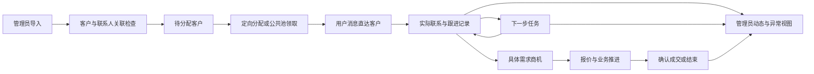

# 管理员业务融合与线索跟踪闭环

2026-10-12。用户要求结合传统Excel模型、已有功能及源码融合业务。整体目标已明确；实施仍遵从用户的每重大节点先报告原因、提升、副作用、批准后执行。本文是完整拟实施规格，不是完成报告。最新身份称呼沿用管理员、用户、超级管理员。

## 业务理解及不能从文件推断的规则

管理员已有习惯：按公司整理客户；联系人独立维护，一家公司可有很多联系人；通过负责人、公海、最近跟进了解客户是否被承接；具体需求进入商机，记录关注重点、质量、阶段和合同；电话和拜访同样是跟进；结果落到成交记录；人员与主管提供责任和通知关系。

Excel能确认这些字段和管理意图，不能确认实际使用频率、完整商机阶段顺序、回收期限、绩效归因或成交审批机制。空关联可能是导出丢失，不据此认定原系统没有关系。首次不默认启用自动回收、不生成能力评分、不导入错误成交记录；对应节点另确定口径。

## 共同原则

- 中心PostgreSQL为共享客户、联系人、归属、业务活动、任务和商机事实源。SQLite保留本机邮件/配置等尚未迁移能力，不另建可独立修改的共享CRM副本。
- 保留客户工作面、既有侧栏、主题和详情入口，按照任务逐步展示功能；不为Excel每张表新增导航，不写教学说明挤占空间。
- 客户没有邮箱可以登记、分配、电话跟进；真实邮件发送必须选有效收件人并通过现有发送保护。不得用虚拟邮箱补齐数据。
- 客户关系状态、联系人触达结果、发信步骤、商机阶段、流通归属分别表达，禁止同名字段互相覆盖。
- 来源原文和业务事实分开。原Excel列保存在导入证据中；经审核的字段才成为正式主数据。
- 自有/管理员来源不因分配而改写。分配记录包含操作者、接收人和时间；通知接收人不因收到消息获得客户权限。
- 最新用户表述覆盖旧文档；持久化role、origin和salesUserId等字段保持，避免角色迁移引发权限漂移。

## 主链路与界面

### 管理员工作面

客户页主视图保留待分配、已分配，后续增加待跟进/逾期的任务筛选。主动作仍为导入；选中客户后批量分配，权限由中心逐个复核。表格优先公司、类型、国家、负责用户、关系状态、最近实际跟进和下一步到期时间。例外进入受权的待处理视图，不能悄悄丢掉缺邮箱或抬头歧义的行。

详情把客户摘要放在上面，下方组织联系人、动态、任务、商机。动态默认最近发生，兼容记录时间查看；不把普通资料修改当成实际联系。商机与任务在对应节点启用，不先做不可用的装饰入口。

### 用户工作面

沿用自有线索、分配线索；来源标签保留。消息打开具体客户及对应事件。进入详情后首要动作是记录联系或完成当前任务；已经联系的客户默认推动设置下一步，允许明确结束开发而不是强制制造无意义任务。提醒与任务状态依中心记录，关闭客户端不会停止中心提醒。

### 超级管理员

沿用中心数据访问与授权能力，检查导入异常、归属审计和业务结果。不因为超级管理员能审查业务，就把私人邮箱凭据、私人配置默认开放；未迁移的本地邮件也不得显示为中心已收集。

## 已有功能接入方式

| 已有功能 | 融合方式 | 不能自动推断 |
|---|---|---|
| AI对话、背调 | 从受权客户打开，使用明确客户ID，结果由用户确认写入业务资料 | 模型猜测不是正式客户事实 |
| 自动开发信、发送中心 | 指定客户和联系人，稳定关联发送任务与结果；在线Worker节点前保留现有真实执行边界 | 入队不等于已发送；发送不等于触达或客户回复 |
| 收件箱 | 根据受权邮箱、稳定邮件ID和联系人匹配，先形成通信事件；意图识别可提出商机/任务建议 | 同域名不等于同客户；自动回复不等于有效反馈 |
| Navigator查价 | 从客户/商机带入明确需求，引用一次报价快照，更新通知可关联有效需求 | 查价不等于报价已送达；运价更新不自动改已发报价 |
| 素材库 | 作为营销和报价内容来源，保持私人配置边界 | 素材使用次数不能直接评判工作积极性 |
| 消息中心 | 复用唯一feed、去重、补收和具体对象跳转，按事件扩展 | 通知不复制一份可编辑客户资料，不扩大对象权限 |

真实发送、收信及在线Worker整合必须单独验收；不能在CRM模型升级中声称它们已中心化。

## 数据模型目标

### 客户主档和联系人

沿用companies、crm_customers、contacts、crm_customer_contacts。新增正式客户业务分类和开发限制，分开“代理/直客/电商”“不跟进原因”“已合作关系”；具体字典允许明确未分类，不能把类别缺失判成不可导入。

客户关系阶段独立保存至客户主体，历史记录保留旧值和迁移依据；联系人独立保存触达状态；旧contacts.stage的CRM值和发送值在迁移时分别识别，不按字段同名直接复制。无法判定的历史数据需显式待核对。

客户来源以source及稳定外部标识关联。没有源ID的文件进入显式来源映射：初次精确同名也先排除同名歧义；记录确认后的来源客户映射，后续重导复用。公司名和行号只用于匹配候选/证据定位，不作为永久跨文件主键。公司更名或联系人转公司需显式复核。

联系人邮箱冲突仍需中心复核，不能仅因为是管理员就强制抢占他人客户。电话、职位、姓名、国家进入正式字段。新导入不把历史创建日期覆盖系统created_at，单设source_created_at。

### 跟进活动

以客户为必需关联主体，可选contact_id、opportunity_id；记录actor_id、方式（邮件/电话/拜访/其他）、内容、occurred_at、recorded_at及来源外部ID。客户级记录不再人为挂到第一位联系人。邮件引用仅对有权用户可访问，不在广泛通知中泄露完整正文。

最近跟进由有效联系活动的occurred_at派生；最后资料修改、最后分配、最后消息时间分别查询，不互相冒充。后台同步的邮件事件幂等写入，不与人工补记同一事件重复累计。

### 下一步任务

拟新增中心任务及变更历史：customer_id、可选opportunity_id、assignee_user_id、due_at、状态、动作、创建人、完成时间、version。待办/完成/取消与逾期派生分开；到期不把任务状态写成“已完成”。任务转交必须复核当前归属，旧接收者提醒停止。

中心Worker采用可恢复的到期领取、处理、重试与幂等事件键，不依赖客户端在线，不把到期通知当成自动发邮件许可。现有真实发信仍遵守明确审批和队列保护。

### 商机与成交

拟新增独立商机及阶段历史：客户、负责人、需求描述、关注重点、人工质量判断、业务阶段、可选联系人、预期日期与version；一家公司多条商机可处于不同阶段。货代航线/柜型/数量/报价快照按明确需求扩展，不能由空文本补造。

成交事实关联商机和客户，记录发生日期、业务确认依据、操作者；撤销保留审计。仅“合作中”客户阶段不足以认定新增成交。是否增加正式订单明细，在成交节点根据真实认定方式决定，不预先建设订单/财务系统。

人员主管/区域通过业务档案关联identity.userId，不创建另一套登录账号；首期沿用手选额外通知人，组织维度非必要不先引入。

## 消息与互反馈

| 触发 | 中心事实 | 接收者与动作 |
|---|---|---|
| 导入/修正 | 来源批次、每行回执、已确认关联 | 导入管理员查看完成/异常；不对全部成员广播 |
| 分配/领取 | 当前owner与归属历史 | 接收用户及手选有权通知人；打开客户；并发仅一人成功 |
| 实际跟进 | 客户活动、可选关系变化与下一步任务 | 来源管理员可见业务摘要；用户自己的任务更新 |
| 到期/完成/取消 | 任务状态与处理记录 | 当前负责人；管理员按授权看逾期/完成，旧负责人不继续收到旧提醒 |
| 商机变化 | 商机阶段历史与需求 | 当前负责人、来源管理员及有权人员，直接打开对应商机 |
| 成交/撤销 | 可核对的结果事实 | 管理员查看结果与统计，撤销反向更新派生统计 |

所有写入、版本推进和对应outbox事件同事务提交；投递可重试且不重复业务操作。通知只携带必要摘要与稳定对象ID，客户端收到后向中心重取受权详情。feed重连补收、账号切换世代隔离和已读保持复用现有机制。

## 分节点报告和验收

| 节点 | 改动原因 | 优化后提升 | 副作用/边界 | 独立验收 |
|---|---|---|---|---|
| B1 客户导入与主档 | Excel按客户、联系人分表，缺稳定客户号；现有首表强制邮箱无法承接 | 程序内关联和完整回执，保留多联系人、无邮箱客户及业务类别 | 扩导入契约、约束和主档字段；不会自动合并抬头歧义或直接导入真实库 | 用实际文件只读预览；隔离合成数据跨表导入、幂等、重复和受限冲突；所有源行有结果；分配通知链路仍通过 |
| B2 阶段与活动 | 当前首联系人stage推导客户，写全联系人，发生/记录时间混用 | 客户、触达、发信各自稳定；电话/拜访和历史跟进可追溯 | 数据迁移需识别旧值，前后端同节点更新；历史映射需预演 | CRM改阶段不改发送步；仅指定联系人事件；历史记录不算今天联系；权限、消息和并发版本核查 |
| B3 任务 | 文字跟进不能表达下一步，客户端关闭后本地提醒不足 | 待办、到期、完成、取消形成闭环 | 增加中心任务Worker、重试去重和授权处理；不默认代发邮件 | 关客户端仍提醒，服务重启补处理不重复，转派取消不误发，消息直达任务 |
| B4 商机与结果 | 客户阶段不能承接同客户多次需求和成交 | 需求、报价、推进、结果可追踪 | 新实体和阶段字典；成交认定待节点确定；不把Excel占位导为成交 | 同客户多商机独立，结果与证据关联，撤销可追溯，通知和统计口径一致 |
| B5 邮件/运价与业务反馈 | 当前本地邮件尚未成为中心事实 | 用真实通信结果和需求支持跟进，保留现有营销能力 | 涉及私人配置、邮箱权限、在线Worker和发送保护，需单独安全验收 | 不越权读邮件，不重复发信，旧owner后台任务停止，入队/发送/回复/商机事件区分 |
| B6 管理员视图和人员指标 | 前序无统一事件时统计会误导 | 真实首次跟进耗时、到期履约、商机转化和异常 | 定义观察期、分母和转派归因；不用自造积极性评分 | 可按客户事件复算；未观测与零值区分；撤销影响正确，无权限泄露 |

交付每节点前：独立checkpoint；契约先行；增量迁移，不改已执行迁移校验；变更源调用点核对；单元与PG/HTTP专项测试；真实Electron跨身份、权限、重连和界面检查。新增IPC/API必须逐项说明目的及调用者，避免只增接口不接UI或复制另一条事实链。未用的旧协议只有全调用点核对后才能删除。

## 当前实施边界

本轮只完成整体规格和B1实施计划。B1是下一项具体审批对象，不把整体目标自动当成每个后续节点的批准。按节点批准后自行完成可逆实现与隔离验证，不要求用户代测。真实Excel可用于预览/统计核对，写入真实CRM数据另需用户明确授权；默认业务测试全部隔离合成数据。

执行顺序B1→B2→B3→B4；B5分邮箱/发信子节点再审批；B6只建立在真实事件已验证之后。负责人：Agent负责代码、契约、迁移、测试、报告与知识同步；用户在关键业务取舍和节点批准处决策。日期按批准后的实际节点记录，不承诺未经估算的上线日。
