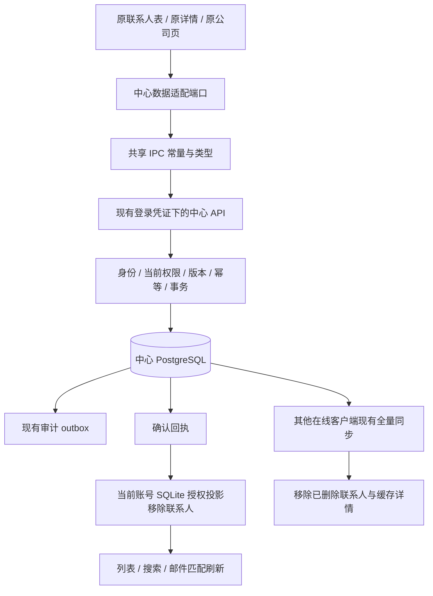

# 原客户生命周期接口接入 · 2026-10-16

范围：用户批准的公司新增、联系人删除、空公司删除。沿用原客户表、公司页及详情组件，不更换布局样式。工作区版本 0.45.0-alpha.1，未提交、推送或发布。

## 改动与验收

| 原入口 | 当前行为 | 验收方式 |
|---|---|---|
| 公司页新增 | 创建真实中心空公司，创建后选中；不伪造客户或联系人 | 新建测试公司，确认列表和详情可见 |
| 空公司删除 | 仅创建者或有全局权限的超级管理员可删；保留历史行 | 删除刚建的空公司；有关联资料的公司删除按钮禁用 |
| 联系人单条、批量及详情删除 | 中心确认后移出当前列表、搜索及本机邮件匹配；保留原行与历史 | 删除自己的测试联系人，搜索邮箱并检查匹配结果 |
| 受分配联系人 | 普通用户不能删除管理员原始线索 | 用户查看分配联系人，删除入口不可用 |
| 待接受分配 | 必须先撤回请求再删除；不会制造悬空待接受请求 | 管理员对待接受联系人尝试删除，操作被拦截 |

离线不开放本节点创建/删除。批量最多 200 条，混入无权删除或版本冲突记录时整批回滚，不部分删除。不要用真实线索做删除验收；当前没有恢复入口。

## 数据链路

删除事件写现有审计 outbox，**本节点没有新增消息中心删除推送协议**。其他客户端依赖现有周期同步（不是即时推送）；收到详情不存在回执时也移除对应缓存。离线设备只能在恢复连接后获知删除，不能保证离线缓存立即撤销。未更改旧邮箱正文文件、邮件证据或发送历史。

已删除/失去授权联系人的待上传邮件事件保留载荷并标记 `blocked`，不再阻塞其他联系人的正常同步；不冒充已上传，也不丢弃原事件。跨重启持久重试、恢复授权后的人工处理和完整冲突策略仍属于后续 N6。

## 结构与契约

新增迁移 `022-crm-lifecycle`，只增加列及索引，不新建业务表，不改旧迁移校验和：

| 表 | 新增列 | 目的 |
|---|---|---|
| public.contacts | crm_deleted_at timestamptz | 联系人软删除时间 |
| public.contacts | crm_deleted_by uuid → identity.users | 删除操作人 |
| public.companies | crm_created_by uuid → identity.users | 独立空公司创建者与可见范围 |
| public.companies | crm_deleted_at timestamptz | 公司软删除时间 |
| public.companies | crm_deleted_by uuid → identity.users | 删除操作人 |

增加 `idx_crm_companies_creator` 有效公司创建者索引。联系人删除递增既有 `crm_contact_version`；公司删除使用原始高精度 `updated_at::text`，不转毫秒字符串比较。保留联系人邮箱唯一约束，删除后不会自动用相同邮箱重建另一身份，避免历史邮件错误重挂。

公司只要存在任何联系人（含已删除）或客户记录就不可删除；任务、商机、分配与客户历史受客户外键关系间接保护。新建空公司没有这些关系。原新增联系人/单表导入仅复用本人显式创建、确实无关联的同名空公司，不根据全局名字合并别人的公司。

新增 5 个 IPC，均复用 `{ok,data?,error?}`，由共享常量供主进程契约、preload 与页面同源使用：

| IPC | 中心 HTTP | 数据 |
|---|---|---|
| online:company-list | GET /api/crm/companies | CompanyQuery → CompanyPage |
| online:company-detail | GET /api/crm/companies/:id | companyId/scope → CompanyDetail |
| online:company-create | POST /api/crm/companies | CompanyCreate → CompanyDetail |
| online:company-delete | POST /api/crm/companies/:id/delete | CompanyDelete → companyId |
| online:contact-delete | POST /api/crm/contacts/delete | ContactDelete → ContactDeleteReceipt |

公司独立查询是为了展示真实的零联系人公司，不能继续从联系人列表推导公司全集。没有第二套账号、CRM、删除通知或旧 SQLite 写接口；原公司编辑仍走已有 `online:company-update`。空公司创建后可增加联系人，但暂不支持其独立资料编辑/背调。

## 验证记录

- 常规全量：165 文件通过，27 文件条件跳过；1410 项通过，164 项条件跳过，无失败。条件中心测试另行隔离执行，跳过不当成通过。
- 隔离中心：37 文件、203 项通过；独立临时 PostgreSQL 已停止并回收。
- 端口与原生后端定向：5 项通过；覆盖未知结果原幂等键重试、混合无权批次、账号变化、离线写保护与公司独立版本。
- 实际完整 Electron 主进程、原 renderer/preload、原生 SQLite 与 HTTP/PostgreSQL 回滚验收 14 条通过，pageErrors=[]。验证原联系人表单条/多选删除、原表单创建公司、公司删除/保护、联系人详情删除、立即移出匹配与全局搜索、另一账号拒绝后清缓存、原邮件正文不变及真实账号切换退出进程。切换测试只抑制子进程重启，未替换业务入口。
- 桌面验收前后账号77、联系人1072、客户147、会话179、outbox154，数据计数一致；未留下合成线索或新测试账号。此前数次桌面脚本失败为测试定位器与匹配数据引用字段问题，已修正测试脚本后重跑，未据此改产品样式。
- typecheck、桌面/服务端构建、225源码0例外架构检查与检查器5项通过。
- 本机测试库迁移前已生成 before-022.pgdump（302351字节）且 pg_restore --list 通过。实际服务加载记录见下文。

完整 pre-node checkpoint：`D:/Agent Basement/checkpoints/prospector-lifecycle-20261016`。测试只使用固定 Agent 账号和合成事务数据，禁止留下临时新账号。未调用真实 SMTP、外部搜索或模型。

## 已知边界与下一节点

本节点不处理成交/任务自动撤销、删除恢复界面、硬删除/存储回收或 AI 删除工具；历史活动、邮件、分配、商机和任务事实保留，不假装级联完成。旧底层 SQLite 删除代码未移除，正式中心页面不调用它。忘记密码仍为已约定占位。后续优先 N6 的跨重启重试、版本冲突、撤权及待同步事件处置，按节点批准执行。

## 本机加载与收尾

2026-10-16 本机测试中心127.0.0.1:55844已加载新代码并应用022；live/ready均200，5个新接口匿名访问均401。只读确认5列齐全，业务数据计数仍为77/1072/147/179/154，未迁正式55846中心库或Navigator库。正式中心下次部署须先备份并按节点迁移。

桌面构建为0.45.0-alpha.1；已运行的旧窗口需使用托盘“重启应用”加载，不强行终止用户窗口。8份本次验收临时profile均已回收，无验收Electron残留。checkpoint/verified收存报告、最终源码与文档，原始pre-node备份保持不变。

知识库：项目状态、聚合审阅、项目入口与人用总览已同步；只读巡检ok=true、errors=[]。保留含并行改动的源码指纹待审阅提示，未重置全仓基线。
