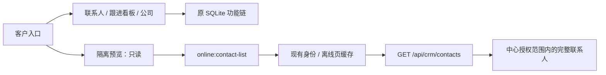

# 旧客户切换恢复与接口隔离预览

2026-10-14，工作区0.34.0-alpha.4，未发布。

## 原因与改动

恢复旧客户页时只挂了ContactList/CrmPipeline/CompanyPage，漏了原CustomersPage中的Segmented三视图切换。页面源码没有删除，但缺少入口。现按Git HEAD旧壳恢复“联系人/跟进看板/公司”，保留显式view深链；子页消费detail后清hash不能把看板切回联系人。

ContactList、CrmPipeline、CompanyPage、ContactDetail和useContacts五份源码hash与本节点改前一致；改动集中在LegacyCustomersPage壳、router新增路由与AppLayout新增路径适配。旧页面仍走旧SQLite，不改字段、行为或样式。

已接好的中心联系人查询增加独立CenterContactsPreview，入口为“客户”顶部右侧“隔离预览”，路径 `/customers-preview`。显示使用原列宽、文本/徽章样式、紧凑搜索/筛选/表格、同一主题和国家编码；查询复用useCenterContacts与原online:contact-list。这个预览是只读验收入口，不替换原ContactList，不冒充完整旧功能迁移。

## 用户可验收范围

进入“客户”：点击三个原标签，可看到原列表、原看板、原公司页。进入右上角“隔离预览”：读取当前登录身份获准访问的中心联系人，可搜索、按发送阶段/邮件状态/类型/标签/国家筛选、分页、切换显示列、刷新和返回。预览列偏好留在预览组件中，不覆写旧列偏好。

预览导出、导入、新增、邮件/跟进/删除按钮禁用；双击行暂不打开详情，不调用本地contacts:getById或写入/发送。中心ID不映射成旧SQLite id；出错显示错误，不把接口不可用伪装为成功的零联系人。

本节点没有新IPC/API、schema、依赖、配置或同步协议。本机中心旧进程仍对新路径返回404，已使用受控生命周期脚本重载；55844健康/就绪通过，无凭据查询现为401会话无效，证明端点存在并执行鉴权，未把401当已登录查询通过。已有账号、PG数据保留；客户端开发页面可热更新，不强制退出用户窗口。

## 验证与限制

17项定向测试通过：恢复三视图、深链消费保持视图、隔离入口、中心读取/分页、错误可见、禁止本地操作、IPC一致性与身份门禁。类型、桌面/中心构建及架构检查（204文件、0例外）通过。

隔离真实Electron/生产renderer/preload、真实ONLINE IPC及原生SQLite配合合成中心，实测八条交互链，1366×768和1040×660截图已检查，页面异常0。覆盖旧看板六栏、原公司页、预览搜索/分页/国家值、未接按钮禁用/双击不调用本地详情、返回原入口。临时账号只存在合成中心内存，无真实邮件外发或业务迁移；四个临时桌面资料已回收。证据.work/customer-tabs-preview/report.json与对应截图。

本轮不宣称真实账号HTTP/PG/桌面全链、全部旧写功能或像素一致性已认证。中心空数据时预览为空，不向业务库塞mock。此前真实PG联系人读取验收见center-contact-read-delivery-20261014.md。

## 后续执行规则

用户说“下一步”，先简述准备接的接口/组件、原因、提升与影响，待逐项确认再实施。每项接完必须开放可进入的对应隔离态，未接操作禁用。当前只读列表已可见，不继续接详情。

下一项候选：完整联系人详情只读，预览行双击后复用旧详情布局，以customerId/contactId定位并核查版本和归属；编辑和邮件往来保持未接，不能碰巧按数字ID调用本地服务。邮件匹配、历史补挂、时间线与发送账号另逐接口核对。本候选未实施、未视为已批准。

checkpoint：D:/Agent Basement/checkpoints/prospector-customer-tabs-preview-20261014。
