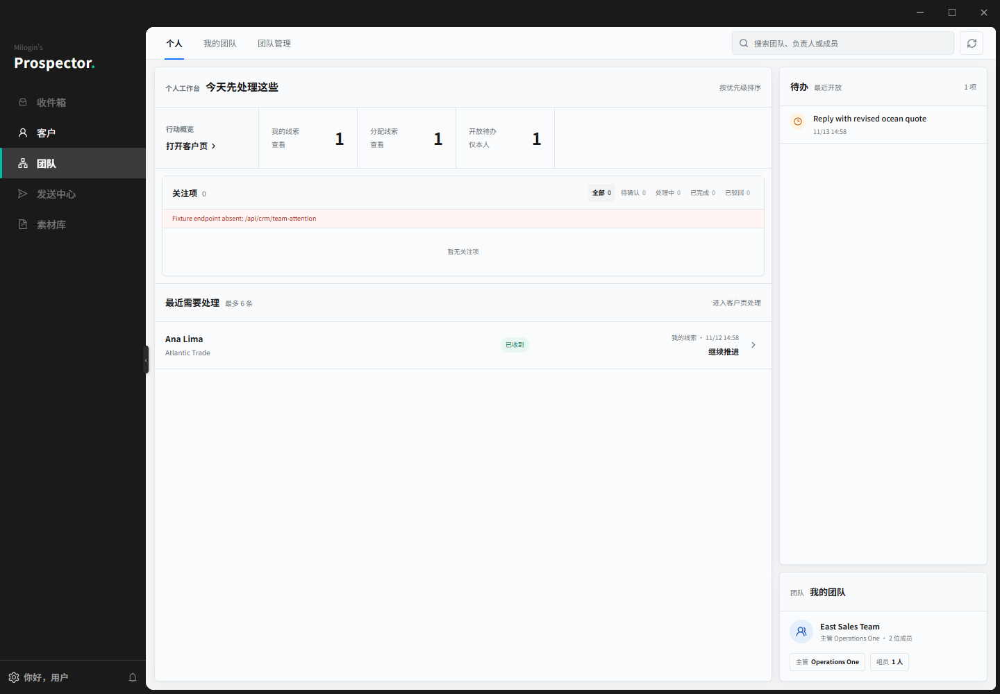

# Prospector 团队工作台落地备注

状态：树形团队、邀请、成员门禁和超级管理员团队范围已接入中心；团队工作台已与客户页去重。

从团队行动进入客户页后的真实联系人详情：[客户详情](prospector-team-sales-customer-detail-1440.png)。

## 当前实现

- 客户页是联系人、分配、公司、跟进、商机、邮件往来和客户写操作的唯一入口。
- 中心使用 `crm_teams`、`crm_team_members`、`crm_team_invitations` 和 `crm_team_idempotency` 保存团队关系、邀请与幂等回执；`crm_teams.parent_team_id` 保存上下游树。
- `/team` 通过 `online:team-context` 决定界面：未加入时只提供创建和待处理邀请；加入后才显示工作台和“我的团队”。
- 团队负责人可搜索中心账号、邀请成员和撤回邀请；成员只能查看团队名称、负责人和成员构成。
- 运营/管理员获得团队树，可进入团队详情、查看直属下级和成员；创建下级团队仅开放给超级管理员。
- 超级管理员自动拥有全部团队可见范围，但不写入成员关系，因此不出现在成员列表。
- 工作台仍只提供个人行动概览，不包含联系人表、搜索、分页、详情抽屉、编辑能力或账号成员目录。
- 工作台复用 `online:contact-list`，读取 `scope=personal` 与 `scope=assigned` 的总数及最多 8 条摘要，合并为最多 6 条待处理行动。
- 点击行动通过客户页深链携带 `centerContact` 与 `centerCustomer`，由客户页打开原有 `CenterContactDetail`；团队页不复制详情实现。
- 销售复用 `online:task-list?status=open` 展示本人最近开放待办。管理员不展示待办，因为现有接口没有本人过滤条件。
- 2026-11-12 更新：`TaskQuery` 已增加 `mine`，个人工作台对所有角色统一展示本人开放待办；上一条仅保留当时决策背景。
- `online:members` 不再由团队页调用。团队邀请使用独立 `online:team-candidates`，不把分配目录冒充团队关系。
- 创建页提供取消和“返回团队树”；团队详情提供“返回团队树”，树页始终保留“新建根团队”入口。
- 本节点新增 8 个 IPC/HTTP 接口、4 张 PostgreSQL 表和 052 父团队迁移，没有新增依赖；完整表格见 [团队中心交付](../team-foundation-delivery-20261029.md)。

## 权限边界

- “我的线索”只查询中心 `personal` 来源且当前账号为负责人/创建人的联系人。
- “分配线索”只查询中心 `assigned` 范围，继续由服务端联系人权限裁剪。
- 团队概览只显示当前账号有权读取的少量行动摘要；完整检索、批量选择、编辑、分配和邮件详情必须在客户页完成。
- 退信和自动回复属于正常业务状态，团队概览不使用异常或风险标签。

## 后端缺口

以下能力在中心现有契约中不存在，因此没有对应前端入口：

- 跨团队继承与树节点拖拽改父级。
- 移除成员、退出团队、解散团队和负责人转让。
- 负责人按成员查看线索及邮件的授权接口；不能复用普通联系人详情隐式越权。
- 按团队或成员聚合线索与邮件总量。
- 运营/管理员个人待办的“仅当前负责人”筛选。

这些缺口不能通过账号角色、联系人负责人字段、联系人分配组或现有分配账号目录替代。后续新增契约前必须先确认数据模型、授权边界、审计和迁移方案。

## 后续方向

个人工作台继续以服务端团队成员关系为门禁。负责人视图后续应由服务端解析可查看成员集合，再提供团队级负载和风险摘要；客户详情仍回到客户域，不复制第二套客户操作界面。

Coupler 的 Sales Team Performance Dashboard 仍留作后续团队看板参考，但不进入本轮真实数据实现。
