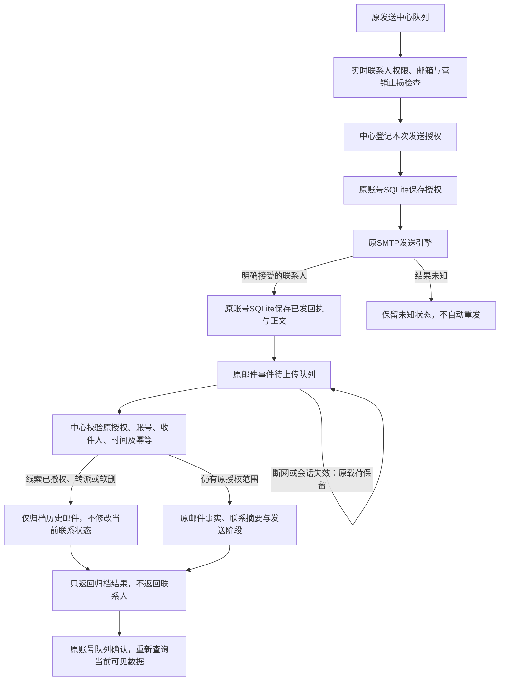

# 已发邮件在撤权后的补传归档（0.48.0-alpha.1）

## 本节点解决什么

用户批准的范围：邮件已经被SMTP服务器接受，但断网或线索撤权发生在回执上传之前，真实发送记录仍须进入中心。保持原客户、收件箱和发送中心布局，不增加导航或测试入口。

发送前登记一次授权，发送后凭原授权归档。撤权后不能查询联系人、修改资料或再发新邮件。迟到归档不修改当前负责人、联系人版本、发送轮次、触达摘要和最近跟进时间；已有正常记录不因后来撤权而被抹掉。

代价：每次中心联系人发送前增加一次HTTP登记、一次本地持久写入；授权日志随发送数量增长。中心不可用或授权无法安全落盘时停止新发送；SMTP结果未知时仍禁止自动重发。授权记录当前保留，不实现自动清理，避免提前删除防重放证据。

## 流转图

最大请求131072字节，容纳实际SMTP和一份IMAP原证据；原普通mail接口大小上限不变。

SMTP“接受”不等于送达或客户阅读。中心验证的是事前权限、一次发送身份与回执约束；实际SMTP接受沿用可信桌面报告，不是服务器自行取证。

## 中心数据库：025-send-acceptance

唯一DDL：`server/adapters/postgres/send-acceptance-schema.ts`。不改020、021、024等既有迁移。共新增一张18字段表及一个邮件事实字段，不新建CRM联系人副本。

### public.crm_send_authorizations

| 字段 | 类型 | 用途 |
|---|---|---|
| authorization_id | uuid主键 | 本次、此联系人的授权编号 |
| actor_id | uuid外键→identity.users | 真正的发送操作者，由登录会话确定 |
| send_key | text，1至256字符 | 原发送队列编号；相同账号同编号不得换内容或续期 |
| contact_id | integer外键→contacts | 授权联系人编号 |
| customer_id | uuid外键→crm_customers | 客户关系编号，与contact_id受复合外键保护 |
| recipient_email | text | 授权时联系人邮箱 |
| from_email | text | 原发件邮箱 |
| subject | text | 原发送主题 |
| authorized_recipients | jsonb数组 | 整次授权的联系人收件集合；实际接受只允许其中子集 |
| authorized_cc | jsonb数组 | 原请求抄送集合，不代表每个CC都被SMTP接受 |
| request_fingerprint | text | 规范化请求摘要，防相同编号换内容 |
| owner_user_id | uuid可空外键→identity.users | 授权时负责人，防转派后改动新负责人摘要 |
| allow_advance_stage | boolean | 原发送是否可按真实接受结果推进轮次 |
| issued_at | timestamptz | 中心签发时间 |
| expires_at | timestamptz | 发送发生窗口上界，不能用旧编号续期 |
| consumed_event_id | uuid可空、唯一外键→crm_contact_mail_events | 已消费的真实邮件事件，一事实不重复消费 |
| consumed_fingerprint | text可空 | SMTP实际回执与可选IMAP原证据摘要 |
| archived_after_revocation | boolean可空 | 消费时是否走仅历史归档分支；未消费为空 |

约束：`UNIQUE(actor_id,send_key,contact_id,customer_id)`；签发时间小于到期时间；消费编号/摘要/归档标志同时为空或同时有值。复用唯一索引的账号与发送编号前缀，不另建重复索引。

### public.crm_contact_mail_events 新增字段

`archive_only boolean NOT NULL DEFAULT false`：仅标记迟到且新建的历史事实，不参与当前触达、状态和最近跟进摘要，也不补推发送轮次。已有正常邮件保持false，后来撤权不能改变它已产生的真实贡献。原邮件详情查询仍保留该历史事件。

## 客户端数据库

本账号 `data/prospector.db` 新增 `crm_send_authorizations`：

| 字段 | 类型 | 用途 |
|---|---|---|
| send_key | text非空 | 原队列编号 |
| center_scope | text非空 | 中心URL与登录账号组成的作用域 |
| payload | text非空JSON | 原授权请求input及完整authorizations响应，绑定收发件人和主题 |
| recorded_at | text非空 | 本地持久保存时间 |

主键 `(send_key,center_scope)`。命名迁移 `v0.48-center-send-authorizations`，基础schema与迁移同源DDL位于 `src/main/core/center-send-storage.ts`。不存密码、Token或邮件正文；正文仍在原本地邮件存储。

原 `crm_send_receipts.payload.receipt` 增加可选 `authorizations`。SMTP在账号切换期间完成时，回执仍落原捕获的数据库和账号作用域；不能落到新账号。

原 `crm-offline.db.crm_contact_mail_events.payload` 增加本地队列字段 `sendAuthorizationId`，必要时增加 `smtpAcceptance`。它们不是普通邮件API的新字段；上传适配器拆为专用归档请求。完整扫描或单联系人撤权仍移除联系人，但不再阻塞有发送前授权的已发回执。普通失权邮件继续保留并阻塞，不绕过权限。

## 接口核对

无新增IPC、依赖或配置键。新增两个HTTP路径，各有独立职责，由同一会话鉴权和事务入口处理，统一返回 `{ok,data?,error?}`：

| 方法与路径 | 输入 | 输出 |
|---|---|---|
| POST /api/crm/send-authorizations | sendKey/fromEmail/subject/recipients/可选ccEmails | 逐联系人授权；只在全组实时校验成功后写入 |
| POST /api/crm/send-acceptances | authorizationId/event/可选observedEvent | eventId/duplicate/archivedAfterRevocation，不含联系人资料 |

原 `POST /api/crm/contact-mail-events` 继续实时校验当前线索权限，不接受授权编号或本地队列嵌套字段。归档接口只接受sent/outbound，无分类更正。授权属于当前操作者，联系权限撤销不等于可以绕过账号停用、会话失效或产品权限撤销。

发送发生窗口600秒，前后最多60秒时钟偏差；未来时间另受原300秒限制。补传上传本身可迟于窗口，但实际SMTP发生时间必须在原窗口内，过期编号不能重新签发。同授权同载荷重复只确认一次，变更收件人、CC、主题、发件人、时间或旧证据均不自动覆盖。

IMAP“已发送”先到时，保留原已提交事实的时间、正文摘要和digest。另传SMTP实际接受子集及时间；中心仅在原IMAP证据摘要与同邮件身份完全匹配时复用旧事实，不能借不同邮件证据消费授权。两者不相同时不覆盖历史，也不重复推进发送阶段。

## 验证与部署

- 普通全量最终回归：181文件1500项通过、30文件167项按环境条件跳过（含大请求容量边界）；无失败。
- 隔离中心全量：40文件206项通过；一次性PostgreSQL已停止并删除。旧R2测试已按管理员共享运营线索规则对齐，保留用户自有线索不可见断言，不为旧断言改回生产权限。
- 真实生产Electron主进程＋原renderer/preload＋原生SQLite＋HTTP/PostgreSQL事务回滚：10条链路通过，页面异常为空。覆盖正常共享发信、SMTP接受后断网、撤权、同profile重启自动补传、联系人不复活、新发送阻断及原历史渲染。
- 账号80、联系人1081、客户154、会话183、outbox158，事务前后逐项相等；这是验收时环境快照，不是项目固定数量。无持久测试账号或业务数据新增，无真实外发。3个本节点临时profile已删除，正文目录未改。
- 大请求边界与核心链专项6文件74项通过。类型、桌面/服务端构建通过；架构检查231源码、0例外，检查器5项自测通过。独立审查未发现剩余阻塞；按建议补齐旧证据跨邮件身份及窗口负例，并修复未来归档事实、归档事实干扰后续摘要的边界。
- checkpoint：`D:/Agent Basement/checkpoints/prospector-late-send-receipt-20261016`；迁前备份before-025.pgdump为321950字节，pg_restore目录核查通过。实现清单、受控验证证据随节点保存。
- 本机55844已备份重载025，live/ready=200；新两路及原mail匿名写均401；18字段授权表、archive_only与三个必要唯一索引实查通过，新授权0行、历史归档0行，业务数量未变。正式55846及Navigator未改，未推送/发布。
- 原renderer/preload对checkpoint逐文件摘要比较无改动。用户现有桌面从托盘“重启应用”加载，无需逐一关闭窗口。

## 如何验收

无需改变日常操作。原共享线索用本人邮箱发送后，拥有权限的一方能在原客户详情“往来记录”看到邮件；发送方原发送历史仍保留。撤销共享后，发送方不能打开该联系人或新发邮件；尚未上传但已有事前授权的已发记录可在恢复网络/登录后补传。

本节点已用假SMTP和事务回滚自动验证上述场景，不需要用户向真实客户发测试邮件。旧版本无事前授权的历史blocked回执不会伪造授权或自动解锁；SMTP结果未知不能当成已发。完整跨设备冲突处理、授权日志留存清理、云端持续营销任务仍是后续范围。

知识库：已同步项目入口、当前状态、聚合审阅及人用总览，结构检查ok。项目源码指纹仍含既有及并行变化待逐项复核，本节点按checkpoint核对，不重置全仓或其他项目基线。源码清单及验证证据保存在本节点checkpoint，不含账号凭据、临时profile或客户邮件。
