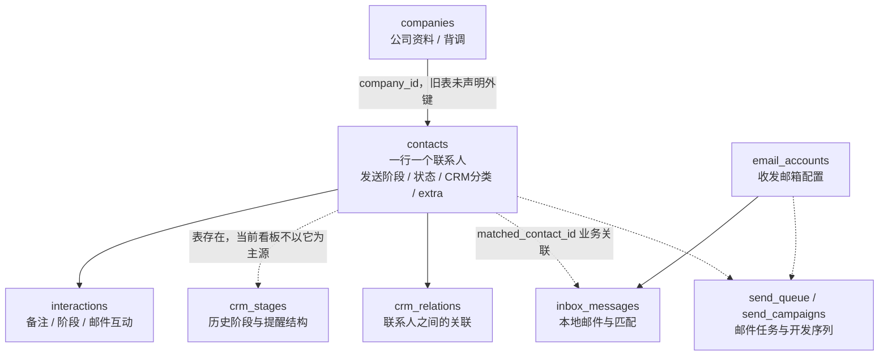
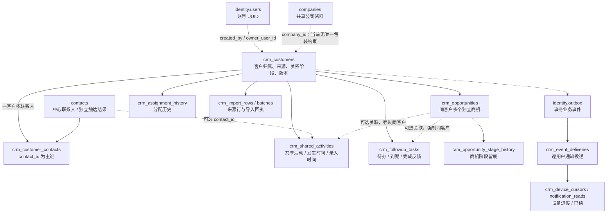
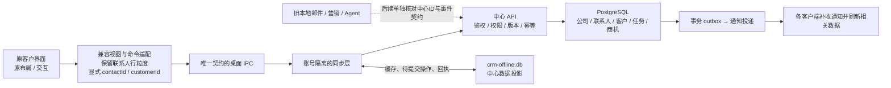

# 新旧 CRM 结构对比与预期映射 · 2026-10-14

状态：结构已只读核对；映射为候选方案，未批准、未实施。本轮不修改程序、IPC/API、表结构或业务数据。

## 依据与范围

- 旧库：只读读取项目 `data/prospector.db` 的 sqlite_master、PRAGMA table_info，并核对 `src/main/db/schema-sql.ts`、`schema/contacts.ts`、`schema/companies.ts`、`schema/crm.ts` 与实际业务 service。
- 中心库：只读事务查询当前项目测试 PostgreSQL 的 information_schema、pg_constraint 和迁移版本；已应用至 `018-opportunities`，有 34 张 public/identity 表。没有读取账号凭据、客户记录或邮件内容。
- 离线库：核对 `src/main/adapters/offline-crm-store.adapter.ts`、`src/main/core/offline-crm.ts` 与离线交付边界。本轮未打开各账号离线文件。
- UI：旧页面现在挂在 `/customers`，在线页保留在 `/customers-online`。恢复旧页面不表示其旧 IPC 已接中心。
- 此报告覆盖 Prospector；不代表 Navigator 业务库或邮件执行器已经迁入中心。

核心纠正：旧 contacts 的 21 个字段在中心 contacts 中全部保留，中心只多 crm_touch_status；companies 字段名完全一致。恢复失败不能主要归因于数据库字段缺失。主要断点是联系人列表与客户摘要的粒度差异、业务状态语义、身份权限、ID空间及未迁移的邮件/营销调用链。

## 1. 存储职责

| 存储 | 当前作用 | 不应误解为 |
|---|---|---|
| 旧 SQLite prospector.db | 原 contacts/companies/跟进；邮件、营销、Agent、模板、运价镜像和搜索仍使用它 | 已自动同步到中心的客户缓存 |
| 中心 PostgreSQL | identity 全局账号；public 中的公司、联系人、客户归属、共享跟进、任务、商机、导入和通知 | 已完成所有桌面业务在线化 |
| 按中心+用户隔离的 crm-offline.db | 中心客户快照、待同步操作、回执、版本与临时ID映射 | 另一套独立联系人主库 |

旧 SQLite 内“用于发信的邮箱账号”email_accounts 与中心“登录应用的用户”identity.users 是不同对象。

## 2. 旧库关系

旧跟进看板实际从 contacts.status='reached' 选联系人，从 tags 读六类 CRM 分类，从 extra.crmReminder 读提醒；最近联系合并 interactions 与 inbox_messages。不能仅看 crm_stages 表名就把它当作旧看板当前真源。

## 3. 中心库关系

约束核对：

- 一个客户可关联多个联系人；crm_customer_contacts.contact_id 是主键，所以一个联系人最多属于一个客户。当前不是多对多。
- companies.id 与 crm_customers.customer_id 分别标识公司资料和客户归属；公司整数 ID 不能替代客户 UUID。
- 当前没有 UNIQUE(crm_customers.company_id)，同一公司理论上可对应多条客户记录；这是实际约束允许的情况，不代表已批准的业务规则。
- contacts.email 在中心允许 NULL；非空邮箱仍由规范化表达式唯一索引去重。重复邮箱跨账号/客户如何流转须走明确业务规则，不能复制一条中心联系人规避归属。
- 商机负责人、任务负责人依客户归属派生；两张表不另存一份当前 owner，避免转派时漂移。
- 当前没有 crm_deals 表；成交由商机 closed_won、金额/币种/证据及阶段历史表达。不能声称独立成交事实表已实现。

## 4. 新旧表对照

| 旧 SQLite | 中心 PostgreSQL | 映射结论 |
|---|---|---|
| companies | companies | 字段名一致；ID重新对应，背调 JSON文本转换为 JSONB |
| contacts | contacts + crm_customer_contacts + crm_customers | 联系方式保留；客户归属和流通从联系人中分离 |
| contacts.assignee | crm_customers.owner_user_id → identity.users | 旧自由文本不能直接当账号身份；中心 UUID 是归属依据 |
| contacts.source/source_detail | contacts 来源字段 + crm_customers 来源字段/origin | 文件出处、客户出处、管理员/个人来源需分别解释，不由 source 字符串推断权限 |
| contacts.tags（当前 CRM 分类） | contacts.tags 兼容字段；新客户关系由 crm_customers.relationship_stage 表示 | 不能同时作为同一状态的可写真源；一客户多人分类冲突须先定业务粒度 |
| contacts.status | contacts.status + crm_touch_status | 原邮件结果与新触达结果分开；不能把 replied、bounced 等机械合并成同一个值 |
| contacts.stage | contacts.stage | 发送序列 cold/f1/f2/f3/f4；不能误当客户关系阶段或商机阶段 |
| contacts.extra.crmReminder | crm_followup_tasks | 单条提醒升级为多个可完成/延期的任务；旧备注保留，不能仅复制日期 |
| contacts.extra.crmPreferences | contacts.extra 现有 JSONB，可作为保留候选 | 现在线客户 DTO 未完整暴露；不认为有列就已经支持界面读写 |
| crm_stages | 无同名表；对应新关系阶段/活动/任务 | 旧看板当前不用该表作主源，不按表名直接搬 |
| interactions | interactions + crm_shared_activities | 中心 interactions 限 internal/crm 与 followup/stage；旧邮件事件不能原样插入 |
| crm_relations | crm_relations | 字段名基本一致，中心加防自关联/重复约束；两端 ID 不共享 |
| email_accounts / inbox_messages | 暂无完整中心对应表 | 邮箱配置和邮件往来尚未中心化，须单独批准事件同步及邮件归属契约 |
| send_queue / campaigns / targets | 暂无完整中心对应表 | 当前发送执行仍在桌面；关机后持续执行的中心 Worker 仍未落地 |
| templates / agent_* | 当前无完整中心对应 | 继续属于现有本机功能；不在客户表适配时顺手迁移 |
| rate_quotes / space_records | 当前无此中心表 | 现有运价查询镜像链路另行保留，不混入客户主数据 |
| 无 | crm_import_* / source_mappings | 导入原行、结果和来源引用 |
| 无 | crm_followup_tasks / due_receipts | 待办和到期通知防重复回执 |
| 无 | crm_opportunities / stage_history | 独立商机与推进记录 |
| 无 | identity.* / 通知投递表 | 登录、授权、审计和多端通知 |

## 5. 字段语义映射

| 界面概念 | 旧字段 | 预期中心真源 | 转换或约束 |
|---|---|---|---|
| 联系人身份 | contacts.id | contacts.id + customer_id | 必须明确为中心ID，禁止与本地整数ID互换 |
| 公司名称 | companies.name | companies.name | 通过中心 company_id 关联；不拿名称当唯一身份 |
| 联系方式/姓名/职务/语言 | contacts 对应字段 | contacts 对应字段 | 这些字段仍存在；现有 LeadContact DTO 未全部输出，需补契约 |
| 国家 | contacts.country / companies.country | 保留这两个不同字段 | 联系人国家不能被公司国家静默覆盖 |
| 联系人类型 | contacts.client_type | contacts.client_type | 不等同于客户 business_type（代理/直客等） |
| 邮件发送序列 | contacts.stage | contacts.stage 或未来发送任务进度 | 保留发送含义 |
| 邮件结果 | contacts.status | contacts.status / 可追溯邮件事件 | 保留回复、退信、自动回复等含义 |
| 是否实际触达 | status='reached' 的旧准入规则 | contacts.crm_touch_status | 新规则 contacted/replied；改阶段不伪造触达，当前两套规则未统一 |
| 客户关系 | contacts.tags 单选分类 | crm_customers.relationship_stage（候选） | 旧按联系人，新按客户；同客户联系人不同分类不能自动择一 |
| 商机推进 | 旧未独立建模 | crm_opportunities.stage | 独立于客户关系：询价/报价/谈判/订舱/成交/丢单 |
| 负责人 | assignee 文本 | owner_user_id | 必须指向中心用户，昵称/邮箱只供显示 |
| 来源类别 | source 文本 | origin | operations 显示管理员线索，personal 显示自有线索；不重命名存储枚举 |
| 跟进时间 | interactions.created_at / 邮件received_at | shared_activities.occurred_at | recorded_at只表示录入时间；备注/改阶段不能冒充真实联系 |
| 下一步 | extra.crmReminder | followup_tasks 的有效开放任务 | 任务列表支持多项，不只存一个日期 |

## 6. 预期对接图（候选，未实施）

列表应查询“当前身份可见客户下的所有联系人”，不把 online:list 的主联系人摘要当完整联系人清单。公司/客户视图需独立覆盖无联系人客户，不能为了列表显示强造联系人。

在线模式仍经过已有同步层；新联系人列表也必须评估离线缓存和失败行为，不能另造直连API而绕过已经实现的离线能力。

旧UI格式、JSON字符串及时间显示可在一处适配；后端与新契约继续使用规范对象/数组、ISO时间和统一Result。不为了复刻UI把中心JSONB改回文本，也不把中心联系人复制进旧SQLite当第二主库。

## 7. 接口核对顺序与未决点

1. 列表/筛选/分页/全选：确认联系人行粒度及权限一致；现有 PostgreSQL foundation 有联系人查询实现，但只支持基础搜索且无协作身份参数，不能直接当正式授权接口开放。优先扩展同业务的既有实现；确需新接口再列常量/类型/路由/调用点审批。
2. 详情：同一行传中心contactId及所属customerId，保留原详情UI，明确联系人字段与客户级标签。
3. 编辑/阶段/触达：先确定联系人分类与客户关系的业务粒度，再迁移写入，避免tags和relationship_stage双写漂移。
4. 导入/删除/批量操作：逐个复用或补齐中心授权、版本、幂等与回执；不让读取中心而写回旧库。
5. 看板/任务/商机：保留真实触达准入与旧外观，任务/商机按各自ID定位；解决按联系人与按客户的计数口径。
6. 邮件/营销/Agent：独立处理中心联系人关联与共享互动事件；收件箱和发信不得冒充已经在线化。

待确认的模型问题：一客户多联系人分类冲突如何处理；同公司多客户包装是否允许；全局同邮箱唯一约束遇到多账号导入如何合并或限制；离线联系人投影的查询与性能；邮件同步可见范围及持续执行Worker。此报告不默认批准任何结构变更。

## 8. 可追溯来源

### 2026-10-14 用户补充的验收边界

每项已有组件或接口更改先简述、逐项确认；新增项无需逐项汇报。原客户界面样式、布局和交互保持。用户指出的旧邮件功能已核对源码，后续逐接口纳入验收，不能把数据库替换缩减成联系人列表显示：

- inbox.service.ts 的邮箱匹配、多人地址关联、回复/退信/自动回复事件处理。
- inbox-link.ts 的新建/导入联系人后补挂历史邮件及补齐相关互动事件。
- contact.service.ts、crm.service.ts 的邮件往来/时间线：主匹配及抄送关联、邮件行与手工/退信记录合并、避免同邮件重复展示。
- send.service.ts 的发送互动、已发送邮件记录及历史发送账号关联。
- CRM看板、详情与Agent依赖的最近联系、状态、提醒及邮件定位。并非所有下游当前使用完全相同的匹配口径，逐项核对，不声称已统一。

上述是静态依赖确认，不是中心邮件对接已实现或端到端已通过。后续更改必须明确哪一环已接通、哪一环尚待确认；本轮没有代码、IPC/API或数据库变更。

- [旧联系人结构](../src/main/db/schema/contacts.ts)、[旧看板业务](../src/main/services/crm.service.ts)
- [中心基础结构](../server/adapters/postgres/schema.ts)、[客户关联结构](../server/adapters/postgres/lead-schema.ts)
- [客户来源](../server/adapters/postgres/customer-schema.ts)、[档案字段](../server/adapters/postgres/customer-profile-schema.ts)、[跟进结构](../server/adapters/postgres/followup-schema.ts)
- [任务结构](../server/adapters/postgres/task-schema.ts)、[商机结构](../server/adapters/postgres/opportunity-schema.ts)
- [现有查询DTO](../server/core/leads.ts)、[中心基础联系人仓储](../server/adapters/postgres/repository.ts)
- [离线交付边界](offline-crm-delivery-20261013.md)、[旧页面隔离说明](legacy-customer-ui-isolation-20261014.md)

以下附录由本轮只读结构快照生成，只记录字段结构，不记录业务行。中心测试库实况不等同于生产部署验收；SQLite快照是项目根旧库，不等同于每个账号文件已逐一检查。

## 附录 A：实际旧 SQLite 字段清单

### _migrations

| 字段 | 类型 | 非空 | 主键 | 默认值 |
|---|---|---|---|---|
| name | TEXT | 是 | 是 |  |
| applied_at | TEXT | 是 |  | CURRENT_TIMESTAMP |

### agent_conversations

| 字段 | 类型 | 非空 | 主键 | 默认值 |
|---|---|---|---|---|
| id | TEXT | 是 | 是 |  |
| title | TEXT | 是 |  | '新对话' |
| created_at | TEXT | 是 |  | CURRENT_TIMESTAMP |
| updated_at | TEXT | 是 |  | CURRENT_TIMESTAMP |
| archived_at | TEXT | 否 |  |  |

### agent_facts

| 字段 | 类型 | 非空 | 主键 | 默认值 |
|---|---|---|---|---|
| id | INTEGER | 是 | 是 |  |
| conversation_id | TEXT | 是 |  |  |
| tool_name | TEXT | 是 |  |  |
| fact | TEXT | 是 |  |  |
| created_at | TEXT | 是 |  | CURRENT_TIMESTAMP |

### agent_gaps

| 字段 | 类型 | 非空 | 主键 | 默认值 |
|---|---|---|---|---|
| id | INTEGER | 是 | 是 |  |
| wanted | TEXT | 是 |  |  |
| scene | TEXT | 否 |  |  |
| workaround | TEXT | 否 |  |  |
| hits | INTEGER | 是 |  | 1 |
| created_at | TEXT | 是 |  | CURRENT_TIMESTAMP |
| last_seen_at | TEXT | 是 |  | CURRENT_TIMESTAMP |

### agent_messages

| 字段 | 类型 | 非空 | 主键 | 默认值 |
|---|---|---|---|---|
| id | INTEGER | 是 | 是 |  |
| conversation_id | TEXT | 是 |  |  |
| role | TEXT | 是 |  |  |
| content | TEXT | 是 |  |  |
| created_at | TEXT | 是 |  | CURRENT_TIMESTAMP |

### agent_suggestions

| 字段 | 类型 | 非空 | 主键 | 默认值 |
|---|---|---|---|---|
| id | INTEGER | 是 | 是 |  |
| day | TEXT | 是 |  |  |
| group_name | TEXT | 是 |  |  |
| template | TEXT | 是 |  |  |
| source | TEXT | 是 |  |  |
| created_at | TEXT | 是 |  | CURRENT_TIMESTAMP |

### agent_tool_calls

| 字段 | 类型 | 非空 | 主键 | 默认值 |
|---|---|---|---|---|
| id | INTEGER | 是 | 是 |  |
| conversation_id | TEXT | 是 |  |  |
| tool_name | TEXT | 是 |  |  |
| side_effect | TEXT | 是 |  |  |
| args_json | TEXT | 否 |  |  |
| result_json | TEXT | 否 |  |  |
| approval | TEXT | 是 |  |  |
| error | TEXT | 否 |  |  |
| created_at | TEXT | 是 |  | CURRENT_TIMESTAMP |

### agent_working_memory

| 字段 | 类型 | 非空 | 主键 | 默认值 |
|---|---|---|---|---|
| id | INTEGER | 是 | 是 |  |
| conversation_id | TEXT | 是 |  |  |
| kind | TEXT | 是 |  |  |
| ref_id | TEXT | 是 |  |  |
| tool_name | TEXT | 是 |  |  |
| context_line | TEXT | 是 |  |  |
| payload_json | TEXT | 是 |  |  |
| created_at | TEXT | 是 |  | CURRENT_TIMESTAMP |
| updated_at | TEXT | 是 |  | CURRENT_TIMESTAMP |

### companies

| 字段 | 类型 | 非空 | 主键 | 默认值 |
|---|---|---|---|---|
| id | INTEGER | 是 | 是 |  |
| name | TEXT | 是 |  |  |
| domain | TEXT | 否 |  |  |
| industry | TEXT | 否 |  |  |
| country | TEXT | 否 |  |  |
| size | TEXT | 否 |  |  |
| backcheck_data | TEXT | 否 |  |  |
| created_at | TEXT | 是 |  | CURRENT_TIMESTAMP |
| updated_at | TEXT | 是 |  | CURRENT_TIMESTAMP |

### contacts

| 字段 | 类型 | 非空 | 主键 | 默认值 |
|---|---|---|---|---|
| id | INTEGER | 是 | 是 |  |
| email | TEXT | 是 |  |  |
| company_id | INTEGER | 否 |  |  |
| first_name | TEXT | 否 |  |  |
| last_name | TEXT | 否 |  |  |
| title | TEXT | 否 |  |  |
| phone | TEXT | 否 |  |  |
| linkedin | TEXT | 否 |  |  |
| country | TEXT | 否 |  |  |
| client_type | TEXT | 否 |  |  |
| language | TEXT | 否 |  |  |
| stage | TEXT | 否 |  | 'cold' |
| status | TEXT | 否 |  | '' |
| tags | TEXT | 否 |  |  |
| extra | TEXT | 否 |  | '{}' |
| assignee | TEXT | 否 |  | '' |
| source | TEXT | 否 |  | 'manual' |
| source_detail | TEXT | 否 |  |  |
| created_at | TEXT | 是 |  | CURRENT_TIMESTAMP |
| updated_at | TEXT | 是 |  | CURRENT_TIMESTAMP |

### crm_relations

| 字段 | 类型 | 非空 | 主键 | 默认值 |
|---|---|---|---|---|
| id | INTEGER | 是 | 是 |  |
| contact_id_a | INTEGER | 是 |  |  |
| contact_id_b | INTEGER | 是 |  |  |
| relation_type | TEXT | 是 |  |  |
| created_at | TEXT | 是 |  | CURRENT_TIMESTAMP |

### crm_stages

| 字段 | 类型 | 非空 | 主键 | 默认值 |
|---|---|---|---|---|
| id | INTEGER | 是 | 是 |  |
| contact_id | INTEGER | 是 |  |  |
| stage | TEXT | 是 |  |  |
| notes | TEXT | 否 |  |  |
| reminder_at | TEXT | 否 |  |  |
| reminder_note | TEXT | 否 |  |  |
| updated_at | TEXT | 是 |  | CURRENT_TIMESTAMP |

### email_accounts

| 字段 | 类型 | 非空 | 主键 | 默认值 |
|---|---|---|---|---|
| id | INTEGER | 是 | 是 |  |
| email | TEXT | 是 |  |  |
| provider | TEXT | 是 |  | 'smtp' |
| smtp_host | TEXT | 否 |  |  |
| smtp_port | INTEGER | 否 |  |  |
| imap_host | TEXT | 否 |  |  |
| imap_port | INTEGER | 否 |  |  |
| encrypted_pass | TEXT | 是 |  |  |
| display_name | TEXT | 否 |  |  |
| signature | TEXT | 否 |  |  |
| consecutive_fails | INTEGER | 是 |  | 0 |
| circuit_open_at | TEXT | 否 |  |  |
| circuit_reset_after | TEXT | 否 |  |  |
| circuit_reason | TEXT | 否 |  |  |
| last_fetch_error | TEXT | 否 |  |  |
| last_fetch_at | TEXT | 否 |  |  |
| fetch_fail_count | INTEGER | 是 |  | 0 |
| is_active | INTEGER | 是 |  | 1 |
| created_at | TEXT | 是 |  | CURRENT_TIMESTAMP |

### inbox_bounce_matches

| 字段 | 类型 | 非空 | 主键 | 默认值 |
|---|---|---|---|---|
| id | INTEGER | 是 | 是 |  |
| message_id | INTEGER | 是 |  |  |
| contact_id | INTEGER | 是 |  |  |
| created_at | TEXT | 是 |  | CURRENT_TIMESTAMP |

### inbox_messages

| 字段 | 类型 | 非空 | 主键 | 默认值 |
|---|---|---|---|---|
| id | INTEGER | 是 | 是 |  |
| account_id | INTEGER | 是 |  |  |
| message_id | TEXT | 否 |  |  |
| from_email | TEXT | 是 |  |  |
| from_name | TEXT | 否 |  |  |
| subject | TEXT | 否 |  |  |
| body_preview | TEXT | 否 |  |  |
| classification | TEXT | 否 |  |  |
| to | TEXT | 否 |  |  |
| cc | TEXT | 否 |  |  |
| my_role | TEXT | 否 |  |  |
| matched_contact_id | INTEGER | 否 |  |  |
| related_contact_ids | TEXT | 否 |  |  |
| is_read | INTEGER | 是 |  | 0 |
| received_at | TEXT | 是 |  |  |
| created_at | TEXT | 是 |  | CURRENT_TIMESTAMP |
| intent | TEXT | 否 |  |  |

### interactions

| 字段 | 类型 | 非空 | 主键 | 默认值 |
|---|---|---|---|---|
| id | INTEGER | 是 | 是 |  |
| contact_id | INTEGER | 是 |  |  |
| type | TEXT | 是 |  |  |
| direction | TEXT | 是 |  |  |
| channel | TEXT | 是 |  | 'email' |
| subject | TEXT | 否 |  |  |
| body_preview | TEXT | 否 |  |  |
| message_id | TEXT | 否 |  |  |
| account_id | INTEGER | 否 |  |  |
| metadata | TEXT | 否 |  |  |
| created_at | TEXT | 是 |  | CURRENT_TIMESTAMP |

### rate_quotes

| 字段 | 类型 | 非空 | 主键 | 默认值 |
|---|---|---|---|---|
| record_id | TEXT | 是 | 是 |  |
| pol | TEXT | 否 |  |  |
| pod_raw | TEXT | 是 |  |  |
| lane | TEXT | 否 |  |  |
| carrier | TEXT | 否 |  |  |
| container | TEXT | 否 |  |  |
| container_raw | TEXT | 否 |  |  |
| ocean_usd | INTEGER | 否 |  |  |
| validity_raw | TEXT | 否 |  |  |
| valid_from | TEXT | 否 |  |  |
| valid_to | TEXT | 否 |  |  |
| free_days | TEXT | 否 |  |  |
| shortfall_fee | TEXT | 否 |  |  |
| note | TEXT | 否 |  |  |
| source_group | TEXT | 否 |  |  |
| sender | TEXT | 否 |  |  |
| msg_time | TEXT | 否 |  |  |
| image_name | TEXT | 否 |  |  |
| etd | TEXT | 否 |  |  |
| status | TEXT | 否 |  |  |
| message_text | TEXT | 否 |  |  |
| synced_at | TEXT | 是 |  | CURRENT_TIMESTAMP |

### search_idx

| 字段 | 类型 | 非空 | 主键 | 默认值 |
|---|---|---|---|---|
| kind |  | 否 |  |  |
| sourceId |  | 否 |  |  |
| contactId |  | 否 |  |  |
| title |  | 否 |  |  |
| body |  | 否 |  |  |
| content |  | 否 |  |  |

### send_block_events

| 字段 | 类型 | 非空 | 主键 | 默认值 |
|---|---|---|---|---|
| id | INTEGER | 是 | 是 |  |
| account_id | INTEGER | 是 |  |  |
| message_id | TEXT | 是 |  |  |
| code | TEXT | 是 |  |  |
| excerpt | TEXT | 否 |  |  |
| occurred_at | TEXT | 是 |  |  |
| created_at | TEXT | 是 |  |  |

### send_campaign_targets

| 字段 | 类型 | 非空 | 主键 | 默认值 |
|---|---|---|---|---|
| id | INTEGER | 是 | 是 |  |
| campaign_id | TEXT | 是 |  |  |
| contact_id | INTEGER | 是 |  |  |
| status | TEXT | 是 |  | 'pending' |
| round | INTEGER | 是 |  | 0 |
| next_touch_at | TEXT | 否 |  |  |
| last_sent_at | TEXT | 否 |  |  |
| updated_at | TEXT | 是 |  | CURRENT_TIMESTAMP |

### send_campaigns

| 字段 | 类型 | 非空 | 主键 | 默认值 |
|---|---|---|---|---|
| id | TEXT | 是 | 是 |  |
| name | TEXT | 是 |  |  |
| status | TEXT | 是 |  | 'running' |
| auto_send | INTEGER | 是 |  | 1 |
| target_filter_json | TEXT | 是 |  | '{}' |
| touch_plan_json | TEXT | 是 |  |  |
| created_by | TEXT | 是 |  | 'agent' |
| account_policy | TEXT | 是 |  | 'rotate' |
| account_ids_json | TEXT | 否 |  |  |
| schedule_json | TEXT | 否 |  |  |
| send_mode | TEXT | 是 |  | 'individual' |
| created_at | TEXT | 是 |  | CURRENT_TIMESTAMP |
| updated_at | TEXT | 是 |  | CURRENT_TIMESTAMP |

### send_queue

| 字段 | 类型 | 非空 | 主键 | 默认值 |
|---|---|---|---|---|
| id | TEXT | 是 | 是 |  |
| batch_id | TEXT | 是 |  |  |
| campaign_id | TEXT | 否 |  |  |
| company_name | TEXT | 否 |  |  |
| company_id | INTEGER | 否 |  |  |
| recipients | TEXT | 是 |  |  |
| account_id | INTEGER | 是 |  |  |
| account_email | TEXT | 否 |  |  |
| subject | TEXT | 否 |  |  |
| tpl_body | TEXT | 否 |  |  |
| contact_vars | TEXT | 否 |  |  |
| cc | TEXT | 否 |  |  |
| tpl_name | TEXT | 否 |  |  |
| country | TEXT | 否 |  |  |
| language | TEXT | 否 |  |  |
| send_mode | TEXT | 是 |  | 'bcc' |
| status | TEXT | 是 |  | 'pending' |
| error | TEXT | 否 |  |  |
| sent_at | TEXT | 否 |  |  |
| created_at | TEXT | 是 |  | CURRENT_TIMESTAMP |
| error_kind | TEXT | 否 |  |  |

### space_records

| 字段 | 类型 | 非空 | 主键 | 默认值 |
|---|---|---|---|---|
| record_id | TEXT | 是 | 是 |  |
| pol | TEXT | 否 |  |  |
| pod_raw | TEXT | 否 |  |  |
| lane | TEXT | 否 |  |  |
| carrier | TEXT | 否 |  |  |
| container | TEXT | 否 |  |  |
| container_raw | TEXT | 否 |  |  |
| box_qty | TEXT | 否 |  |  |
| space_type | TEXT | 否 |  |  |
| vessel | TEXT | 否 |  |  |
| etd | TEXT | 否 |  |  |
| cutoff_raw | TEXT | 否 |  |  |
| price_usd | TEXT | 否 |  |  |
| note | TEXT | 否 |  |  |
| source_group | TEXT | 否 |  |  |
| sender | TEXT | 否 |  |  |
| msg_time | TEXT | 否 |  |  |
| image_name | TEXT | 否 |  |  |
| status | TEXT | 否 |  |  |
| synced_at | TEXT | 是 |  | CURRENT_TIMESTAMP |

### templates

| 字段 | 类型 | 非空 | 主键 | 默认值 |
|---|---|---|---|---|
| id | INTEGER | 是 | 是 |  |
| name | TEXT | 是 |  |  |
| language | TEXT | 是 |  |  |
| subject | TEXT | 是 |  |  |
| body | TEXT | 是 |  |  |
| category | TEXT | 否 |  |  |
| stage | TEXT | 否 |  |  |
| version | INTEGER | 是 |  | 1 |
| is_active | INTEGER | 是 |  | 1 |
| created_at | TEXT | 是 |  | CURRENT_TIMESTAMP |
| updated_at | TEXT | 是 |  | CURRENT_TIMESTAMP |

注：search_idx 的 FTS5 内部影子表未逐项展开；不属于独立业务实体。

## 附录 B：实际中心 PostgreSQL 字段与约束

### identity.audit

| 字段 | 类型 | 允许空值 | 默认值 |
|---|---|---|---|
| id | bigint | 否 |  |
| user_id | uuid | 是 |  |
| event | text | 否 |  |
| created_at | timestamp with time zone | 否 | now() |

主键、外键与检查约束：

- `CHECK ((event = ANY (ARRAY['login'::text, 'logout'::text, 'fixture'::text])))`
- `PRIMARY KEY (id)`
- `FOREIGN KEY (user_id) REFERENCES identity.users(user_id)`

### identity.credentials

| 字段 | 类型 | 允许空值 | 默认值 |
|---|---|---|---|
| user_id | uuid | 否 |  |
| password_hash | text | 否 |  |
| hash_scheme | text | 否 |  |
| changed_at | timestamp with time zone | 否 | now() |

主键、外键与检查约束：

- `CHECK ((hash_scheme = 'scrypt-v1'::text))`
- `PRIMARY KEY (user_id)`
- `FOREIGN KEY (user_id) REFERENCES identity.users(user_id)`

### identity.desktop_refresh_tokens

| 字段 | 类型 | 允许空值 | 默认值 |
|---|---|---|---|
| token_hash | text | 否 |  |
| session_id | uuid | 否 |  |
| absolute_expires_at | timestamp with time zone | 否 |  |
| idle_expires_at | timestamp with time zone | 否 |  |
| consumed_at | timestamp with time zone | 是 |  |
| created_at | timestamp with time zone | 否 | now() |

主键、外键与检查约束：

- `CHECK ((idle_expires_at <= absolute_expires_at))`
- `PRIMARY KEY (token_hash)`
- `FOREIGN KEY (session_id) REFERENCES identity.sessions(session_id)`
- `CHECK ((token_hash ~ '^[a-f0-9]{64}$'::text))`

### identity.login_emails

| 字段 | 类型 | 允许空值 | 默认值 |
|---|---|---|---|
| user_id | uuid | 否 |  |
| email | text | 否 |  |
| verified_at | timestamp with time zone | 是 |  |

主键、外键与检查约束：

- `CHECK (((email = lower(btrim(email))) AND (email <> ''::text)))`
- `UNIQUE (email)`
- `PRIMARY KEY (user_id)`
- `FOREIGN KEY (user_id) REFERENCES identity.users(user_id)`

### identity.management_audit

| 字段 | 类型 | 允许空值 | 默认值 |
|---|---|---|---|
| id | bigint | 否 |  |
| actor_id | uuid | 否 |  |
| target_id | uuid | 是 |  |
| action | text | 否 |  |
| product_id | text | 是 |  |
| reason | text | 否 |  |
| created_at | timestamp with time zone | 否 | now() |

主键、外键与检查约束：

- `FOREIGN KEY (actor_id) REFERENCES identity.users(user_id)`
- `PRIMARY KEY (id)`
- `FOREIGN KEY (product_id) REFERENCES identity.products(product_id)`
- `CHECK ((btrim(reason) <> ''::text))`
- `FOREIGN KEY (target_id) REFERENCES identity.users(user_id)`

### identity.management_challenges

| 字段 | 类型 | 允许空值 | 默认值 |
|---|---|---|---|
| token_hash | text | 否 |  |
| user_id | uuid | 否 |  |
| purpose | text | 否 |  |
| issuer_id | uuid | 否 |  |
| email | text | 否 |  |
| expires_at | timestamp with time zone | 否 |  |
| consumed_at | timestamp with time zone | 是 |  |
| created_at | timestamp with time zone | 否 | now() |

主键、外键与检查约束：

- `FOREIGN KEY (issuer_id) REFERENCES identity.users(user_id)`
- `PRIMARY KEY (token_hash)`
- `CHECK ((purpose = ANY (ARRAY['activate'::text, 'recover'::text])))`
- `CHECK ((token_hash ~ '^[a-f0-9]{64}$'::text))`
- `FOREIGN KEY (user_id) REFERENCES identity.users(user_id)`

### identity.outbox

| 字段 | 类型 | 允许空值 | 默认值 |
|---|---|---|---|
| event_id | uuid | 否 | gen_random_uuid() |
| event_type | text | 否 |  |
| user_id | uuid | 否 |  |
| product_id | text | 是 |  |
| revision | integer | 否 |  |
| created_at | timestamp with time zone | 否 | now() |
| customer_id | uuid | 是 |  |
| payload | jsonb | 否 | '{}'::jsonb |
| recipient_user_ids | ARRAY | 是 |  |

主键、外键与检查约束：

- `FOREIGN KEY (customer_id) REFERENCES crm_customers(customer_id)`
- `PRIMARY KEY (event_id)`
- `FOREIGN KEY (product_id) REFERENCES identity.products(product_id)`
- `FOREIGN KEY (user_id) REFERENCES identity.users(user_id)`

### identity.product_access

| 字段 | 类型 | 允许空值 | 默认值 |
|---|---|---|---|
| user_id | uuid | 否 |  |
| product_id | text | 否 |  |
| active | boolean | 否 | true |
| scope | text | 否 |  |
| capabilities | jsonb | 是 |  |

主键、外键与检查约束：

- `CHECK (((capabilities IS NULL) OR (jsonb_typeof(capabilities) = 'array'::text)))`
- `PRIMARY KEY (user_id, product_id)`
- `FOREIGN KEY (product_id) REFERENCES identity.products(product_id)`
- `CHECK ((scope = ANY (ARRAY['own'::text, 'shared'::text, 'summary'::text])))`
- `FOREIGN KEY (user_id) REFERENCES identity.users(user_id)`

### identity.product_grants

| 字段 | 类型 | 允许空值 | 默认值 |
|---|---|---|---|
| user_id | uuid | 否 |  |
| product_id | text | 否 |  |
| role | text | 否 |  |
| active | boolean | 否 | true |

主键、外键与检查约束：

- `PRIMARY KEY (user_id, product_id, role)`
- `CHECK ((product_id = 'crm'::text))`
- `CHECK ((role = ANY (ARRAY['admin'::text, 'operations'::text, 'sales'::text, 'auditor'::text])))`
- `FOREIGN KEY (user_id) REFERENCES identity.users(user_id)`

### identity.products

| 字段 | 类型 | 允许空值 | 默认值 |
|---|---|---|---|
| product_id | text | 否 |  |
| name | text | 否 |  |
| connected | boolean | 否 | false |
| description | text | 否 |  |

主键、外键与检查约束：

- `PRIMARY KEY (product_id)`

### identity.sessions

| 字段 | 类型 | 允许空值 | 默认值 |
|---|---|---|---|
| token_hash | text | 否 |  |
| user_id | uuid | 否 |  |
| security_revision | integer | 否 |  |
| expires_at | timestamp with time zone | 否 |  |
| revoked_at | timestamp with time zone | 是 |  |
| created_at | timestamp with time zone | 否 | now() |
| session_id | uuid | 否 | gen_random_uuid() |
| client | text | 否 | 'api'::text |

主键、外键与检查约束：

- `CHECK ((expires_at > created_at))`
- `CHECK ((client = ANY (ARRAY['api'::text, 'browser'::text])))`
- `PRIMARY KEY (token_hash)`
- `UNIQUE (session_id)`
- `CHECK ((token_hash ~ '^[a-f0-9]{64}$'::text))`
- `FOREIGN KEY (user_id) REFERENCES identity.users(user_id)`

### identity.users

| 字段 | 类型 | 允许空值 | 默认值 |
|---|---|---|---|
| user_id | uuid | 否 |  |
| display_name | text | 否 |  |
| active | boolean | 否 | true |
| identity_admin | boolean | 否 | false |
| security_revision | integer | 否 | 1 |
| created_at | timestamp with time zone | 否 | now() |
| management_revision | integer | 否 | 1 |
| must_change_password | boolean | 否 | false |
| deleted_at | timestamp with time zone | 是 |  |

主键、外键与检查约束：

- `CHECK (((deleted_at IS NULL) OR (NOT active)))`
- `CHECK ((btrim(display_name) <> ''::text))`
- `PRIMARY KEY (user_id)`
- `CHECK ((security_revision > 0))`

### public.companies

| 字段 | 类型 | 允许空值 | 默认值 |
|---|---|---|---|
| id | integer | 否 |  |
| name | text | 否 |  |
| domain | text | 是 |  |
| industry | text | 是 |  |
| country | text | 是 |  |
| size | text | 是 |  |
| backcheck_data | jsonb | 是 |  |
| created_at | timestamp with time zone | 否 | now() |
| updated_at | timestamp with time zone | 否 | now() |

主键、外键与检查约束：

- `CHECK (((backcheck_data IS NULL) OR (jsonb_typeof(backcheck_data) = 'object'::text)))`
- `CHECK ((btrim(name) <> ''::text))`
- `PRIMARY KEY (id)`

### public.contacts

| 字段 | 类型 | 允许空值 | 默认值 |
|---|---|---|---|
| id | integer | 否 |  |
| email | text | 是 |  |
| company_id | integer | 是 |  |
| first_name | text | 是 |  |
| last_name | text | 是 |  |
| title | text | 是 |  |
| phone | text | 是 |  |
| linkedin | text | 是 |  |
| country | text | 是 |  |
| client_type | text | 是 |  |
| language | text | 是 |  |
| stage | text | 否 | 'cold'::text |
| status | text | 否 | ''::text |
| tags | jsonb | 否 | '[]'::jsonb |
| extra | jsonb | 否 | '{}'::jsonb |
| assignee | text | 否 | ''::text |
| source | text | 否 | 'manual'::text |
| source_detail | text | 是 |  |
| created_at | timestamp with time zone | 否 | now() |
| updated_at | timestamp with time zone | 否 | now() |
| crm_touch_status | text | 否 | 'uncontacted'::text |

主键、外键与检查约束：

- `FOREIGN KEY (company_id) REFERENCES companies(id)`
- `CHECK ((crm_touch_status = ANY (ARRAY['uncontacted'::text, 'contacted'::text, 'replied'::text, 'unreachable'::text])))`
- `CHECK (((email = lower(btrim(email))) AND (email <> ''::text)))`
- `CHECK ((jsonb_typeof(extra) = 'object'::text))`
- `PRIMARY KEY (id)`
- `CHECK ((jsonb_typeof(tags) = 'array'::text))`

### public.crm_assignment_history

| 字段 | 类型 | 允许空值 | 默认值 |
|---|---|---|---|
| id | bigint | 否 |  |
| customer_id | uuid | 否 |  |
| owner_user_id | uuid | 否 |  |
| actor_id | uuid | 否 |  |
| created_at | timestamp with time zone | 否 | now() |

主键、外键与检查约束：

- `FOREIGN KEY (actor_id) REFERENCES identity.users(user_id)`
- `FOREIGN KEY (customer_id) REFERENCES crm_customers(customer_id)`
- `FOREIGN KEY (owner_user_id) REFERENCES identity.users(user_id)`
- `PRIMARY KEY (id)`

### public.crm_customer_contacts

| 字段 | 类型 | 允许空值 | 默认值 |
|---|---|---|---|
| customer_id | uuid | 否 |  |
| contact_id | integer | 否 |  |

主键、外键与检查约束：

- `FOREIGN KEY (contact_id) REFERENCES contacts(id)`
- `FOREIGN KEY (customer_id) REFERENCES crm_customers(customer_id)`
- `PRIMARY KEY (contact_id)`

### public.crm_customers

| 字段 | 类型 | 允许空值 | 默认值 |
|---|---|---|---|
| customer_id | uuid | 否 | gen_random_uuid() |
| company_id | integer | 否 |  |
| source | text | 否 |  |
| customer_key | text | 否 |  |
| source_detail | text | 否 |  |
| state | text | 否 | 'draft'::text |
| owner_user_id | uuid | 是 |  |
| created_by | uuid | 否 |  |
| version | integer | 否 | 1 |
| created_at | timestamp with time zone | 否 | now() |
| origin | text | 否 | 'operations'::text |
| business_type | text | 是 |  |
| development_restriction | text | 是 |  |
| source_created_at | timestamp with time zone | 是 |  |
| relationship_stage | text | 否 | 'cold'::text |
| stage_needs_review | boolean | 否 | false |
| legacy_stage_snapshot | jsonb | 否 | '[]'::jsonb |

主键、外键与检查约束：

- `CHECK (((state = 'owned'::text) = (owner_user_id IS NOT NULL)))`
- `FOREIGN KEY (company_id) REFERENCES companies(id)`
- `FOREIGN KEY (created_by) REFERENCES identity.users(user_id)`
- `CHECK ((origin = ANY (ARRAY['operations'::text, 'personal'::text])))`
- `FOREIGN KEY (owner_user_id) REFERENCES identity.users(user_id)`
- `PRIMARY KEY (customer_id)`
- `CHECK ((relationship_stage = ANY (ARRAY['cold'::text, 'reaching'::text, 'quoting'::text, 'trial'::text, 'cooperating'::text, 'lost'::text, 'other'::text])))`
- `UNIQUE (source, customer_key)`
- `CHECK ((state = ANY (ARRAY['draft'::text, 'published'::text, 'owned'::text, 'paused'::text])))`
- `CHECK ((version > 0))`

### public.crm_device_cursors

| 字段 | 类型 | 允许空值 | 默认值 |
|---|---|---|---|
| user_id | uuid | 否 |  |
| device_id | text | 否 |  |
| cursor | bigint | 否 | 0 |
| updated_at | timestamp with time zone | 否 | now() |

主键、外键与检查约束：

- `PRIMARY KEY (user_id, device_id)`
- `FOREIGN KEY (user_id) REFERENCES identity.users(user_id)`

### public.crm_event_deliveries

| 字段 | 类型 | 允许空值 | 默认值 |
|---|---|---|---|
| delivery_id | uuid | 否 | gen_random_uuid() |
| event_id | uuid | 否 |  |
| recipient_user_id | uuid | 否 |  |
| projection_type | text | 否 |  |
| delivery_seq | bigint | 否 |  |
| customer_id | uuid | 否 |  |
| event_type | text | 否 |  |
| version | integer | 否 |  |
| created_at | timestamp with time zone | 否 | now() |

主键、外键与检查约束：

- `FOREIGN KEY (customer_id) REFERENCES crm_customers(customer_id)`
- `CHECK ((delivery_seq > 0))`
- `FOREIGN KEY (event_id) REFERENCES identity.outbox(event_id)`
- `UNIQUE (event_id, recipient_user_id, projection_type)`
- `PRIMARY KEY (delivery_id)`
- `CHECK ((projection_type = 'lead'::text))`
- `UNIQUE (recipient_user_id, delivery_seq)`
- `FOREIGN KEY (recipient_user_id) REFERENCES identity.users(user_id)`

### public.crm_feed_heads

| 字段 | 类型 | 允许空值 | 默认值 |
|---|---|---|---|
| user_id | uuid | 否 |  |
| delivery_seq | bigint | 否 | 0 |

主键、外键与检查约束：

- `CHECK ((delivery_seq >= 0))`
- `PRIMARY KEY (user_id)`
- `FOREIGN KEY (user_id) REFERENCES identity.users(user_id)`

### public.crm_followup_tasks

| 字段 | 类型 | 允许空值 | 默认值 |
|---|---|---|---|
| task_id | uuid | 否 | gen_random_uuid() |
| customer_id | uuid | 否 |  |
| title | text | 否 |  |
| due_at | timestamp with time zone | 否 |  |
| status | text | 否 | 'open'::text |
| version | integer | 否 | 1 |
| created_by | uuid | 否 |  |
| created_at | timestamp with time zone | 否 | now() |
| updated_at | timestamp with time zone | 否 | now() |
| completed_at | timestamp with time zone | 是 |  |
| completed_by | uuid | 是 |  |
| feedback | text | 是 |  |
| opportunity_id | uuid | 是 |  |

主键、外键与检查约束：

- `CHECK ((((status = 'open'::text) AND (completed_at IS NULL) AND (completed_by IS NULL) AND (feedback IS NULL)) OR ((status = 'completed'::text) AND (completed_at IS NOT NULL) AND (completed_by IS NOT NULL) AND (feedback IS NOT NULL) AND (btrim(feedback) <> ''::text) AND (length(feedback) <= 20000))))`
- `FOREIGN KEY (completed_by) REFERENCES identity.users(user_id)`
- `FOREIGN KEY (created_by) REFERENCES identity.users(user_id)`
- `FOREIGN KEY (customer_id) REFERENCES crm_customers(customer_id)`
- `CHECK (isfinite(due_at))`
- `PRIMARY KEY (task_id)`
- `CHECK ((status = ANY (ARRAY['open'::text, 'completed'::text])))`
- `CHECK (((btrim(title) <> ''::text) AND (length(title) <= 500)))`
- `CHECK ((version > 0))`
- `FOREIGN KEY (opportunity_id, customer_id) REFERENCES crm_opportunities(opportunity_id, customer_id)`

### public.crm_import_batches

| 字段 | 类型 | 允许空值 | 默认值 |
|---|---|---|---|
| batch_id | uuid | 否 | gen_random_uuid() |
| actor_id | uuid | 否 |  |
| source | text | 否 |  |
| source_detail | text | 否 |  |
| mapping | jsonb | 否 | '{}'::jsonb |
| version | integer | 否 | 1 |
| created_at | timestamp with time zone | 否 | now() |

主键、外键与检查约束：

- `FOREIGN KEY (actor_id) REFERENCES identity.users(user_id)`
- `PRIMARY KEY (batch_id)`

### public.crm_import_rows

| 字段 | 类型 | 允许空值 | 默认值 |
|---|---|---|---|
| row_id | uuid | 否 | gen_random_uuid() |
| batch_id | uuid | 否 |  |
| row_index | integer | 否 |  |
| customer_key | text | 否 |  |
| raw_row | jsonb | 否 |  |
| customer_id | uuid | 是 |  |
| status | text | 否 |  |

主键、外键与检查约束：

- `FOREIGN KEY (batch_id) REFERENCES crm_import_batches(batch_id)`
- `UNIQUE (batch_id, row_index)`
- `FOREIGN KEY (customer_id) REFERENCES crm_customers(customer_id)`
- `PRIMARY KEY (row_id)`
- `CHECK ((status = ANY (ARRAY['created'::text, 'appended'::text, 'duplicate'::text, 'invalid'::text, 'unmatched'::text, 'ambiguous'::text, 'restricted_conflict'::text])))`

### public.crm_lead_idempotency

| 字段 | 类型 | 允许空值 | 默认值 |
|---|---|---|---|
| actor_id | uuid | 否 |  |
| operation | text | 否 |  |
| key | text | 否 |  |
| digest | text | 否 |  |
| response | jsonb | 否 |  |

主键、外键与检查约束：

- `FOREIGN KEY (actor_id) REFERENCES identity.users(user_id)`
- `PRIMARY KEY (actor_id, operation, key)`

### public.crm_notification_consumed

| 字段 | 类型 | 允许空值 | 默认值 |
|---|---|---|---|
| event_id | uuid | 否 |  |
| consumed_at | timestamp with time zone | 否 | now() |

主键、外键与检查约束：

- `FOREIGN KEY (event_id) REFERENCES identity.outbox(event_id)`
- `PRIMARY KEY (event_id)`

### public.crm_notification_reads

| 字段 | 类型 | 允许空值 | 默认值 |
|---|---|---|---|
| user_id | uuid | 否 |  |
| delivery_id | uuid | 否 |  |
| read_at | timestamp with time zone | 否 | now() |

主键、外键与检查约束：

- `FOREIGN KEY (delivery_id) REFERENCES crm_event_deliveries(delivery_id)`
- `PRIMARY KEY (user_id, delivery_id)`
- `FOREIGN KEY (user_id) REFERENCES identity.users(user_id)`

### public.crm_opportunities

| 字段 | 类型 | 允许空值 | 默认值 |
|---|---|---|---|
| opportunity_id | uuid | 否 | gen_random_uuid() |
| customer_id | uuid | 否 |  |
| title | text | 否 |  |
| description | text | 否 | ''::text |
| pol | text | 是 |  |
| pod | text | 是 |  |
| container_type | text | 是 |  |
| source | text | 否 | ''::text |
| stage | text | 否 | 'inquiry'::text |
| amount | numeric | 是 |  |
| currency | text | 是 |  |
| lost_reason | text | 是 |  |
| evidence | text | 是 |  |
| version | integer | 否 | 1 |
| created_by | uuid | 否 |  |
| created_at | timestamp with time zone | 否 | now() |
| updated_at | timestamp with time zone | 否 | now() |
| closed_at | timestamp with time zone | 是 |  |
| closed_by | uuid | 是 |  |

主键、外键与检查约束：

- `CHECK ((((amount IS NULL) AND (currency IS NULL)) OR ((amount IS NOT NULL) AND (currency IS NOT NULL) AND (amount >= (0)::numeric) AND (amount < power((10)::numeric, (12)::numeric)) AND (scale(amount) <= 2) AND (currency ~ '^[A-Z]{3}$'::text))))`
- `CHECK ((((stage = ANY (ARRAY['closed_won'::text, 'closed_lost'::text])) AND (closed_at IS NOT NULL) AND (closed_by IS NOT NULL)) OR ((stage <> ALL (ARRAY['closed_won'::text, 'closed_lost'::text])) AND (closed_at IS NULL) AND (closed_by IS NULL))))`
- `CHECK ((((stage = 'closed_won'::text) AND (evidence IS NOT NULL) AND (amount IS NOT NULL) AND (lost_reason IS NULL)) OR ((stage = 'closed_lost'::text) AND (lost_reason IS NOT NULL) AND (evidence IS NULL)) OR ((stage <> ALL (ARRAY['closed_won'::text, 'closed_lost'::text])) AND (evidence IS NULL) AND (lost_reason IS NULL))))`
- `FOREIGN KEY (closed_by) REFERENCES identity.users(user_id)`
- `CHECK ((length(container_type) <= 128))`
- `FOREIGN KEY (created_by) REFERENCES identity.users(user_id)`
- `FOREIGN KEY (customer_id) REFERENCES crm_customers(customer_id)`
- `CHECK ((length(description) <= 20000))`
- `CHECK (((btrim(evidence) <> ''::text) AND (length(evidence) <= 4096)))`
- `CHECK (((btrim(lost_reason) <> ''::text) AND (length(lost_reason) <= 2000)))`
- `UNIQUE (opportunity_id, customer_id)`
- `PRIMARY KEY (opportunity_id)`
- `CHECK ((length(pod) <= 128))`
- `CHECK ((length(pol) <= 128))`
- `CHECK ((length(source) <= 500))`
- `CHECK ((stage = ANY (ARRAY['inquiry'::text, 'quote_sent'::text, 'negotiation'::text, 'booking_confirmed'::text, 'closed_won'::text, 'closed_lost'::text])))`
- `CHECK (((btrim(title) <> ''::text) AND (length(title) <= 500)))`
- `CHECK ((version > 0))`

### public.crm_opportunity_stage_history

| 字段 | 类型 | 允许空值 | 默认值 |
|---|---|---|---|
| history_id | uuid | 否 | gen_random_uuid() |
| opportunity_id | uuid | 否 |  |
| from_stage | text | 是 |  |
| to_stage | text | 否 |  |
| actor_id | uuid | 否 |  |
| occurred_at | timestamp with time zone | 否 | clock_timestamp() |
| amount | numeric | 是 |  |
| currency | text | 是 |  |
| lost_reason | text | 是 |  |
| evidence | text | 是 |  |

主键、外键与检查约束：

- `FOREIGN KEY (actor_id) REFERENCES identity.users(user_id)`
- `CHECK ((((amount IS NULL) AND (currency IS NULL)) OR ((amount IS NOT NULL) AND (currency IS NOT NULL) AND (amount >= (0)::numeric) AND (amount < power((10)::numeric, (12)::numeric)) AND (scale(amount) <= 2) AND (currency ~ '^[A-Z]{3}$'::text))))`
- `CHECK ((from_stage IS DISTINCT FROM to_stage))`
- `CHECK ((((to_stage = 'closed_won'::text) AND (evidence IS NOT NULL) AND (btrim(evidence) <> ''::text) AND (length(evidence) <= 4096) AND (amount IS NOT NULL) AND (lost_reason IS NULL)) OR ((to_stage = 'closed_lost'::text) AND (lost_reason IS NOT NULL) AND (btrim(lost_reason) <> ''::text) AND (length(lost_reason) <= 2000) AND (evidence IS NULL)) OR ((to_stage <> ALL (ARRAY['closed_won'::text, 'closed_lost'::text])) AND (evidence IS NULL) AND (lost_reason IS NULL))))`
- `CHECK ((from_stage = ANY (ARRAY['inquiry'::text, 'quote_sent'::text, 'negotiation'::text, 'booking_confirmed'::text, 'closed_won'::text, 'closed_lost'::text])))`
- `FOREIGN KEY (opportunity_id) REFERENCES crm_opportunities(opportunity_id)`
- `PRIMARY KEY (history_id)`
- `CHECK ((to_stage = ANY (ARRAY['inquiry'::text, 'quote_sent'::text, 'negotiation'::text, 'booking_confirmed'::text, 'closed_won'::text, 'closed_lost'::text])))`

### public.crm_relations

| 字段 | 类型 | 允许空值 | 默认值 |
|---|---|---|---|
| id | integer | 否 |  |
| contact_id_a | integer | 否 |  |
| contact_id_b | integer | 否 |  |
| relation_type | text | 否 |  |
| created_at | timestamp with time zone | 否 | now() |

主键、外键与检查约束：

- `CHECK ((contact_id_a <> contact_id_b))`
- `UNIQUE (contact_id_a, contact_id_b, relation_type)`
- `FOREIGN KEY (contact_id_a) REFERENCES contacts(id)`
- `FOREIGN KEY (contact_id_b) REFERENCES contacts(id)`
- `PRIMARY KEY (id)`

### public.crm_schema_migrations

| 字段 | 类型 | 允许空值 | 默认值 |
|---|---|---|---|
| version | text | 否 |  |
| checksum | text | 否 |  |
| applied_at | timestamp with time zone | 否 | now() |

主键、外键与检查约束：

- `PRIMARY KEY (version)`

### public.crm_shared_activities

| 字段 | 类型 | 允许空值 | 默认值 |
|---|---|---|---|
| id | bigint | 否 |  |
| customer_id | uuid | 否 |  |
| interaction_id | integer | 是 |  |
| actor_id | uuid | 否 |  |
| note | text | 否 |  |
| stage | text | 是 |  |
| created_at | timestamp with time zone | 否 | now() |
| method | text | 否 | 'legacy'::text |
| occurred_at | timestamp with time zone | 否 | now() |
| recorded_at | timestamp with time zone | 否 | now() |
| contact_id | integer | 是 |  |
| contact_status | text | 是 |  |
| opportunity_id | uuid | 是 |  |

主键、外键与检查约束：

- `FOREIGN KEY (opportunity_id, customer_id) REFERENCES crm_opportunities(opportunity_id, customer_id)`
- `CHECK (((contact_status IS NULL) OR ((contact_id IS NOT NULL) AND (method <> ALL (ARRAY['note'::text, 'legacy'::text])))))`
- `FOREIGN KEY (actor_id) REFERENCES identity.users(user_id)`
- `FOREIGN KEY (contact_id) REFERENCES contacts(id)`
- `CHECK ((contact_status = ANY (ARRAY['uncontacted'::text, 'contacted'::text, 'replied'::text, 'unreachable'::text])))`
- `FOREIGN KEY (customer_id) REFERENCES crm_customers(customer_id)`
- `FOREIGN KEY (interaction_id) REFERENCES interactions(id)`
- `CHECK ((method = ANY (ARRAY['legacy'::text, 'email'::text, 'phone'::text, 'visit'::text, 'other'::text, 'note'::text])))`
- `PRIMARY KEY (id)`

### public.crm_task_due_receipts

| 字段 | 类型 | 允许空值 | 默认值 |
|---|---|---|---|
| task_id | uuid | 否 |  |
| task_version | integer | 否 |  |
| responsible_user_id | uuid | 否 |  |
| event_id | uuid | 否 |  |

主键、外键与检查约束：

- `FOREIGN KEY (event_id) REFERENCES identity.outbox(event_id)`
- `UNIQUE (event_id)`
- `PRIMARY KEY (task_id, task_version)`
- `FOREIGN KEY (responsible_user_id) REFERENCES identity.users(user_id)`
- `FOREIGN KEY (task_id) REFERENCES crm_followup_tasks(task_id)`
- `CHECK ((task_version > 0))`

### public.crm_workbook_source_mappings

| 字段 | 类型 | 允许空值 | 默认值 |
|---|---|---|---|
| actor_id | uuid | 否 |  |
| source | text | 否 |  |
| origin | text | 否 |  |
| entity | text | 否 |  |
| source_ref | text | 否 |  |
| customer_ref | text | 否 |  |
| customer_id | uuid | 否 |  |
| contact_id | integer | 是 |  |
| created_at | timestamp with time zone | 否 | now() |

主键、外键与检查约束：

- `FOREIGN KEY (actor_id) REFERENCES identity.users(user_id)`
- `CHECK (((entity = 'contact'::text) = (contact_id IS NOT NULL)))`
- `FOREIGN KEY (contact_id) REFERENCES contacts(id)`
- `FOREIGN KEY (customer_id) REFERENCES crm_customers(customer_id)`
- `CHECK ((entity = ANY (ARRAY['customer'::text, 'contact'::text])))`
- `CHECK ((origin = ANY (ARRAY['personal'::text, 'operations'::text])))`
- `PRIMARY KEY (actor_id, source, origin, entity, source_ref)`

### public.interactions

| 字段 | 类型 | 允许空值 | 默认值 |
|---|---|---|---|
| id | integer | 否 |  |
| contact_id | integer | 否 |  |
| type | text | 否 |  |
| direction | text | 否 | 'internal'::text |
| channel | text | 否 | 'crm'::text |
| body_preview | text | 是 |  |
| metadata | jsonb | 否 | '{}'::jsonb |
| created_at | timestamp with time zone | 否 | now() |

主键、外键与检查约束：

- `CHECK ((channel = 'crm'::text))`
- `FOREIGN KEY (contact_id) REFERENCES contacts(id)`
- `CHECK ((direction = 'internal'::text))`
- `CHECK ((jsonb_typeof(metadata) = 'object'::text))`
- `PRIMARY KEY (id)`
- `CHECK ((type = ANY (ARRAY['followup'::text, 'stage'::text])))`

注：邮箱规范化唯一约束是表达式唯一索引，不在上述pg_constraint清单中；定义已另与schema.ts核对。

## 附录 C：离线库结构（依据源码）

仅一张 `crm_offline_state(key TEXT PRIMARY KEY, value TEXT NOT NULL)` 表；value 为 JSON 工作集。

| JSON项 | 用途 |
|---|---|
| permissionKey / bootstrap | 当前授权边界和启动信息 |
| customers / views / cache | 客户详情、视图索引、已获取的查询结果 |
| outbox | 待同步、失败或冲突操作 |
| receipts | 幂等摘要及响应回执 |
| aliases / contacts / versions | 临时实体ID、中心联系人ID及版本映射 |
| nextContactId | 离线临时联系人ID分配 |
| lastSyncedAt / lastAttemptAt / lastError | 同步状态与错误 |

当前使用整个JSON工作集的事务存储；没有独立的离线contacts关系表，不应假定可无代价进行大规模关系查询。
