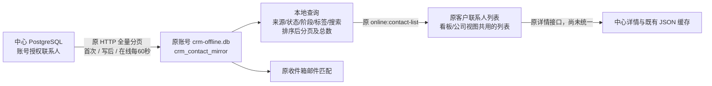

# 联系人列表统一本地读取

2026-10-15；0.37.0-alpha.1，工作区实施，未发布或推送。用户批准前一节点“联系人列表读取接口：本地统一数据、联网刷新、离线读取、原筛选/排序/分页/总数”。原前端文件、布局和交互不修改；详情入口及发送/AI完整迁移仍是下一节点。

## 实现

- 复用原`online:contact-list`参数/响应与原`/api/crm/contacts`刷新接口，没有新增IPC、HTTP路由、依赖、配置或新的数据库文件。CONTACT_DETAIL保持原路由。
- `contact-local-read.service`只通过端口读取账号投影，`contactMirrorPage`纯函数按完整授权集合先筛选、排序，再分页，独立计算total。线上已有请求验证保留，客户端传入账号/归属等额外字段仍拒绝。
- 来源personal/assigned按origin和当前owner判定；accepted按真实`assignmentStatus`而非有负责人推断。中心联系人DTO增加可选assignmentStatus(pending/accepted/null)，现有数据库子查询直接输出，不新增中心表或存储派生来源标签。
- 保留发送stage、原status/tags、关系阶段的独立含义；搜索邮箱、姓名、职位、公司，大小写不敏感，百分号/下划线/感叹号按文字匹配。普通列表按updatedAt、ID降序；followupOnly排除未触达，按真实lastFollowupAt优先排序。
- 原本地SQLite新增单行`crm_contact_mirror_meta(id=1,permission_key,format_version)`，只标记已完成、兼容的完整快照。单条回执upsert不标完整，零联系人完整快照合法；失败或分页中断不能替换已有完整快照。旧缓存缺标记或accepted字段时必须联网完成一次新格式同步，不把旧快照冒充完整。
- 同一账号本地读取复用现有身份及离线授权期限；快照绑定角色/能力指纹，权限变化后重新同步；已观察到的中心FORBIDDEN拒绝失效联系人投影，收件匹配同步停用。不是完整远端撤权/冲突/增量删除方案，断网不能即时发现服务器上的权限变化。
- 确认写回仍立即更新相同镜像，后台保持既有60秒刷新；页面原5秒轮询现在读取本地，无需为每个搜索条件访问中心或保存独立查询页。首次完整同步仍需要网络，后台跨端变更存在刷新间隔。

## 核查与证据

先加入失败用例再实现。36项核心读取/镜像测试首轮通过，61项受影响读取/同步/契约回归通过。真实PG外层回滚3项验收通过，其中用户/管理员/超级管理员21组查询逐一对照中心和本地结果；包括来源、接受、触达、关系阶段、百分号搜索、分页和总数。

最终验证：串行全量149文件/1232项通过，24文件/153项条件跳过；上述PG三项已另启用实际数据库验证。desktop/server类型检查、最终三段构建、架构213源码/0例外及5项检查器测试通过；7份原UI/共享通道文件与checkpoint哈希一致。并行全量先后遇到旧依赖读取UNKNOWN和旧tasks-http大请求ECONNRESET，分别单跑14/4项通过，未修改范围外实现；最终串行全量通过不代表这些并发偶发错误已修复。对应日志`.work/local-contact-tests-serial.log`、`.work/local-contact-build-final.log`，运行十项报告ok=true、pageErrors=[]。

本机中心受控停止/启动后健康读回通过，已加载新的派生字段；当前用户窗口保留，需托盘重启应用加载新主进程。知识库当前状态、审阅和人用总览已同步；源码指纹范围外待复核保持，不更新整体基线消警。

知识库只读巡检ok=true、errors为空；Prospector与运价台账旧指纹待复核保留，不将本轮范围外差异标成已审查。

实际生产main/preload/renderer+原生SQLite+PG/HTTP验收：接受分配和兄弟联系人隔离；邮件事实及确认回执；旧同号ID/FK保护；原邮件正文及详情；中心写后本地更新；重复事件去重；离线新组合查询无中心列表请求；断网重启恢复账号和已同步列表；新设备重新下载同账号授权联系人；观察到权限变化/中心拒绝后本地与匹配停用。证据`.work/local-contact-read/report.json`及offline-contact-list.png、replacement-contact-list.png；等待截图加载结束再核对原界面。只使用固定agent测试账号及回滚事务，无真实邮件外发，临时资料成功后回收。

checkpoint：`D:/Agent Basement/checkpoints/prospector-local-contact-read-20261015`，包含改动前源码、测试、文档、版本与工作区diff。本轮不删除旧历史contacts，也未重新编号。

## 验收及边界

中心加载更新后，从系统托盘“重启应用”加载新主进程，联网等待首次完整同步。客户列表搜索、来源、状态/阶段/标签及分页应保持原效果；断网后使用此前没有用过的筛选组合，结果及总数仍可查询；断网重启后保留已同步列表。在另一份干净设备资料中登录同一账号，已同步联系人ID不变，未授权的同公司联系人不出现。

本次只统一联系人列表读取，详情活动/邮件全文仍使用其既有接口，发送、AI、旧历史迁移以及更广用户数据归档待逐项接入。新设备测试证明已同步联系人恢复，不证明邮件原文、附件、个人模板或未上传变化可完整恢复。不宣称大容量压测或全部CRM功能迁移；本地列表目前按完整投影筛选，尚未实现索引化条件查询。最多沿用既有1000页×100条扫描限制，超过范围不接受半份数据。
