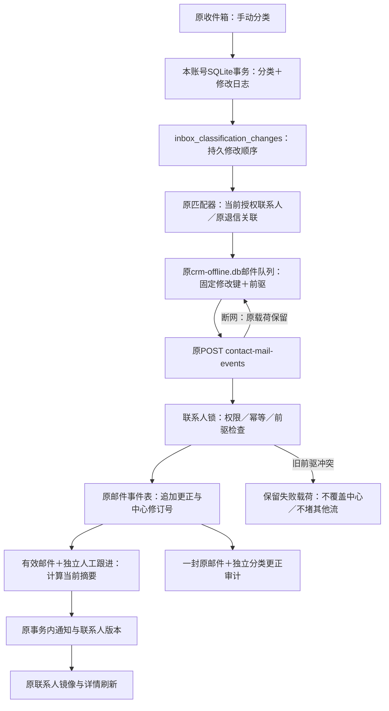

# 邮件分类更正同步（0.47.0-alpha.1）

## 原因、效果与边界

用户批准本节点：原收件箱分类操作此前按“邮件+分类”生成固定事件键。自动回复→其他→自动回复会命中旧事件，无法表达先后修改；改成其他也不能撤销原分类对当前状态的贡献。本节点保留原收件箱布局、分类菜单和联系人详情，把人工修改记录为追加式更正，而非重复收信。

更正影响该邮件当前有效分类及由此计算的联系人邮件/触达摘要；原邮件、旧活动、原收信时间、正文和独立人工跟进保留。发送轮次及已发送事实不回退，更正不再次触发营销止损/恢复。不能通过收件分类菜单伪造已发送。

## 数据流

管理员与用户使用同一中心数据。修改日志先落盘，`inbox:classify` 的成功仅表示本地已保存；中心回执确认后原队列才标为已确认。`queued` 仅表示日志已经变成待上传邮件事件，不是已同步。不同邮件独立推进，同一邮件的更正按先后顺序上传。

## 数据库增量

### 中心 PostgreSQL：原 public.crm_contact_mail_events 增加2列

| 字段 | 类型 | 含义 |
|---|---|---|
| classification_correction | jsonb，可空 | 目标分类及前一条更正的事件键；旧事实为空 |
| classification_revision | integer，可空 | 中心在该流上分配的递增更正序号，正整数；旧事实为空 |

更正流按 `actor_id + mailbox_key + message_key + contact_id + customer_id` 区分。首次更正前驱为空；之后必须指向中心最新更正。JSON只允许 `previousEventKey` 和 `classification`，分类为other/replied/autoreply/bounced。other对应received事件，入站且不允许发送阶段标记。同键同载荷重放返回既有回执；不同载荷或旧前驱报冲突。原邮件时间与收发人不得随更正改变。

迁移 `024-mail-classification-correction`；增加更正序号唯一索引、邮件流检索索引及活动关联部分索引。原020/021迁移不改，原事件不删除。DDL：`server/adapters/postgres/contact-mail-correction-schema.ts`。

### 本账号 SQLite：data/prospector.db 新增 inbox_classification_changes

| 字段 | 类型 | 含义 |
|---|---|---|
| id | integer主键自增 | 本地修改顺序，不能代替中心编号 |
| change_key | text唯一、非空 | 本次人工操作的固定UUID，重试不能换键 |
| center_scope | text非空 | 中心地址与账号身份，防切换账号串写 |
| message_id | integer非空 | 本地邮件编号，不是中心联系人编号 |
| source_json | text非空 | 捕获本次邮件元数据、原发生时间及目标分类 |
| status | text非空，默认pending | pending等关联；queued已入原镜像事件队列 |
| created_at | text非空，默认当前时间 | 修改记录时间，不冒充邮件发生时间 |

命名迁移 `v0.47-inbox-classification-changes`；基础schema、Drizzle声明与迁移同步。DDL：`src/main/core/mail-classification-storage.ts`。原 `crm-offline.db.crm_contact_mail_events.payload` 增加可选更正信息，沿用原pending/ack/failed，不新建第二份联系人库。日志和失败载荷是未确认业务修改，不当作可随意清理的缓存。

## 接口与显示

- 无新增IPC或HTTP路由、依赖、配置键。原 `inbox:classify` 入参/返回不变；`markReplied` 复用同一保存链路。
- 原 `POST /api/crm/contact-mail-events` 追加可选 `correction`；输出可选 `correctionRevision`。旧普通事件digest保持兼容。仅入站更正，禁止推进发送轮次。
- 详情活动追加可选 `mailEventId` / `mailSuperseded`。已加载邮件与其对应活动去重，超出200条邮件窗口的活动保留；失效贡献标为历史已更正。更正审计用记录时间，原邮件用收信时间，避免重复正文。
- 人工“其他”不会被普通重扫自动识别回回复；异步旧匹配结果不能覆盖新人工选择。分类失败展示错误，不把失败Result当成成功。

## 验收

托盘选择“重启应用”加载新桌面代码，然后在原收件箱对已关联联系人邮件切换“自动回复→其他→自动回复→其他”，联系人详情应显示当前有效分类，并保留更正记录；收信时间和发送阶段不变。断网修改后恢复，允许原队列补传，不能重复生成原邮件。改为“回复”时最后联系时间取原邮件时间，改为“其他”只撤销该邮件贡献，不能清掉其他真实回复或独立人工跟进。

2026-10-16最终验证：

- 普通完整回归178文件、1475项通过，29文件/166项条件跳过；跳过的中心用独立PostgreSQL专项补验，不将跳过说成通过。末次全量日志 `.work/mail-correction-20261016/tests-final.log`。
- 完整隔离中心39文件205项通过；测试集群已停止清理。覆盖更正重复/前驱冲突、权限、非法发送标记、时间/收发人不可改、事务失败回滚、独立回复与人工跟进优先、发送不回退及活动计数不增。
- 最终真实生产Electron主进程＋原renderer/preload＋原生SQLite＋HTTP/PG事务回滚10条链路通过，pageErrors为空。原菜单实际操作、重扫不重复、断网关闭并重新启动同账号自动补传、reply更正恢复/清除原时间、零虚假跟进与原时间线均已核对。
- 测试前后账号77、联系人1073、客户148、会话180、中心outbox154一致；邮件正文目录未变，测试资料全程在回滚事务，7个独立桌面测试profile已移除。无真实SMTP/模型外发、无持久新增测试账号。
- 类型、桌面与服务端构建通过；架构边界扫描231源码、0例外通过，检查器自测5项通过。顺手将已有重启确认IPC的注册移动到transport，不改变既有契约或重启行为。
- 本机55844测试中心已重载024；live/ready均200，原邮件事件接口匿名401，2新增列及3索引实查通过。迁前备份 `before-024.pgdump` 311848字节、目录验证通过。部署后业务数量与测试前一致。正式55846与Navigator未改，未提交/推送/发布。

证据：`.work/mail-correction-20261016/report.json`、`mail-corrections.png`、`deployment.json`、`backup.json`、`center-tests-final.log`、`typecheck.log`、`build.log`、`server-build.log`。最终交付与验证副本保存在checkpoint的verification目录；原迁前源码备份保持不变。

## 仍然保留的边界

- 两台设备并行修改同一邮件，旧前驱会被拒绝；本地保存原载荷，不自动换前驱覆盖。完整人工冲突处理界面属于后续节点，当前不可宣称所有设备已达成一致。
- 无Message-ID时仍沿用原folder/uid后备键，跨设备识别能力依赖邮箱元数据；不宣称正文云同步、全部邮件迁移或完全离线CRM。
- 已SMTP接受但中心确认前撤权的迟到发送事实，仍仅保留本地blocked，中心迟到归档尚未实施。
- 本节点仅本机测试中心；正式服务与Navigator未部署，未推送或发布。

Checkpoint：`D:/Agent Basement/checkpoints/prospector-mail-correction-20261016`。

## 后续节点覆盖（2026-10-16，0.48）

发送前已有中心授权的迟到SMTP接受回执现已支持撤权/转派/软删后仅历史归档，原权限继续阻断新发送。无事前授权的旧blocked记录不自动解锁。详见[迟到回执交付](late-send-receipt-delivery-20261016.md)。本页原节点时点的限制与验证记录保留，不扩大为所有历史邮件已恢复。
