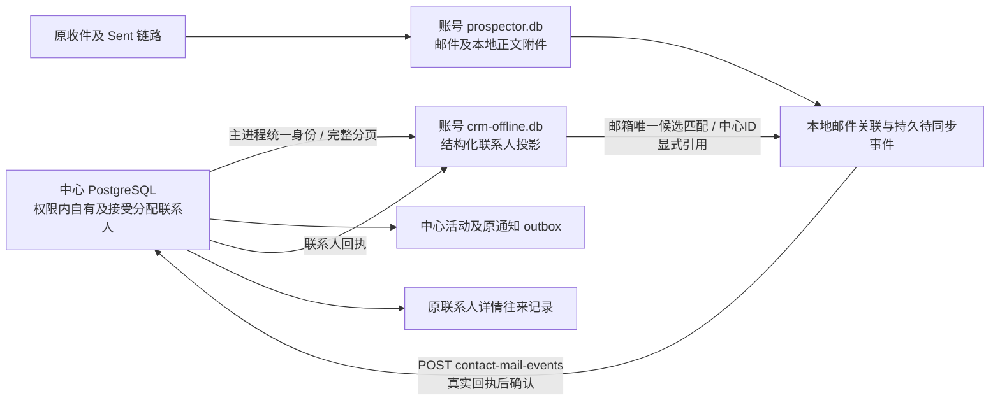

# 中心联系人、本地投影与邮件数据流交付

2026-10-14；工作区0.36.0-alpha.1，未发布。用户批准先库与接口、后复杂版本/冲突/删除/撤权/重试。已有前端布局保持。

## 本轮实现

- 中心是联系人归属、授权和已确认字段的权威；同账号的自有与接受分配共用一个本地投影，未接受和无权限联系人不会下发。不新建分配专用库。
- 已有账号隔离`crm-offline.db`新增`crm_contact_mirror`、`crm_contact_mail_links`、`crm_contact_mail_events`；现有JSON离线客户缓存/队列保留兼容。旧`prospector.db.contacts`保留历史，不自动迁移或删除。中心ID不进入旧邮件FK、交互、营销及删除协议。
- 登录初始化、中心联系人写成功和每60秒连接正常时刷新。新邮件本地落地后合并上传；镜像完整变化才补扫历史邮件。原收件、正文、附件、分类、Sent检测保留，通过端口统一关联。
- 本地保存邮箱/邮件/联系人明确关联和待同步事件；中心确认后标记acknowledged，失败保留。正文HTML、附件及邮箱密码不上传；仅收发地址、标题、发生时间、分类和最多2000字符预览。
- 中心020迁移新增`crm_contact_mail_events`。事件/活动/触达/原通知同一事务；当前归属与开发权限先检查，独立邮件事实不要求用户编辑版本。真实主联系人回复/发送可推进触达；抄送、自动回复、退信及普通收件不冒充回复。较早发生的历史邮件不覆盖较新事实。
- 原`contacts:listForMatch`适配同账号镜像，离线有效授权下仍可读；原联系人详情及收件详情使用中心明确引用和单次中心状态/阶段命令。状态显示按触达事实派生，保留明确退信/自动回复；不用数字ID猜数据源。同邮箱多候选不自动选人。
- 已有手工FOLLOWUP按明确输入原子同步兼容状态/阶段字段；备注及标签不制造触达，无法联系不改为无效邮件。

## 最低一致性及接口检查

新增1条HTTP写路由`POST /api/crm/contact-mail-events`，不新增桌面IPC/登录/消息/调试通道；ONLINE仍43条。详情沿既有GET返回mailEvents/mailAvailable/mailEventLimit，列表匹配沿已有IPC增加显式centerReference。所有新中心调用用同一主进程身份，不经renderer传密钥。

扫描不使用缓存页冒充中心回执；全部成功且总数一致才替换镜像；重复ID、迟到账号响应、较低版本响应及本进程更新竞态均阻止覆盖。已有编辑版本/权限检查保持。邮件稳定键包括邮箱与Message-ID哈希；重复增强预览保留首份事实，不重复入队已确认事件。旧清理去重按邮箱账号限定。

## 验证与运行证据

- 全量Vitest：148文件通过，1217项通过，153项条件跳过；PG条件跳过另独立启用邮件及分配两项真实PG/HTTP回滚验收通过。同步13项另在末次调度改动后重跑通过。
- 桌面/服务端类型检查、三段构建、212源码架构检查0例外通过；独立审查发现的邮箱覆盖、预览重扫冲突、分页/迟到覆盖、历史分类、去重账号范围、显示口径已修复回归。
- 实际生产main/preload/renderer、原生SQLite、真实PostgreSQL与HTTP临时端口：分配接受镜像/同公司未分配隔离；收件关联并确认；旧同号联系人及FK不误写；原正文与深链、中心时间线实窗；中心字段确认后刷新本地；重复分类去重；断网保留本地匹配及正文读取。没有真实SMTP/IMAP外发。
- `.work/mail-dataflow/report.json`及两张实际桌面截图为证据，非模拟IPC页面。临时业务数据用外层事务回滚，前后用户/联系人/客户/会话/outbox计数一致。测试账号复用固定agent账号，不新增持久身份。
- checkpoint：`D:/Agent Basement/checkpoints/prospector-mail-dataflow-20261014`（源码及中心变更前dump）；旧收件适配另有`prospector-mail-dataflow-inbox-20261014`。

## 验收

中心加载后，当前桌面从托盘“重启应用”加载新主进程。管理员分配一个联系人，用户接受后查看；该邮箱的实际收件匹配到对应联系人，点公司进入该联系人的原详情，往来记录出现真实摘要。该联系人字段在线修改后，本地匹配读取同一更新。重复收信/分类不会重复事件。断网时已授权账号仍能查看本地邮件/匹配信息；中心写入受限。

## 后续边界

这不是全部旧功能100%迁移完成。Agent客户写操作、旧营销/发送队列、旧contacts历史迁移、联系人新建/删除、离线联系人字段命令、跨端全文/附件、中心无人值守收发Worker尚未统一。本轮Sent检测只适配其邮件事实，不意味着中心联系人已接旧发送队列。

中心联系人列表仍走既有中心查询与账号JSON缓存，本轮统一的是收件匹配所用结构化本地副本；没有偷偷切换整个客户页读取源。复杂增量游标、服务器事务快照、批量容量、删除/撤权失效、冲突交互及通用重试/失败队列管理按后续节点处理。offset分页仅有总数/重复ID/版本保护，不能保证外部并发同总数变动的完整快照。拒绝或网络失败事件保留且会阻止当前批次继续，不宣称已同步，也暂没有新增用户失败队列界面。

只读权限联系人可以在本地关联邮件，不提交无开发权限的中心事件；归属变化后的未确认旧事件会被中心拒绝并保留，交由后续撤权/失败处理节点。没有发布、推送、新依赖或新增配置键。

部署读回：本机中心受控重载完成，新POST无凭据为401（不是404）；用户当前窗口保留，需托盘重启加载主进程。知识库当前状态/审阅/人用总览已同步，巡检结果由收尾追加。

收尾：知识库结构巡检errors为空。指纹另含先前登录期限/会话仓库/IdentityContext/Sidebar等本轮未改的31项变化中的范围外部分，已保留needs_review，不更新整体基线冒充逐文件验证；运价项目提示未处理。本轮交付与聚合状态已同步。实际桌面临时资料目录已回收，报告与截图保留。
## 2026-10-14 后续方向确认

用户确认中心保存账号名下的正式业务数据，本地承担离线读取、查询加速与待同步变化。中心与本地是同一业务数据的权威记录和工作副本；设备不决定数据归属。下一节点候选为联系人列表/详情的本地读取统一，后续再对齐发送、AI和历史迁移；已有接口仍逐项汇报审批。

这项确认不表示入口统一或换电脑恢复已实现，也不批准特殊编号替换数据库主键、删除旧表、历史数据迁移或邮件原文/附件集中上传。正式实施前应分别确认字段覆盖、来源筛选、分页/总数、深链、授权及缓存有效性，避免仅替换查询而丢失原功能。

