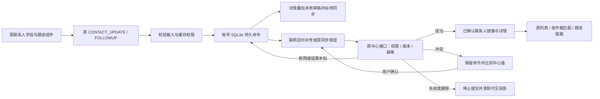

# 联系人离线修改与可靠补传

状态：0.49.0-alpha.1工作区实现并验证，未提交、推送或发布。批准来源：用户同意“断网时修改联系人、填写跟进记录，联网后可靠同步”方案，回复“继续”。保留原界面布局和导航；正式入口是原`/customers`。

## 改动和使用

- 联系人详情沿用原字段编辑和跟进表单，断网后按最后同步的真实权限保存本地命令；关闭重开仍能看到待同步资料。
- 联网后每15秒有界补传，原客户页标签栏右侧“同步 / 待同步 N / 同步冲突 N / 同步失败 N”打开原同步详情。没有增加第二个客户页面。
- 中心已保存但客户端未收到回应时，以原版本、原保存标识、原内容重放，不能换新标识重复跟进。
- 其他人先修改时保留整组本地意图，不自动覆盖中心。比较后可“保留中心”，或明确确认后按最新权限和版本重试本地整组修改。
- 中心明确拒绝时保留表单与本地处理记录，不伪报保存成功；可安全处理的失败记录有出口，不永久堵住后续编辑。撤权后停止新写、移除可见投影，待处理详情不泄露失权联系人内容。
- 未知请求不能当作未发生而放弃；“保留中心”只移除可处理的本地意图，不撤销中心已保存的事实。当前权限拒绝也不能证明先前重试从未被接受。

## 数据流

SQLite的确认投影不写草稿，邮件匹配与新发送继续读已确认资料。例如离线修改邮箱，不会立即把尚未获中心接受的新邮箱作为已确认发信目标。列表同样展示确认数据，待同步改动在联系人详情可见。

## 持久化字段

没有新增数据库；现有账号`crm-offline.db`增加下表，PostgreSQL无新增表列或迁移。

| 表列 | 类型/约束 | 用途 |
|---|---|---|
| `permission_key` | TEXT NOT NULL，联合主键 | 当前角色与能力指纹，防旧权限下命令串入新权限 |
| `command_id` | TEXT NOT NULL，联合主键 | `contact-command:`前缀的稳定处理编号 |
| `payload` | TEXT NOT NULL，JSON | 以下命令及状态字段 |

`payload`由`src/main/core/contact-commands.ts`定义：

| 字段 | 用途 |
|---|---|
| `id` | 稳定的本地处理编号，显式重试不改变此编号 |
| `action` | `update`或`followups`，仅联系人字段和跟进 |
| `input.contactId / customerId` | 中心联系人及客户关联，同时核对，禁止仅拿数字ID匹配旧表 |
| `input.expectedVersion` | 本次原始提交版本；未知请求不改版本 |
| `input.idempotencyKey` | 本次提交去重标识，未知请求重放原标识 |
| `input.fields` | 字段修改的局部值；只覆盖此次明确修改的字段 |
| `input.note / method / occurredAt / stage / contactStatus` | 跟进内容、方式、真实发生时间及可选结果 |
| `status` | pending待确认、conflict冲突、failed需处理、confirmed已确认 |
| `createdAt` | 命令创建时间，默认跟进发生时间在首次校验时固定 |
| `predecessorId` | 同一联系人连续修改的前序，必须存在且已确认才发后序 |
| `attempted` | 发请求前持久标记，崩溃后不误判为未发送 |
| `error / errorCode` | 最后处理信息，不作为权限事实 |
| `discardable` | 明确拒绝或证明尚未发送时，允许显式移除本地处理记录 |
| `retiredKeys / history` | 明确冲突重试前的键及请求历史，避免旧键被重新利用 |

账号及中心由现有`accountProfileRoot`路径隔离，权限指纹再隔离表内记录。未重复保存完整公司背调、邮件、活动及详情快照。确认记录保留用于去重，保留期清理尚未实施。

## 接口与结构核对

- **新增IPC：0；新增HTTP：0；新增依赖/配置键：0。**沿用`online:contact-update`、`online:contact-followup`和`online:sync-status/now/resolve`；中心仍是POST`/api/crm/contacts/:id/update`、`/followups`。
- `CenterContactDetail.localSync?`是客户端派生的待同步信息；`CrmSyncIssue.contact?`是当前仍获授权的比较内容。中心不接收这些派生字段作为写入事实。
- `contact-command.service.ts`替代并删除旧`contact-write.service.ts`。旧套件中独有的三项回归已迁入新服务：错误联系人回执、中心已接受而本地保存失败、保存途中联系人移除。其余重复或仅在线旧语义测试退役。
- SQLite事务内重读/核对输入后再登记尝试、处理结果和整组重试；多实例不依据启动时的旧队列快照发送，防止复活另一窗口已放弃的修改。
- 原客户整包队列仍服务旧客户级契约；联系人命令不伪装成整客户覆盖。两者在同一同步入口合并统计和按编号分流，没有第二套联系人写接口。

## 验证结果

- 普通全量：**1530通过、167条件跳过、0失败**，216文件；跳过的中心用例另行隔离执行。首次回归发现35项旧页面测试因同步组件新增不必要的身份上下文依赖而失败；已改为父页面传递范围并复跑全量通过。
- 隔离中心：**40文件206项通过**，真实PostgreSQL临时实例已停止并删除；检查既有权限、版本、幂等和中心业务契约。它与以下合成HTTP桌面验证是分层证据，不宣称同一次真实中心端到端。
- 原生桌面：**8项通过、页面错误0**。使用生产主进程、原renderer/preload、原生SQLite和本机合成HTTP中心，验证离线字段/跟进、同资料重启恢复、真实15秒定时器自动补传、手动同步无重复、回执丢失原样重放、正式客户页冲突比较/保留中心、撤权后无新写；临时资料已清理。
- 命令核心22项，加SQLite持久/事务回滚2项、原状态入口1项；前端实际路由4项、离线详情7项、字段失败草稿1项。独立审查复现并推动修复失败记录死锁、多实例复活已放弃修改、正式路由无处理入口三项问题。
- 全项目类型、桌面构建、服务端构建通过；架构232个源码、0例外，检查器5项通过。
- 无真实邮件/模型调用，无持久测试账号新增；正式55846和Navigator未改。55844无需新增中心迁移；桌面需托盘“重启应用”加载新主进程，账号库按需加表。

证据：`.work/offline-contact-20261016/full-tests-final.json`、`native-report.json`、`native-offline-pending.png`、`native-conflict-comparison.png`；隔离PG执行与清理报告在`.work/center-tests/`，交付前复制到本节点checkpoint。

## 验收与边界

正常登录并同步一位可编辑联系人后断开网络，在原详情改字段并添加跟进；应看到“待同步”，重启仍保留。恢复网络后自动确认，其他窗口刷新可见，跟进只出现一次。双端同时修改同一联系人时，从原客户标签栏右侧同步入口比较与处理；不会直接覆盖。

离线权限沿用现有有效离线授权期限，无法实时知道服务器刚发生的撤权；重连必须重新校权。离线公司编辑、删除、分配、分享、邮箱发信和服务器持续营销未开放。未同步草稿不能用于确认数据统计。历史日期的跟进阶段在本地待同步预览可能暂时与中心按发生时间排序不同，确认回执后以中心为准；不污染确认镜像。旧SQLite历史联系人不自动迁移，数据保留清理和全量容量评测仍后续。

Checkpoint：`D:/Agent Basement/checkpoints/prospector-offline-contact-20261016`，先存678个源文件，最终附变更清单和验证证据。知识库已同步项目状态、入口、审阅及人用总览；只读巡检ok、无结构错误，保留源码变化提示，不重置旧有/并行工作区的未审查源码指纹。
