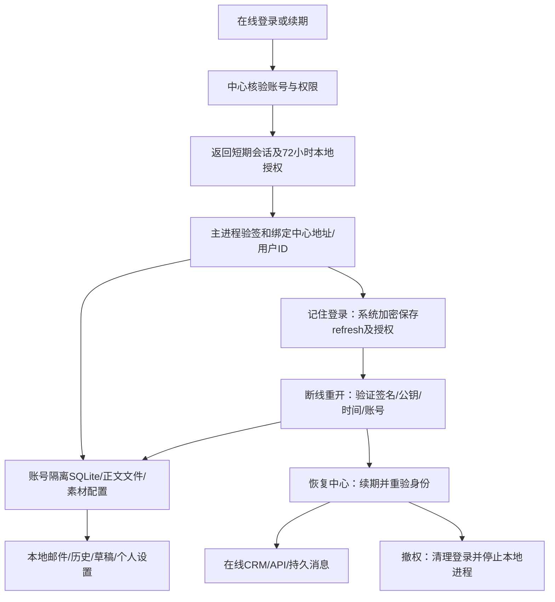

# 离线本地工作区 · 2026-10-12

用户批准在中心服务或网络故障时保留基础功能。本节点工作区版本为 0.22.0-alpha.1，未发布。改前 checkpoint：`D:/Agent Basement/checkpoints/prospector-offline-local-20261012`。

## 行为与验收

| 情况 | 行为 |
|---|---|
| 已登录，中心连接或数据库暂时故障 | 保留当前账号和本地工作区；显示“离线 · 本地工作区” |
| 记住登录，服务停止后重开 | 签名授权有效时进入同账号缓存收件箱，最长72小时 |
| 第一次使用、未记住登录后重开、明确退出 | 仍需在线登录；没有离线密码登录或其他账号资料入口 |
| 授权过期或检测到明显回拨 | 拒绝解锁本地资料，需恢复在线身份校验 |
| 恢复连接 | 自动重新核验账号；明确撤权/停用返回401时清理身份并退出本地进程 |

验收时先在线登录并勾选记住登录，退出整个程序，再停止测试中心并重开。查看已经缓存的邮件正文、发送历史和素材，保存模板草稿、打开个人设置；客户、消息、发送和收信刷新应不能执行。恢复中心后身份及在线权限自动恢复。只有预先下载的邮件正文保证完整；未缓存正文只显示已保存的摘要。中心客户暂无离线缓存，不建立本地CRM写入或离线分配队列。

可用操作由 `src/main/core/offline-local-policy.ts` 的具体通道白名单决定，默认拒绝未来未知通道。草稿包括模板和已有 draft 状态发信任务编辑；创建新的发信任务、发送、模型生成和联网测试仍需在线。个人配置留在原账号隔离目录，没有上传到中心。

## 身份和数据链路

中心私钥使用Node内置Ed25519，位于既有受控测试目录 `.work/pg-crm/offline-access-private.pem`。这是应用内部授权签名，不是购买证书的程序代码签名。完整临时文件以独占硬链接原子发布，竞争进程读取同一获胜文件；损坏或错误算法不自动换密钥，符号链接/目录链接拒绝使用。部署备份须保留私钥并保护该目录权限；没有新增配置键。

主进程将在线认证得到的公钥单独保存在系统加密记录中；离线不从令牌本身接受替换公钥。核验原始签名字节、用途、签发中心、不可变用户ID、期限及最近观察时间。回拨容差60秒，时钟保护30秒节流，观察到过期或异常回拨立即落盘。加密保护及软件时钟无法防止拥有操作系统控制权的人恢复整个旧系统快照；不宣称防止本机管理员攻击。

授权只解锁同账号本地资料，不能作为HTTP bearer，权限执行仍由在线中心负责。账号被停用但客户端完全离线时，中心无法即时通知；已有本地资料最多仍可在授权窗口内访问。这是保留离线可用性的代价，不能宣称立即远程撤回已缓存数据。

## 后台任务与一致性

IPC按钮守卫外，收信自动轮询/正文懒拉、SMTP队列、Campaign定时触点及后台AI阶段都有相同的在线身份检查。断线暂停运行中Campaign，停止Agent审批/后续动作并合作取消后台任务；已经发出的外部请求可能完成，不冒充撤销成功。恢复连接不会突然补发积压邮件；用户明确恢复/重新启动所选任务后，其后续周期可继续，其他旧任务保持暂停。更新器沿用原边界，本节点不修改更新或代码签名。

中心CRM UUID/版本/归属与消息游标仍是唯一真源。没有故障转写SQLite、复制角色权限表、第二个消息消费者或本地分配队列。`OnlineSessionSnapshot.connection`和`offlineExpiresAt`只是主进程派生投影；签名授权、公钥、refresh及密码不交给renderer。

22个ONLINE常量、处理器及preload白名单保持对等；没有新增IPC/API路由、依赖或表迁移。原桌面登录/续期响应新增可选offlineAccess，状态/恢复返回可选连接状态；旧中心响应保持当前进程兼容，但旧无签名缓存不能离线重开。旧本地IPC保持已有`success`返回形态，在线IPC保持统一`ok`形态，未另建第三套协议。

## 验证证据

隔离真实Electron/HTTP/PG证据：`.work/offline-local/report.json`、`offline-workspace.png`及`runtime.cjs`。完成数据库错误和网络故障注入、本地邮件列表/正文/历史/草稿/设置访问、中心/SMTP/IMAP/AI拒绝、真实停止中心后记住登录重开、无缓存首次启动拒绝、中心真实恢复以及明确退出删除系统加密授权；页面异常为0，没有真实邮件外发或用户业务数据导入。

独立限定复核修复两类问题：时钟保护迟到写入覆盖轮换refresh；Campaign明确恢复/重启后未重新启用周期调度。带延迟存储、重启和周期扫描回归通过。该复核覆盖本节点变更及调用路径，不是仓库全面安全认证。

最终普通回归964通过/112跳过（跳过含需要专门环境的PG/模型用例）；中心专用100通过，额外原桌面会话HTTP/PG8通过。类型、桌面/管理中心/服务端构建通过；架构193源码0例外及5项检查器测试通过。最终独立限定复核8文件109项通过。公网、多设备及持续服务器Worker未在本节点完成。

## 回退

按checkpoint保存的节点文件恢复源码并重新构建，不回退或重建PG/SQLite，不删除其他节点的未提交内容。新签发私钥可保留但须受控，不将其复制进源码或普通交付证据；旧程序忽略可选授权字段。暂停的任务不能因回退自动改回running；必须由用户明确恢复。新增文件清单及改后哈希由checkpoint中的delivery-manifest.json保存。
