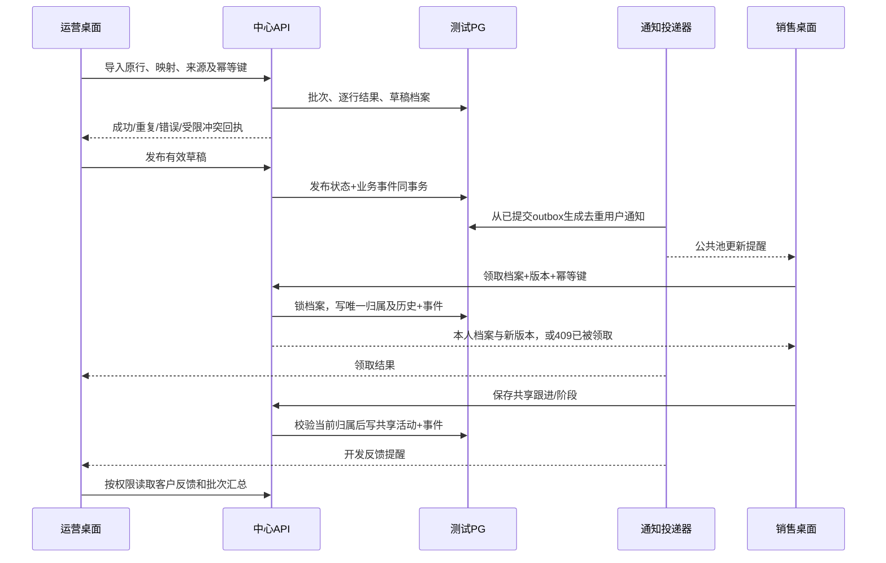

# M2 · 运营到销售线索闭环实施计划

> 执行方式：本会话使用 superpowers:executing-plans，按任务建立检查点并验证。本文是实施前报告，尚未实施；须遵守用户“每次优化前按原因、提升、副作用报告，批准后执行”的既定边界。

**Goal:** 在同一 Prospector 桌面应用中，用独立运营、销售身份完成导入、发布、领取、共享跟进与可补收通知。

**Architecture:** 中心 API 是协作数据唯一写入口，现有独立 PostgreSQL 保存档案、归属、来源、共享活动和事件；客户端仅保存设备游标、主题与受控会话材料。复用账号服务、既有产品能力和桌面主题，业务权限在服务与数据库事务中复查。账号管理网页继续负责账号管理，运营/销售界面进入 Prospector 桌面，不新建第二套产品逻辑。

**Tech Stack:** 现有 TypeScript、Node、pg、Electron、React、Ant Design、xlsx；不新增依赖。

**Spec:** D:/Agent Basement/designs/prospector-online-20261010/00-总方案.md、03-CRM与数据流转.md、06-局域网验证阶段.md。本文 M2 是当前交付节点名，对应局域网切片 L1；04 文档早期 M0–M7 编号保留为目标能力分解，不能混用。

## 1. 原因、提升、副作用

| 改动 | 原因 | 完成后提升 | 副作用与限制 |
|---|---|---|---|
| 来源与客户档案模型 | 现有四张 CRM 表没有稳定负责人和导入发布状态，assignee 文本不是身份 | 每条线索能追溯批次/原行，同一客户的联系人共用负责人 | 增加独立005迁移；公司重名或私有客户冲突需核实，不能自动公开 |
| 服务端领取与跟进 | 当前账号权限有了，但没有在线业务接口 | 两销售抢同一客户只有一人成功，跟进结果运营可见 | 在线协作操作需要中心可达；断线禁止假装本地保存成功 |
| 桌面双身份工作区 | 现有个人客户界面无法承担运营发布与销售公共池 | 同一应用按有效权限显示运营工作区/销售工作区 | 增加明确的本地/在线模式，避免两个库串读或隐式回退 |
| 持久通知和投递器 | 已有 outbox 还没有消费者，无法构成互联 | 发布、领取、共享跟进可通知，断线重连可补收和精准跳转 | 增加后台投递循环与设备游标；收到、已读、业务已处理分开 |

这是第一条业务闭环，不是邮件后台自动开发节点。自动发送/收信/AI持续任务按后续 L2 独立实施；旧私有客户、真实邮件与正式 Navigator 账号不在本节点迁移范围。

## 2. 当前核对与约束

- 工作区0.13.0-alpha.1，中心仅127.0.0.1:55844，隔离PG仅127.0.0.1:55843；已有中心改密、会话、角色/能力/范围。M2先同机双独立桌面用户目录验证，跨设备及网络绑定属于L3。
- companies/contacts/interactions/crm_relations 已存在；新增模型引用这些记录，不再建立第二套联系人库。001–004迁移原文不改。
- operations 已有 leads.import/publish/assign/reclaim；sales 已有 leads.claim/develop。身份管理权不自动获得业务权；账号停用、CRM准入撤销、mustChangePassword、能力与范围每次请求均生效。
- 本节点仅合成线索与测试账号。CSV/XLSX读取使用已安装xlsx；列映射/预览/校验直接在应用完成，不要求人工制作中间JSON。运价采集流程不改。
- 不新增运行配置键，超时/批次/体积/缓冲/重连参数在core命名常量；新接口有独立受限请求体，不能放宽身份接口4096字节上限。
- 新增兼容API和可选桌面在线入口，拟功能版本0.14.0-alpha.1；若实际改变旧契约或默认数据持有方式，停止按minor交付并重新报告breaking影响。
- 仓库有.codegraph但本机codegraph命令不可用，本报告依据定向源码/契约核对，不声称完成图谱审查。

## 3. 数据流与权限



运营可读其可管理来源、公共池与共享开发反馈，不能读私人邮箱正文、凭据和销售私密笔记。销售可读公共池最小预览及本人已领详情；他人详情、活动、搜索计数与历史通知不可透传。范围和能力共同判定，不从导航可见性推导权限。

导入按 source + customerKey（来源客户编号）分组，不能把公司名称当归并键；同组联系人归同一档案。联系人规范邮箱冲突时不重复建档；命中不可见私有客户只返回受限冲突，不返回姓名、负责人或现有记录。尚无可核实公司归并依据的跨来源候选交运营核实，不自动合并。

## 4. 契约与状态

新契约唯一来源：server/core/leads.ts、server/core/notifications.ts；桌面镜像类型通过src/shared/online-crm.ts引用纯core类型，IPC常量先登记src/main/contract.ts。统一 Result，不改变旧桌面返回口径。

```ts
type LeadState = 'draft' | 'published' | 'owned' | 'paused';
interface ImportRow { customerKey: string; companyName: string; email: string; name?: string; country?: string; }
interface ImportRequest { source: string; sourceDetail: string; idempotencyKey: string; rows: ImportRow[]; }
interface LeadCommand { customerId: string; expectedVersion: number; idempotencyKey: string; }
interface FollowupRequest extends LeadCommand { note: string; stage?: CrmStage; }
interface FeedQuery { deviceId: string; after: string; limit: number; }
interface FeedPage { items: Notification[]; nextCursor: string; hasMore: boolean; }
```

customerKey、source、email必填；sourceDetail保留来源说明。原行与映射用于追溯，不能作为可执行HTML。批次最多200行、请求体最多1MiB、字段上限沿用或更严；更大文件客户端分批，显示逐批回执，断线重试相同键不重复创建。

| 接口 | 动作与输入 | 权限/失败语义 |
|---|---|---|
| GET /api/crm/bootstrap | 当前模式能力、本人摘要、feed起始游标 | CRM有效准入，必须改密拒绝 |
| POST /api/crm/imports | ImportRequest→batchId与逐行回执 | leads.import；拒绝未知列/超限，冲突行不发布 |
| POST /api/crm/imports/:id/publish | rowIds、expectedVersion、idempotencyKey | leads.publish及批次管理范围；仅有效草稿 |
| GET /api/crm/leads | view=pool/mine/operations、分页、搜索 | 服务端限定行范围和total；pool仅最小预览 |
| GET /api/crm/leads/:id | 当前授权档案及共享活动 | 无权对象统一NOT_FOUND，避免探测 |
| POST /api/crm/leads/:id/claim | LeadCommand | leads.claim；原子版本/状态检查，竞争失败409 |
| POST /api/crm/leads/:id/followups | FollowupRequest | leads.develop且为现行负责人；事务复查 |
| GET /api/crm/notifications | FeedQuery→FeedPage | 本用户feed，设备游标隔离，旧无权正文过滤 |
| POST /api/crm/notifications/:id/read | 当前用户通知ID | 已读不表示业务已处理；不能标记他人通知 |
| GET /api/crm/events | 受控Bearer流，设备与游标 | SSE只作变更提示；定期复查权限，撤权断开 |

本节点不开放回收/转派写接口，避免未完成后台任务停止规则时提供误导操作；前述assign/reclaim能力模板不等于已交付对应功能。后续L2再实现安全回收与持续任务。

## 5. 数据结构与可靠消息

005增量迁移：crm_customers（引用company、state、owner_user_id、version）、crm_customer_contacts（contact唯一归属）、crm_import_batches、crm_import_rows（原行/结果/来源键）、crm_assignment_history、共享活动关联；以及crm_event_deliveries、crm_feed_heads、crm_device_cursors、crm_notification_reads。引用现有identity.users稳定UUID，不依赖邮箱、昵称或assignee文本。

客户归属及其全部联系人同事务；领取、发布、跟进与现有identity.outbox事件写入同事务。幂等记录绑定用户/操作/请求摘要；同键不同内容409，读取旧回执也重新检查现行资源权限。

投递器只读取已提交事件；唯一(event_id,recipient_user_id,projection_type)防重复。同用户feed head行锁内分配delivery_seq，不能以全局outbox自增ID作为可靠已提交游标；多用户锁按稳定ID顺序取得。补收扫描过滤失权事件时仍推进到已扫描游标。快照与订阅衔接使用bootstrap水位，过期游标返回RESYNC_REQUIRED重新建快照。

SSE缓冲有界，慢客户端断开后补收；每次回放和详情读取复查当前权限。事件仅传最小对象定位和版本，页面以当前受权查询刷新。点击通知打开具体客户详情，对象已不可见时清空旧详情并显示权限变化，不跳转到空泛首页。

## 6. 执行任务与检查点

### 任务1：归属和导入事务

Files：新增server/core/leads.ts、server/services/leads.ts、server/adapters/postgres/lead-schema.ts、lead-repository.ts；新增tests/integration/lead-collaboration.test.ts。修改server/online.ts组合与迁移注册，不修改001–004。

- [x] 保存Git状态、定向源码哈希/schema-only至D:/Agent Basement/checkpoints/prospector-m2-leads-preflight-20261011；不复制运行凭据或真实客户行。
- [x] 先写真实PG失败用例：导入重复行/重复键、私有冲突不泄漏、同客户多联系人归属一致。
- [x] 定义契约，新增005结构及参数化事务；只用有证据来源键归并，不用公司名自动归并。
- [x] 验证约束/回滚/并发导入和001–004校验和，再保存任务交付快照。

### 任务2：授权API与销售领取反馈

Files：新增server/transport/crm-http.ts，修改server/online.ts挂载；新增tests/integration/lead-http.test.ts。

- [x] 写两个销售并发claim仅一胜、停用/撤准入/必须改密拒绝、非法对象搜索和计数隔离的失败用例。
- [x] transport只做鉴权入口/有界解码/路由和Result响应；仓储事务复查授权和归属，不信任客户端actor。
- [x] 完成列表、详情、领取、共享跟进及阶段；expectedVersion不符409，断线重试原幂等键不重复活动。
- [x] 运行真实HTTP/PG角色矩阵与故障回滚，保存第二任务快照。

### 任务3：持久通知与断线补收

Files：新增server/core/notifications.ts、server/services/notifications.ts、server/adapters/postgres/notification-repository.ts、server/adapters/notification-dispatcher.ts、server/transport/events-http.ts；新增tests/integration/notification-delivery.test.ts。

- [x] 写outbox提交后崩溃、重复消费、提交顺序交错、全是失权事件、双设备游标的失败用例。
- [x] 接入有界投递循环、去重feed、bootstrap水位、增量查询、SSE和已读；退出关闭stream与循环，异常分级日志，不输出敏感payload。
- [x] 验证重启补投、断线补收、撤权断流与权限过滤，保存第三任务快照。

### 任务4：Prospector双身份桌面入口

Files：新增src/shared/online-crm.ts、src/main/adapters/online-crm.adapter.ts、src/main/services/online-crm.service.ts、src/main/transport/online-crm.ipc.ts、src/renderer/pages/online/OnlineWorkspace.tsx；修改src/main/contract.ts、既有preload注册、renderer导航与路由。新增tests/unit/online-crm.test.ts与tests/integration/online-crm-renderer.test.ts。

- [x] 先定义IPC常量/类型与调用点，网络和系统加密存储留在adapter，不让renderer保存明文令牌。
- [x] 同一工作区根据有效能力展示运营导入/发布/反馈、销售公共池/本人客户/跟进；复用现有brandTheme与组件。管理员当前具有全部角色时可切换视图，但角色隔离验收用独立单角色账号。
- [x] CSV/XLSX列映射/预览/逐行结果在应用完成；在线模式所有协作读写只走中心，失败不回退个人库。
- [x] 独立用户目录验证运营和销售A/B登录、通知精确详情跳转、切换账号清缓存、断线错误与重连补收；不伪装合成IPC为真实服务联调。

### 任务5：安全、回归与交付

- [x] 跑新增PG/HTTP/通知及真实Electron双身份联调，故障注入只在隔离测试库；普通跳过PG必须由专用命令另验。
- [x] 运行npm.cmd run typecheck、npm.cmd run check、npm.cmd run test:architecture、npm.cmd test、npm.cmd run build、npm.cmd run crm:online:test；新增专用套件纳入该命令，检查原管理页和强制改密回归。
- [x] 安全审查覆盖批次来源/私有冲突、IDOR、幂等回执、通知重放、失权长连接、导入HTML注入与跨产品令牌，修复后复测实际失败用例。
- [x] 同步架构基底/IPC契约/版本记录/已知陷阱与知识库；保存delivery清单、schema、diff、日志和截图。仅提交定向节点文件，保留其他既有改动；不推送或发布。

## 7. 验收与回退

成功标准：运营导入10条合成线索，其中无效/重复有逐行回执；有效发布进入销售公共池；两个销售同时领取同一档案仅一人成功；本人未触达客户仍可见；销售共享跟进运营可见；双方各断线一次、服务重启一次后消息不丢且不重复提示；通知点击定位确切档案；销售B不能通过详情、分页、搜索、回执或旧feed读取A的客户；原个人模式与管理工作台回归通过。

中心停止或主机关机时在线操作和通知停止，本节点不能声称销售关机后自动开发已完成，也不能声称第二台设备已验收。回退先停止测试API/投递器并退出在线入口，按文件清单恢复前置代码；保留测试结构/记录作为证据，不自动DROP或覆盖数据库。005测试数据/结构若需删除，另行明确授权。

## 2026-10-11实施结论与调整

用户“执行”批准后实施。实际消息结构分为005-lead-collaboration与006-notification-m2两个不可变增量迁移。桌面Bearer仅内存保存，本节点没有系统加密落盘；5秒补收持久feed，SSE作为服务端接口暂不用于桌面订阅。重登从0合并，不做永久设备应用确认；准确边界见[M2交付](../../m2-lead-collaboration.md)。同机两个真实Electron客户端断线/中心重启/精确通知跳转验证通过；运行harness只隔离无关壳层和文件选择器，在线IPC与HTTP/PG为生产代码。未提交Git、未发布；以定向文件快照和哈希交付，保留已有大量未提交修改。
