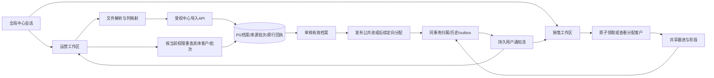
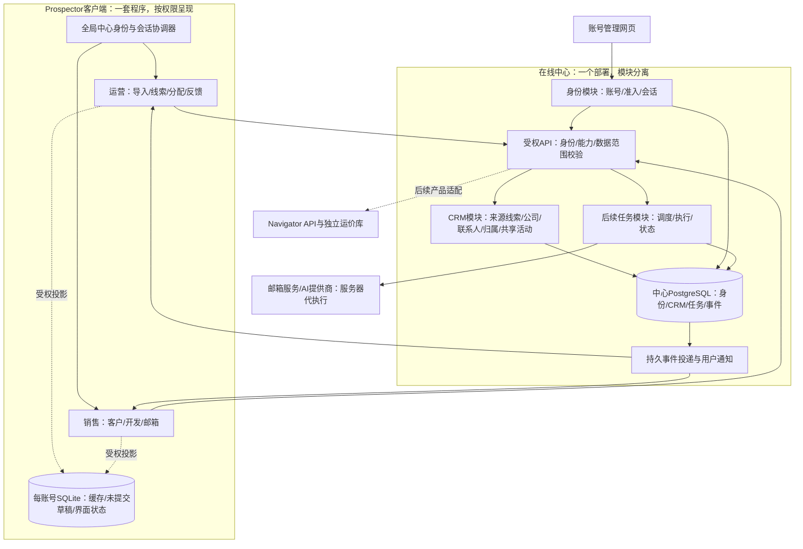

# Prospector 全局身份与运营工作区设计

> 历史提案说明：同日用户补充完整角色行为后，当前产品设计入口改为 [双角色产品链与在线数据设计](2026-10-11-prospector-role-product-chain-design.md)。本文“运营默认无邮箱/三个精简入口/管理员不默认查看业务”等旧建议已被取代；身份续期与缓存隔离技术分析可继续参考。冲突处以新文为准，历史文字不表示当前决定。

日期：2026-10-11。状态：待批准方案；未修改业务代码、API、IPC、数据库或版本号。取代“先跨设备联调”的下一节点排序，先修产品身份与运营架构。既有M2服务端能力继续复用，不重做CRM数据库。

## 1. 结论、现状与方案取舍

推荐一个Prospector客户端、一套中心CRM业务逻辑、两种按有效权限呈现的工作区。应用启动先处理中心身份，登录后进入运营或销售空间；“在线协作”不再是旧个人销售导航中的附加页。Navigator令牌是产品授权，SMTP/IMAP配置是邮箱授权，均不能代替Prospector中心身份。

本次核对源码而非仅凭历史记录：

| 项目 | 当前代码事实 | 差距 |
|---|---|---|
| Navigator | NavigatorClient有access/refresh、并发刷新、身份epoch；adapter用safeStorage存navigator-refresh.enc，并绑定base | 可以复用模式，不能复用令牌或盲目复制协议 |
| Prospector中心 | OnlineCrmAdapter只有内存Bearer；中心API固定会话默认3600秒，无refresh契约 | 重启重新登录，页内身份无法驱动全局壳层 |
| 运营UI | OnlineWorkspace混合导入卡片、列表、销售tabs、通知、详情；Sidebar仍固定显示旧销售入口 | 操作路径不清，权限只驱动局部页面 |
| 客户与邮箱本地库 | 单个data/prospector.db及原个人任务/缓存 | 不能登录B后直接把A的本地资料当B所有；中心登录不自动完成本地隔离 |
| 中心CRM | 已有来源导入/发布/原子领取/共享跟进、outbox/feed | 不足运营批次恢复、条件筛选、负责人显示、阶段/最近跟进、定向分配与真实统计 |

备选A：仅给当前Bearer加密落盘，改动小，但只在会话到期前免登录，身份仍散在页面，不能称长期登录态。备选B（推荐）：中心可撤销续期会话＋全局身份协调器＋角色工作区；改动适中，解决产品结构。备选C：拆两客户端/先全面SSO或微服务，当前无必要，部署与版本成本过高。

当前.codegraph存在但本机codegraph命令不可用，使用定向源码读取；未新建索引。当前0.14.0-alpha.1仍是工作区版，本轮没有发布。

## 2. 全局身份设计

### 2.1 四种状态各自负责什么

1. 中心身份：稳定userId、账号状态、产品准入和有效能力，是在线业务身份唯一真源。
2. 工作区：operations/sales，仅在服务器返回的可用空间中选择；它是UI偏好，不增加权限。
3. 产品连接：Navigator授权独立。展示“已授权Navigator账号”，允许与中心账号暂不一致，不误称统一SSO；不把CRM令牌发送给Navigator。
4. 邮箱连接：本人绑定的SMTP/IMAP账号，不等于应用登录账号；运营默认没有邮箱/发送模块。

角色名不直接授全部模块。读取、写入、数据范围及字段由中心校验，客户端能力只控制呈现；身份管理员默认只有账号管理入口，不因此能读CRM内容。运营角色有业务能力时才能进入运营空间；双角色可切换，但同一时刻只展示一种工作区，避免复杂侧栏叠加。

### 2.2 登录、记住登录与自动恢复

启动：标题栏与品牌启动页 → 主进程读取系统加密恢复凭据 → 中心续期 → 获取当前身份及产品bootstrap → 清理过期缓存/选择受权空间 → 进入运营线索首页或销售客户首页。没有凭据时显示独立全屏登录，中心地址置于高级连接设置，邮箱＋密码为主要输入，不把调试URL放入业务页面。

勾选“记住登录”才持久保存刷新凭据；access只在主进程内存；密码不保存。存储键绑定规范化center origin、稳定userId、deviceId及凭据格式版本，使用safeStorage/Windows DPAPI原子写入，并复用现有凭据串行队列与generation模式。加密不可用、basic_text或解密失败时不降级明文，退回本次登录。DPAPI并不能防止同一Windows用户下的恶意进程；该功能是系统加密存储，不是硬件安全柜。[Electron官方说明](https://www.electronjs.org/docs/latest/api/safe-storage)。使用现有Electron37实际可用API，不因为最新版文档新增async API就默认升级依赖。

中心新增可撤销刷新会话族：建议access有效15分钟，refresh空闲7天、绝对30天，均为可调整配置，时间键统一_seconds后缀；本机测试也使用同样撤销语义。数据库只存令牌摘要、family/device、到期、安全版本、轮换记录，不存明文恢复凭据。旧api/browser会话继续区分，不让浏览器Cookie和桌面Bearer混用；不改变001–006原迁移，新增增量迁移。

刷新一次轮换，一客户端并发请求合并为一次刷新，401最多重试一次。刷新请求使用持久attemptId：服务端同一attemptId/设备可短期重放同一个加密保存的续期回执，处理“已提交但响应丢失”；不同attempt重用旧凭据撤销该family。回执密钥必须是独立服务器本地机密配置，不进入对话/源码/数据库，不新增依赖；密钥不可用时安全拒绝持久刷新。下一实施报告需冻结回执期限与加密密钥轮换/旧回执失效契约；不能只把重复refresh都当攻击，造成正常断网退出。

续期、改密、停用、撤销会话、准入撤销都检查当前安全版本及权限。保持登录不等于保持原权限。强制改密走独立受限页面，未改密不得进入工作区；可先复用已验证管理页流程，再接桌面受限改密契约，不放宽现有中心限制。

### 2.3 状态机及异常

状态分两轴：identity为restoring/anonymous/active/change_required/revoked；connection为connecting/online/offline。断网不冒充退出，恢复凭据还在但身份未被服务器重新核验时不开放中心业务；在线会话断网时默认遮蔽中心敏感详情、禁止写入、不排队盲重试。保留必要的界面位置及安全的待重试操作标识，不把旧contacts做离线身份依据。

明确403准入/能力变化只撤掉相应空间，不一概清全局账号；401续期失败转重新登录；服务503/超时显示连接问题，不误删有效恢复凭据。切中心地址需确认，将当前中心会话退出/清上下文后重新登录；凭据不可跨origin发送，禁重定向。未配置公网/TLS不扩大当前回环限制。

身份变更触发统一identityEpoch：取消请求与轮询、清React Query用户缓存、销毁keep-alive视图及Drawer、清搜索/通知/导入预览/待操作，最后重新挂载新的工作区。不能只换头像或隐藏菜单。通知按center＋userId隔离，补收与身份会话独立；业务页面卸载不停止全局通知协调器。

### 2.4 旧个人库必须处理

仅增加登录态而不处理本地库，会制造假身份隔离。第一节点保留原文件且不自动上传，列为“未绑定的旧个人工作区”；只有用户明确选择目标中心账号才能绑定。本地先采用每userId独立目录/数据库/敏感配置，服务端UUID作路径键，邮箱和昵称不作键。未绑定旧库不向新账号开放，不在运营空间展示。

账号切换和退出前先检查原本地发送/收信/AI任务：先停止调度并等进行中操作完成或返回“已有不可撤回外发正在结束”；不能宣称取消已交给邮件服务器的邮件。任务上下文固定发起userId＋epoch，后续动作失权拒绝；暂停未执行任务，恢复仍走既有用户确认。切换期间不启动新账号任务；无法隔离既有数据的模块默认不开放，不能靠菜单遮住而留下IPC入口。DB路径/配置迁移独立小节点、源码与schema检查点，不整仓重构。

### 2.5 拟模块与契约（未实现）

| 层 | 职责 |
|---|---|
| shared/core | SessionSnapshot、SessionState、Workspace、capability契约，不含IO |
| main/services/session | 恢复/续期/撤销/切账号协调器，端口注入 |
| main/adapters/session | HTTP、safeStorage、原子文件、设备标识 |
| main/transport/session | IPC解码路由，无独立身份缓存 |
| renderer/SessionProvider | 只接身份快照及事件，永不接收Bearer/refresh |
| renderer/WorkspaceShell | 受权路由/侧栏/账号菜单/通知层 |
| server identity模块 | 持久会话族/轮换/当前权限，CRM消费actor |

拟IPC：session:status/login/logout/restore（恢复内部只执行一次）/workspace；事件session:changed。业务online:*取消页内login/logout职责后移到session，兼容期代理同一协调器，不能有两套令牌。HTTP拟/api/auth/refresh、/api/auth/sessions/current/revoke；login新增明确desktop客户端和remember协议，保持旧browser响应兼容。所有返回{ok,data?,error?}，原冒号粗权限与管理点号细能力需在中心边界显式归一，业务使用细能力，不让客户端自行合并两套授权。

## 3. 运营端功能架构

首期运营导航只保留「线索」「导入批次」「开发反馈」，通知在全局铃铛，账号/设置在侧栏底部；“运营概览”只在指标数据齐备后增加，不堆假图表。销售导航后续围绕客户开发设计，现有邮箱/AI/运价功能在销售空间迁移，不在运营侧栏混入“新对话”和发送中心。

| 区域 | 使用目标 | 当前能力与新增需求 |
|---|---|---|
| 线索 | 搜索、筛选、查看来源/负责人/联系人/当前状态 | 复用M2列表/详情；需状态、来源、负责人、阶段、时间条件及字段 |
| 导入批次 | 查看原行回执、待发布、失败、重试和追溯 | M2只有当前页内回执；新增中心批次列表/详情、权限筛选、进度恢复 |
| 开发反馈 | 看已领档案的最近共享跟进及阶段 | M2已有客户内活动；新增反馈分页/筛选，禁止读销售私人邮件 |
| 通知 | 新领取/跟进/批次结果，直接定位资源 | 复用持久feed，补资源名称与事件摘要（鉴权后生成） |
| 线索分配 | 指定销售或发布到公共池 | M2只有发布/自行领取；定向分配需独立归属命令与审计，见下一节 |
| 账号管理 | 身份/准入/角色/会话 | 仅有管理能力者打开既有中心管理入口，不再复制人员管理系统 |

批次：选择文件 → 列映射 → 预览校验 → 导入逐行回执 → 待发布审核 → 明确发布有效档案。原始回执不可覆写；修正无效行创建关联修订/重试结果，记录原行关系。客户端分批重试沿用原幂等键，中心保存上传批次关联/完成状态，以便重启可恢复而不是每次重新导一遍。重复与受限冲突保留说明，不自动泄露现有负责人或联系人。

需区分文件行数、联系人数量、客户档案数：10行可形成4个客户档案，不能写成10条已分配客户。发布选择以客户档案为单位，不拆同档案联系人给不同销售；批次草稿中其他联系人尚未审核时，中心必须整体判断是否能发布该档案，不能因为勾选一行就间接公开其余未审核联系人。

### 定向分配与回收边界

首个运营UI节点仍按现有公共池领取执行，不显示可点击但无API的“分配”按钮。后续独立小节点增加assign：选档案/当前销售名单/目标销售、expectedVersion、幂等键、原因 → 中心检查分配能力/目标准入 → 归属事务/assignment_history/outbox → 销售通知与本人客户 → 运营看到当前负责人。负责人对全档案一致，任意一项冲突返回逐档结果，不把整批当全成功。

reclaim/reassign须先有后台任务取消/邮件外发在途规则：冻结新任务、处理已提交不可撤回外发、取消未执行任务、变更负责人、过滤旧事件。首期不实现自动回收，不因模板存在leads.reclaim就开放按钮。

## 4. 运营界面布局

默认首页就是线索表格；窗口标题栏继续36px，不另堆巨大标题卡或欢迎区。侧栏建议200px，账号工作区标识清楚；内容区一行紧凑工具栏，筛选一行，剩余高度给表格。1366×768首屏保留约12行数据；宽表只在必要时横滚，固定公司列和操作列，不使用常驻右侧详情挤压主表。

```text
┌────────────────────── 应用标题栏 ─────────────────────────┐
│ Prospector · 运营 │ 线索                 [通知] [账号 ▼]   │
│──────────────────│ 搜索公司/客户编号    [导入线索] [刷新]  │
│ 线索             │ 来源▼ 状态▼ 负责人▼ 国家▼   重置       │
│ 导入批次         │ 全部 | 待发布 | 公共池 | 已领取          │
│ 开发反馈         │────────────────────────────────────────│
│                  │ □ 公司/编号 来源 国家 联系人 负责人    │
│                  │   状态 开发阶段 最近共享跟进   ⋯        │
│                  │   ……线索列表占主要空间……              │
│                  │────────────────────────────────────────│
│                  │ 选中3个档案 [发布]    总数 / 分页        │
│ 设置   当前账号   │                                        │
└──────────────────┴────────────────────────────────────────┘
```

批量工具条只在选中时出现；切页/筛选明确当前选择范围，默认仅当前已选ID，不能暗中操作全部筛选结果。暂未支持的条件不摆装饰输入框。导入独立完整页面/向导，不让大量映射/回执卡一直堆在线索列表上面。导入结果展示成功档案/有效联系人/异常行三个数字；点击异常打开逐行原因。

详情用临时560–640px Drawer，在标题栏下：摘要（来源/负责人/状态）→ 联系人 → 共享反馈时间线 → 归属/发布历史。必要时多个tabs避免长滚动；关闭后返回原筛选/页码/滚动位置。页面保持当前资源ID，刷新重鉴权，不把notification里的旧信息直接渲染为客户详情。

开发反馈以紧凑客户列表＋最近记录为主，点击进入客户时间线；过滤销售/阶段/时间/来源。概览（后续）只显示来源有效率、领取率、领取后首次共享跟进耗时及未跟进档案数；只有真实数据支持才展示，不把点击次数/AI使用次数等同业绩。

视觉：全部沿用brandTheme/Ant Design token的黑灰白；主按钮黑色、布局浅灰、表格白色，语义颜色仅用于成功/需修正/连接异常。状态用中文短标签，时间本地化且标时区，默认紧凑组件，间距8/12/16/24px；无额外渐变/卡片墙/独立主题硬编码。现有深浅主题可用，未知字段显示“暂无记录”，不造0。

## 5. 数据流与反馈机制



| 动作 | 真源及提交 | 反馈与失败 |
|---|---|---|
| 导入 | 原行/来源键/回执同批次事务，文件映射记录中心 | 运营逐行结果；失败同键重试，原私有对象受限说明 |
| 发布 | 档案状态＋版本＋outbox原子写 | 销售可见公共池；运营看到中心实际提交状态 |
| 领取/后续分配 | 负责人＋归属历史＋版本＋outbox同事务 | 目标销售本人列表、运营归属反馈；竞争409重新读取 |
| 跟进 | 共享活动＋阶段＋版本＋outbox同事务 | 运营反馈列表/通知；私人笔记/邮箱正文不上传 |
| 通知点击 | feed只是资源定位，不授权内容 | 用当前session查档案；失权清详情并告知不可访问 |
| 重连 | 中心当前身份/权限快照＋持久feed补收 | 同ID去重；保留扫描和已读不同含义，显示最后同步时间 |
| 改密/停用/撤权 | 安全版本/会话族/有效能力同步检查 | 即时失效未完成请求及页面，定期检查不用等写操作发现 |

消息不是业务数据库第二真源，不靠发送通知成功决定领取成功。通知仅事件ID/类型/resourceId/版本/时间，名称由受权投影补充；不推邮箱/笔记全文。HTTP写入结果是即时权威回执；通知负责跨端刷新，按既有事务outbox和用户提交游标复用，不引入消息队列依赖。

## 6. 数据与接口增补清单

身份节点：会话族/设备刷新/轮换回执新迁移；session:*契约；默认空间由当前权限推导，只存lastWorkspace偏好不存角色副本。中心账号不读取/迁移Navigator用户密码。

运营节点：批次列表/详情/发布资格/恢复关联、来源与负责人过滤、负责人显示名称、客户阶段及lastSharedFollowupAt、反馈列表、批次摘要。最后跟进/联系人数量/领取率均查询派生，必要索引只优化查询，不写另一个“是否跟进”字段。不可篡改行回执保存，修正另建关系。新API先常量/类型、再服务/仓储/路由，不塞入原users接口第二用途。

拟GET /api/crm/imports、GET /api/crm/imports/:id；GET /api/crm/leads扩展受控filters；GET /api/crm/followups；后续POST /api/crm/leads/:id/assign。所有列表先权限过滤再分页/计数；条件必须服务端支持且建适当索引；返回Result，新字段兼容旧调用方。客户对象至少区分档案流程draft/published/owned/paused与开发阶段reaching/quoting/...，不把两者合成一个杂乱status。

## 7. 实施节点、原因、提升、副作用与验收

| 节点 | 原因 | 完成后提升 | 副作用/边界 |
|---|---|---|---|
| A：中心会话与全局身份 | 页内身份/重启丢失/权限入口错误 | 加密记住登录、启动恢复、准入驱动壳层、全局通知 | 新增会话迁移与续期协议；恢复失败重登；旧本地数据未绑定不可直接访问 |
| A2：旧个人模块账号隔离 | 单库/任务不识别中心账号 | 防串号、本地资料有明确所有者、切换任务可控 | 路径/配置/任务生命周期变动，明确绑定；不自动上传、不整库迁移 |
| B：运营工作区和接口补齐 | 一个页面堆全部功能，批次无法恢复 | 紧凑线索表格、独立导入批次与反馈、追溯清楚 | 新分页/筛选接口与指标索引；原#/online需路由重定向 |
| C：定向分配 | 现有只支持销售自领 | 运营可按销售分配、双端收到反馈 | 归属高风险命令，必须版本/幂等/审计；回收与持续worker另节点 |

推荐先批准A，再A2/B；C另报具体执行规格。A节点不以“登录成功”宣称旧销售模块已隔离，未隔离模块保持受限；B不先改Navigator或引入网页运营产品，待产品架构稳固再做跨设备链路。

每节点开始保存定向源码哈希/Git状态/schema-only，节点结束另存delivery与截图/运行报告；不覆盖M2检查点，不备份秘密。计划阶段快照：D:/Agent Basement/checkpoints/prospector-global-identity-operations-design-20261011。回退文件定向恢复，不删除用户数据、不整库reset；刷新会话结构回退需要先撤销对应新会话族，正式执行前写回退规格。

验收：重启自动恢复/过期续期/弱加密拒绝明文/换中心不串凭据；并发401一次刷新/提交后断网可恢复/改密与管理员撤销无法复活；登录A→切B，搜索/通知/keep-alive/Drawer/导入回执不串号；未授权IPC与深链拒绝；退出任务不继续以B身份发信；运营只见受权导航、12行左右首屏、导入不挤主表、重启能查中心批次；客户整体发布不泄漏未审联系人；source/user条件、计数与详情一致；真实Electron鼠标/权限切换/中心HTTP与PG联调，不以jsdom替代。

方案静态自检：当前已实现能力与新增能力分开；账号中心/CRM/产品授权不混淆；未把线索发布当定向分配，未把本地加密当长期登录、未把remember当永久权限。没有运行新功能测试，M2历史通过不作为本轮新架构验收。

## 8. 大平台对照后的目标架构与SQLite边界

本节为用户要求展示架构及解释SQLite后补充的目标设计，待批准，未实施。前节A2保留旧个人库是过渡保护，不是长期并存两套CRM真源的决定。



图为目标，不表示任务worker/账号统一/产品代理已实现。首期客户端可继续独立Navigator授权查询；目标产品适配保留Navigator业务数据库，不把运价数据复制进CRM。服务器业务模块不得读取客户端SQLite；客户端不直连中心PG、不分发PG密码。

### 唯一权威写入口

| 数据 | 权威位置 | SQLite是否允许 |
|---|---|---|
| 账号/角色/权限/中心会话状态 | 中心身份模块/PG | 只缓存非凭据身份快照；不可据此离线授予权限 |
| 来源线索/批次原行/公司/联系人/归属/阶段/共享反馈 | 中心CRM/PG | 仅当前账号受权读取投影，可删除重建，不能独立确认修改成功 |
| 来源与公司关系 | 中心CRM/PG | 缓存引用；source+customerKey标识来源线索，公司规范主档独立UUID，不按名称自动归并 |
| 商机 | 后续中心CRM | 需求确认后建商机，领取不等于成交；暂不新增空商机模块 |
| 自动开发计划/队列/执行状态/关联回执 | 后续中心任务模块/PG | 仅展示缓存；不能与服务器同时执行同一任务 |
| 正式个人笔记 | 中心账号私有内容区，按权限保护（后续契约） | 若产品选择跨设备可用则只缓存，运营不获得读取权 |
| 未提交表单/草稿、筛选/窗口位置 | 客户端本地 | 可以；未同步明确标注，不冒充中心记录；需按用户隔离及敏感数据保护 |
| 邮件正文/附件 | 邮箱服务器为原始邮件来源；持续收信需中心私有邮件存储/引用 | 可保存按账号隔离的展示缓存；运营只读经定义的共享活动摘要 |
| 运价 | Navigator服务/业务库 | 当前仍有查询镜像；仅非权威读取，不用缓存替代实时授权 |
| 密码、refresh及邮箱/AI密钥 | 系统加密凭据存储/服务器机密管理 | 不放普通SQLite、源码或明文配置 |

当前data/prospector.db含contacts/companies/interactions、email_accounts/inbox、send_queue/send_campaign、agent记录及rate镜像，既有独立业务库又有缓存；不能全部称为缓存。M2在线档案走中心，但旧“客户/收件箱/发送中心”仍独立运行，没有完整账号隔离或客户迁移。当前线上/本地是过渡状态，不是最终正确架构。

### 一次业务动作如何流转

运营导入→中心保存来源与原行回执→受权审核并发布/后续分配→中心记录归属与事件→销售通知→重新查询受权档案。销售跟进→中心版本/负责人检查→活动、阶段、事件同事务→运营反馈刷新。SQLite只更新中心确认后的读取投影，断网禁止提交归属/共享阶段；允许保存明确标记的未提交草稿，不做任意双向库同步。

销售建立自动开发计划→中心验证客户归属/能力/邮箱授权→持久任务→服务器worker取任务→再次核验暂停/撤权/归属与发送限额→邮箱/AI执行→记录发送回执及共享活动→推通知。服务端需任务租约、防并发重复、取消/重试及“邮件服务已接收但回执丢失”的不确定状态处理；SMTP不具备数据库事务，不声称严格exactly-once。邮件/AI机密须通过专门受控授权通道，不能要求发到Agent对话。原本地执行器在切换完成前保留，迁移后禁同一任务双端执行。

通知权威内容来自中心用户流，客户端按事件ID去重；业务写入与outbox同事务、投递可重试。通知点击重新鉴权读取对象，不把通知正文当授权缓存。正式线索写入API，未提交草稿本地保存，邮件原件读取邮箱，三种链路不能混作同一“同步”。

### 平台参考与采用范围

- [SQLite官方用途](https://www.sqlite.org/whentouse.html)：明确支持作为企业数据库的客户端缓存；据此保留本地缓存，而不是网络共享SQLite或两套CRM各自写。
- [Microsoft Dataverse安全模型](https://learn.microsoft.com/en-us/power-platform/admin/wp-security-cds)：操作权限、记录归属/共享、列级权限分开；只采用所需边界，不引入用户已明确不需要的分公司组织树。
- [Dynamics 365线索确认流程](https://learn.microsoft.com/en-us/dynamics365/sales/qualify-lead-convert-opportunity-sales)：来源线索、公司、联系人、商机概念分离；现有customer作为领取档案，不把导入或领取当商机资格确认。
- [Auth0刷新轮换](https://auth0.com/docs/secure/tokens/refresh-tokens/refresh-token-rotation)：短期access、轮换refresh、会话族撤销；参考语义，未决定采购或新增Auth0依赖。
- [AWS transactional outbox](https://docs.aws.amazon.com/prescriptive-guidance/latest/cloud-design-patterns/transactional-outbox.html)：业务与事件事务原子性、消费幂等；沿用M2，不引入Kafka等基础设施。

结论是针对当前项目的设计取舍，不宣称采用平台同款底层实现。单部署模块化＋中心PG适合当前功能规模；身份和CRM可以同库不同schema，未来部署变化不影响逻辑边界。数据库数量不是衡量架构正确性的标准，数据所有者与权威写入路径才是。

### 对迁移顺序的修正

A先全局身份；A2先隔离并保护旧个人数据/任务；B补运营工作区及中心数据访问；再分节点把共享CRM唯一写入口和来源/公司/联系人关系规范化，验收后迁移旧联系人及跟进，保留原库只读备份。随后实现服务器持续任务并切换执行权，SQLite才逐步退为缓存/草稿。商机模块及跨产品统一账号另按实际需求实施。不删除现有SQLite、不迁真实客户、不上传邮件、不新增服务依赖，本轮仍只设计。
