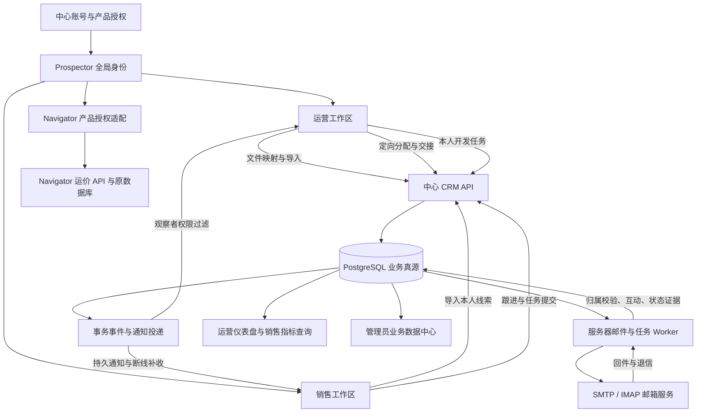

# Prospector 双角色产品链与在线数据设计

日期：2026-10-11。状态：用户需求已明确，本文是待批准实施的修订设计，不是已实现功能说明。没有修改业务代码、运行数据库迁移或新增依赖。

本文为当前产品设计入口。用户本轮要求优先于同日《全局身份与运营工作区设计》中“运营默认无邮箱”“运营三个精简入口”“管理员不默认查看业务”的旧建议。旧文的身份续期、缓存隔离与权威数据原则继续作为技术参考；冲突处以本文为准。

## 1. 产品边界与方案选择

推荐一个 Prospector 桌面客户端、一个中心服务、一套业务逻辑，按授权呈现运营和销售工作区。运营是具备管理/分发能力的完整使用者，同样有个人收件箱、发送中心、AI 对话、运价和素材；销售保留现有使用体验。账号管理与全量业务监管仍放管理中心。

不拆两个安装包，也不另建一套 CRM 数据库。中心服务先按模块组织，身份、CRM、邮件、任务、通知各有边界；同一 PostgreSQL 实例可以承载它们。将客户端旧 CRM 访问替换为中心访问层，是必要迁移；复制现有客户界面另写运营专用 CRM，会造成规则漂移。

| 备选 | 收益 | 代价与判断 |
|---|---|---|
| 只给侧栏加角色开关 | 很快看到双界面 | 本地客户、任务、邮箱仍无中心闭环，不能满足线上化 |
| 一个客户端、共享业务模块、服务端细分授权 | 最大程度复用现有功能，权限和数据有真源 | 需要全局身份、存储迁移与持续任务；推荐 |
| 两套独立客户端与独立业务服务 | 可分别发布与定制 | 目前没有独立发布需求，权限和 CRM 重复维护成本过高 |

目前实际已有中心导入/发布/销售自领/共享跟进/通知，但没有完整定向分配、全局持久登录、个人旧库上云和服务器持续收发。现有自动回件识别会更新 replied/bounce/autoreply 等联系状态、写互动记录；不会据此可靠推断报价/成交。不得把上述差距标为 UI 调整即可完成。

## 2. 角色、功能与数据范围

本文把用户“销售不开放导航栏的销售界面”理解为：销售没有「销售人员目录/销售管理」入口；自己的销售工作区照常存在。

| 内容 | 销售 | 运营 | 最高管理员（数据中心） |
|---|---|---|---|
| 新对话、收件箱、发送中心、库、个人设置 | 本人 | 本人，与销售共用逻辑 | 管理能力另列，不以后台身份代替本人发送 |
| 自己导入的客户 | 可管理与开发 | 可管理与开发 | 可监管 |
| 运营分配客户 | 本人当前负责的客户 | 自己导入/管理的客户及其分配、跟进 | 全部业务客户及历史 |
| 他人自有客户与邮件 | 不可见 | 默认不可见 | 授予全量业务监管能力后可查阅、留访问审计 |
| 销售目录与整体工作指标 | 无此入口 | 全部销售；客户详情依记录范围限制 | 全部 |
| 分配与改派 | 不自行指定别人 | 对本人可管理客户执行 | 全局管理能力 |
| 账号、授权、会话、管理审计 | 管理本人会话/资料 | 管理本人会话/资料 | 中心身份管理 |

运营能看所有销售的指标，不等于能看所有销售的私人邮件和自有客户。默认展示销售人员资料、全体销售的业务统计；点击客户或邮件仍只允许其管理来源的记录。这是本文采用的数据范围，若改为运营全量查阅，是额外的权限扩大节点。

身份管理和业务数据监管保留两个能力集合。最高管理员可同时拥有；普通身份维护人员不因此自动获得邮箱正文。管理员“看到一切数据”指业务档案、互动、任务与审计，绝不包括密码原文、邮箱授权码、令牌或 API Key。

个人配置不参与角色互通：邮箱连接、署名、AI 服务设置、发送偏好与个人草稿按账号保存；跨设备恢复不代表其他角色能查看。模板/素材区分个人与显式共享，首期默认个人；不把整目录强制共享。

能力命名必须在共享契约集中定义。现有粗粒度冒号权限与管理平台点号权限应通过服务端兼容映射收敛，不能由前端拼接两套权限形成更高权限。所有对象 API 再校验当前能力和记录范围，隐藏导航不能代替鉴权。

## 3. 全局登录与账号体系

### 3.1 登录界面

沿用现有 OnboardingWizard 的品牌背景、全屏结构和有限过渡动画，改成登录外壳。现有 SMTP/IMAP 设置不能冒充产品登录；原向导中的邮箱连接/署名/通用设置改为登录后可跳过的个人初始化。

登录页沿用原向导外观、动态菱形和固定视口，仅展示品牌、邮箱、密码、记住登录、登录、创建账号及忘记密码入口。忘记密码暂不接链路；连接设置、诊断、开发工具及教学说明不展示给用户。错误就地展示，提交时禁用重复按钮，支持键盘提交。正常客户端不得存在 Shift 跳过登录校验的隐藏入口。2026-10-12 用户修订优先于旧提案。

创建账号页面只有邮箱、密码及确认密码，不显示角色选择。服务器固定创建销售账号；管理员/运营由授权管理者邀请或授予。注册请求自行传 role/admin 标志一律拒绝。当前已实现本机注册与登录，邮箱标记未验证，实际验证邮件另行接入。注册成功不自动获得 Navigator 管理权限，也不读取他人 CRM。

注册验证与密码恢复需要真正的服务器验证邮件链路，当前测试激活挑战不能冒充正式邮件验证。首次强制改密保留受限登录状态，完成改密后重新登录；生产校验与防滥用需作为账号节点验收。

### 3.2 身份生命周期

应用级身份协调器状态：恢复中 → 未登录 / 必须改密 / 已登录；已登录下另有连接中断、续期中等连接状态。断网不等于退出：显示离线提示，缓存可读但在线变更不可伪装成功。续期成功且 userId 未变不跳登录页；退出、会话撤销、账号停用、续期凭据失效才回登录。

服务器返回稳定 userId、产品准入、有效能力与可用工作区。账号切换清除上一用户页面、查询缓存、通知连接和内存凭据，先关闭旧身份请求再恢复新资料。能力变化只清理失权内容；角色切换不会授予新的权限。

主进程管理续期凭据，使用已有 Electron safeStorage 在 Windows 加密存储并绑定中心地址和用户；渲染进程不读长期凭据。中心当前没有 refresh，需先定义可撤销、轮换、并发续期与重试契约，不直接持久化当前一小时 Bearer。

### 3.3 Milogin 产品身份与成长

中心用户 UUID 是跨产品关联键。Navigator 现有账号通过明确验证的关联过程接入，不能只凭同邮箱自动合并历史账号或复制其密码。阶段一保留 Navigator 自身授权适配；完成服务端信任/产品授权接入后，才对用户宣称统一登录。

中心个人资料管理昵称、头像及展示徽章；经验事件记录 product、来源 eventId、规则版本与增减原因，唯一事件约束防止重复计分。Navigator 现有事件账本、每日上限和等级计算可参考复用，但不能直接把它的审核运价规则套到 Prospector 邮件次数上。

各产品先保留分项经验与规则；总等级是否合并单独确定，不重复累计迁移历史事件。经验、徽章从不授予业务权限，不把发信次数作为可刷的增长奖励。首期仅统一资料展示，跨产品经验发放在适配后接入。

## 4. 两端界面与布局

两个工作区共用主题 tokens、Ant Design 组件和现有客户/邮箱交互。保留程序主题及深浅色，不新增运营独占配色或第二套组件库。表格区优先，避免大标题、重复统计卡片挤压内容；详情抽屉遵守现有标题栏高度，沿用已确认的关闭交互。

### 4.1 运营导航

```text
新对话
仪表盘
收件箱
客户
销售
发送中心
库 ▾ 运价库 / 素材库
────────────────
消息中心   设置
头像 / 昵称 / 当前工作区
```

「在线协作」入口退出主导航；已有中心链路能力并入客户、仪表盘和消息中心，不只是删掉可用能力。运营默认首页仪表盘，销售可保留新对话作为默认首页。

「客户」复用当前联系人/跟进看板/公司三视图，不另建第四种客户系统。上方紧凑筛选范围「全部我管理的 / 待分配 / 已分配 / 我开发的」，联系人/看板/公司视图切换保持现有位置。导入批次通过导入按钮旁的「导入记录」进入；批次有映射、预览、逐行结果、错误下载与续处理，不长期占主侧栏。

表格建议列：客户/联系人、来源、当前负责人、跟进阶段、最近有效互动、下一跟进、异常提示。分配状态可有业务字段；最近互动/统计/是否超期查询派生，不把已校验或已成交记录改状态来实现视觉分组。

选择客户后出现批量操作栏：分配、加入发送计划、标签；禁用按钮说明具体原因。分配对话框选择销售、备注、要通知的人，确认区域显示将变更的负责人、将暂停的旧发送任务、通知对象与可见范围。不同客户不能偷偷扩大成同公司全部联系人的权限。

仪表盘以「待处理客户」和「销售跟进动态」为核心，排序可选更新时间/逾期/明确重要等级，来源字段保留。销售页上方为搜索/筛选，主体人员表；详情显示可见指标、分配客户、时间线，不重建邮箱收件箱。

### 4.2 销售导航与客户界面

导航与运营相同但不显示「销售」。客户范围为「自有线索 / 分配线索」，可增加「全部我的」便于发送选择；范围与联系人/看板/公司视图是两个不同维度，不重复嵌套多层 tabs。分配线索带运营来源、分配时间、当前负责关系与备注。

点击分发通知精确进入对应客户档案；如果已改派，显示授权变化提示并刷新通知，不转成无意义的客户列表。发送计划只允许选择本人当前有执行权限的客户。

### 4.3 左下账号与消息入口

设置区域整合应用设置、连接设置、账号资料、工作区选择（仅实际获多工作区用户）、切换账号和退出。中心账号邮箱与发信邮箱分别标注，避免用户以为注册邮箱必须也是业务邮箱。

消息中心展示分发、改派、客户有效回复、跟进变化、任务失败等业务通知；筛选未读/全部、定位具体对象。已读只代表阅读通知，不代表领取、完成跟进或处理异常。通知入口全局存在，离开客户页仍能接收。

## 5. 开发调试：预览与真实联调各有用途

目标是在开发者面板一次选择「运营 / 销售 / 管理者」，即可检查导航和布局，无需反复手输账号；但预览绝不能把生产销售账号变成运营。

| 模式 | 如何使用 | 能证明什么 | 限制 |
|---|---|---|---|
| 界面预览 | 开发启动后，面板切角色、明暗、分辨率、样例/空/错误/断线状态 | 两套界面与组件行为 | 仅合成数据；禁用真实写入、发信和导出 |
| 真实联调 | 一键启动运营和销售两个独立 profile 窗口，测试夹具自动建立独立账号与会话 | 真实 API、对象权限、分配与通知闭环 | 仅明确命名测试 PG/中心，禁止运行于生产库 |
| 生产支持诊断 | 查看版本、连接状态、脱敏错误编号和权限概要 | 排查实际连接问题 | 无角色伪装、无密码/令牌显示 |

角色预览同时需要开发构建限制和测试适配器隔离；打包不包含可调用的模拟身份 IPC/API，不能依赖一个可修改的配置键作为唯一防线。服务器每次仍按真实身份授权。

拟定统一启动脚本与开发面板，不要求新增依赖。具体命令在实施节点定义后才写入开发手册；当前没有新的可用命令，不给出假装可直接执行的 npm 脚本。

开发者日常操作目标：启动测试中心 → 选择界面预览或双窗口联调 → 修改共享组件看热更新 → 点击测试分配 → 两窗口查看通知和详情。主进程/契约变更提示重启相关窗口；不用把所有问题归因于渲染热更新。

必须具备的场景夹具：首次改密、登录到期、禁用/撤权、同账号重登、不同账号切换、同客户冲突分配、空客户、批次部分失败、服务重启补消息、改派后旧销售失权。重置只作用于夹具范围，保存检查点，不提供一键清空生产数据。

## 6. CRM 记录归属与分发规则

中心保存来源 originType（sales_import / operations_import）、创建人、导入批次/来源行、管理运营、当前负责人、分配历史与版本。销售「自有/分配」展示由不可篡改来源与本人当前归属派生，不依赖手工标签冒充来源。

公司/联系人规范资料与「客户工作关系」分开：同一公司或邮箱可以有不同来源关系，但不能因全局去重向另一销售泄露他人客户。导入重复提示只在导入者可见范围内给证据，授权外碰撞返回安全的处理结果；合并/共享需有权限与审计。既有 M2 来源键和导入回执复用，不以来源邮箱替代记录权限。

运营导入后可自行开发。定向分配后，销售成为执行负责人，运营保留对自己管理来源的跟进监督权；默认不允许两边自动任务同时给同客户发信。现有公共池/自领作为独立可选能力，当前主流程为定向分配，不在新注册销售界面默认暴露公共池。

分配事务：校验运营范围和销售准入 → 检查当前版本与发送执行状态 → 写负责人/历史/必要只读观察关系 → 写待投递通知事件 → 提交。失败全回滚，重复请求返回授权重查后的同一回执。无法立即停下的已发起邮件进入交接中，不能在旧发送不确定时开启新自动开发。

首期简单通知选人，不构造完整主管组织树。通知不自动授予读取客户/邮件的权利：可见对象的接收者收到可跳转通知；无权接收者只能收到经批准的最小摘要。若要主管查看该客户，需在分配确认中明确授予该客户只读跟进权限，并校验运营有权授予，不隐式放开整个客户库。

## 7. 数据流转与互反馈



### 7.1 线索导入

运营/销售上传 → 服务端限量校验 → 映射预览 → 确认导入 → 公司联系人与来源关系写中心 → 返回逐行回执 → 客户页读取中心结果。未提交行不显示成功，半失败可按稳定来源行重试；原文件/错误行设置保留期和访问权限，不默认永久存所有导入原文。

### 7.2 分配与通知

运营提交分配 → 中心提交归属及通知事件 → 投递器为被分配销售/授权观察者生成通知 → 在线客户端实时或轮询接收 → 重读客户权限 → 精确打开档案。销售离线时事件保留，重连按持久游标补收。

通知传输按至少一次设计，以稳定事件 ID 去重；游标在业务应用成功后持久化。投递成功、已读和处理完成分别记录，不能混为一个状态。当前页内轮询要改为全局通知协调器；保留轮询兜底，首期不因此新增外部消息中间件。

### 7.3 开发、回信与运营反馈

本人创建任务 → 中心保存任务、目标和负责人 → Worker 执行前重查权限/归属/退订退信止损 → 记录结果 → 收信 Worker 按邮箱账号、消息标识与联系人关系匹配 → 写真实互动与现有确定性分类 → 通知相关销售及有权运营 → 仪表盘查询更新。

邮件证据唯一键至少覆盖邮箱账号与原消息 ID，不能只靠主题或不同销售碰巧相同的邮箱合并。运营查看其管理客户有关的开发邮件/回复证据；整封邮件涉及第三方或其他客户时需要字段过滤/脱敏与附件访问控制。最高管理员按数据监管能力可读业务原件；查看留审计。

成交、报价和任务下一阶段首期人工确认并保留证据，不把回复自动当成成交。AI 意图判断后续提供建议、置信度和原邮件定位，未经另批不直接改重大业务阶段。

### 7.4 关闭电脑仍持续执行

必须把收信、发信调度和相关 AI 任务执行搬到在线 Worker；仅把本地 SQL 行上传不能满足关机运行。可先与中心服务同机部署成独立受监督进程，任务持久在 PG，无需首期上微服务平台。

服务端持有必要邮箱凭据，使用独立服务端加密机制和最小访问权限；Windows 本地 DPAPI 密文不能直接拷贝给服务器解密。让用户手动通过配置/受保护表单提供凭据，绝不提交在 Agent 对话或源文件里。

SMTP 已发送但确认落库失败可能产生不确定结果，应记录 pending_confirmation 并核验，禁止自动盲重试宣称 exactly-once。本地与中心执行权通过迁移检查点切换，防双发；客户端退出不影响中心任务，退出登录与取消任务的产品含义分别呈现。

## 8. 数据库与全量监管

| 数据 | 最终真源 | 本地用途 |
|---|---|---|
| 用户、产品授权、头像、经验事件、会话 | 中心 PG 身份模块 | 加密续期凭据、最小身份缓存 |
| 所有用户客户、来源、归属、跟进、分配历史 | 中心 PG CRM 模块 | 按中心地址+userId 隔离的受权缓存 |
| 邮箱配置、互动、任务与业务邮件索引/正文 | 中心 PG 邮件/任务模块；邮箱服务保留原件 | 缓存/草稿，不是独立的私有业务真源 |
| 附件、导入文件、素材文件 | 受保护文件存储，PG 保存元数据/权限 | 受限临时下载与缩略图 |
| 运价原件与运价业务规则 | Navigator 原服务及其 PG | 已有查询镜像/缓存，显示新鲜度 |

当前一个 prospector.db 仍保存旧 CRM、邮件和队列，因此是过渡形态。保留 SQLite 最终没有问题，前提是它不独占必须监管/协作/关机执行的数据。个人草稿及设备偏好可以本地保存，不强制上传窗口尺寸等无用数据。

旧数据迁移不能依据“当前登录人”猜历史主人。先备份和确定账户归属 → 只读盘点与转换报告 → 合成副本迁移验证 → 分批上传及本地到中心 ID 对照 → 行数/关键字段/关联核对 → 切换读写与任务执行权。涉及在途邮件不能简单恢复整库或重放队列，必要时只回退 UI 与只读入口。

管理中心按产品分区管理成员、活动、客户/任务和审计。Prospector 分区可查全量授权业务数据；Navigator 分区管理其用户/行为/审计，仍不因此新增中心查运价界面。账号中心和业务数据中心可以共用管理壳层，服务职责不能混成一个账号表。

## 9. 销售画像：先统计事实

首期指标：分配量、有效接收/首次打开、首次有效开发耗时、客户实际回复率、按时跟进率、逾期数量、人工确认成交及耗时、退信/自动回复比例、最后有效业务活动。未到观察期记录不混入成熟样本比较，指标同时显示样本量、时间范围和定义。

分配时间、首次开发、首次客户回复、业务成交是不同事件。自动队列重复发信不等于积极，自动回复不等于客户回应；「积极性」先呈现可核查活动与跟进事实，不用黑箱综合分数评价员工。运营所有销售统计可用聚合查询，不把私人客户列表打包发到客户端供前端统计。

## 10. 实施节点与批准范围

每节点开工前保存源代码/契约/必要 schema 与迁移说明检查点；完成后保存测试、运行证据和改后哈希。涉及业务数据时另外做受保护备份，不把密钥和真实邮箱正文放普通 checkpoint。只在对应节点报告批准后实施，不把本文整体认同理解为一次批准所有生产迁移。

| 节点 | 原因 | 优化后提升 | 副作用/风险 | 验收门槛 |
|---|---|---|---|---|
| R1 全局登录与开发调试底座 | 当前身份仅在协作页，旧向导识别邮箱而非产品用户 | 冷启动恢复、失权退出、双角色预览/双窗口联调 | 登录成全局门槛；旧库隔离先行；注册需验证邮件渠道 | A/B 切换无旧资料，撤销不复活，续期并发无串号，生产包无角色绕过；两个真实账号权限测试 |
| R2 客户数据接中心与旧库保护 | 当前个人客户仍在 SQLite，运营无法全量闭环 | 客户/公司/看板共用中心访问层，来源可追溯 | 旧归属和 ID 转换，分页/离线体验变化 | 合成迁移计数与关系一致、跨账号隔离、旧数据未默认上传；正式旧库迁移另批 |
| R3 角色壳层、定向分配与消息 | 现入口混杂，M2 只有发布/自领 | 指定销售+通知对象、客户来源页、精确消息跳转 | 多收件人授权、并发归属、旧任务交接 | 双窗口导入→分配→补通知→详情→反馈；改派失权、重复提交、重启补收；无真实外发 |
| R4 服务器收发与持续任务 | 本地调度关机即停，上传无法替代 Worker | 关机仍开发/收信，邮件证据统一可监管 | 服务端凭据、双发与 SMTP 不确定性，运行成本 | 受控邮箱/替身通道，客户端关闭仍运行，崩溃恢复不盲重发，退信/退订/撤权停发；真实外发单独授权 |
| R5 运营仪表盘与管理数据中心 | 缺少统一事实反馈与销售指标 | 客户动态、人员表现、全量授权审计 | 指标误解、数据范围扩大、查询负载 | 预设事件算出已知指标、源证据可定位、权限过滤及访问审计、范围内分页性能 |
| R6 Navigator 身份/资料成长适配 | 两产品目前仍不同授权链路 | 稳定账号关联与跨产品资料、经验展示 | 账号合并和 XP 迁移、服务不可用 | 关联需证明账户、事件不重复计分、产品撤权独立，先测试不动运价生产 |

建议从 R1 开始，R2/R3 接通客户闭环，R4 满足关机运行，再做真实销售画像。个人数据中心化不是放到最后的美化任务。AI 意图自动推进阶段在 R5 之后另报，不阻塞首期产品链。

## 11. 设计核查与来源

本轮对照用户逐项要求，以及 App/Sidebar/router、OnboardingWizard、CustomersPage、ContactList、inbox.service、OnlineCrmAdapter、server auth/leads/通知契约、现有 M2 交付文档和 Navigator core/growth_contracts.py。来源是当前源码，不把本方案当运行验证。

自审重点：管理员业务监管与凭据保密不混淆；运营保留个人营销工具；他人自有客户不因目录统计泄露；通知不隐式授权；模拟角色不能连生产；客户数据迁移与发送执行权分别切换；已读不是完成；成长积分不授业务权；自动回复与成交不混同。

沿用的官方技术参考：
- [SQLite 企业客户端缓存场景](https://www.sqlite.org/whentouse.html)
- [Dataverse 记录及字段安全](https://learn.microsoft.com/en-us/power-platform/admin/wp-security-cds)
- [Electron safeStorage](https://www.electronjs.org/docs/latest/api/safe-storage)
- [Auth0 续期凭据轮换](https://auth0.com/docs/secure/tokens/refresh-tokens/refresh-token-rotation)
- [AWS 事务 outbox](https://docs.aws.amazon.com/prescriptive-guidance/latest/cloud-design-patterns/transactional-outbox.html)

上述是设计参考，不代表采用这些平台或完成其安全认证。当前 M2 测试仅证明原节点，不证明本文注册、全局身份、迁移、Worker 或双角色壳层已验收。

## 2026-10-12 当前环节覆盖决定

最新用户修订覆盖冲突旧方案：登录页沿用向导，不呈现连接设置与开发工具，不以教学文案代替设计。原登录页DEV合成预览撤回，调试用dev:dual独立真实窗口。自助注册由邮箱/密码创建，服务器固定销售与own范围；不等待恢复账号链路。忘记密码仅组件。邮箱未验证，验证邮件与正式部署在后续相应节点独立推进。其余R2–R6目标与批准边界保留，后续方案按本条更新，不继续实现已撤回要求。
